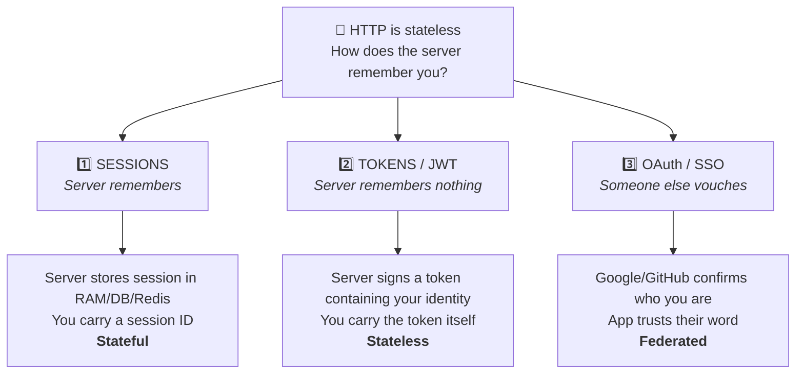
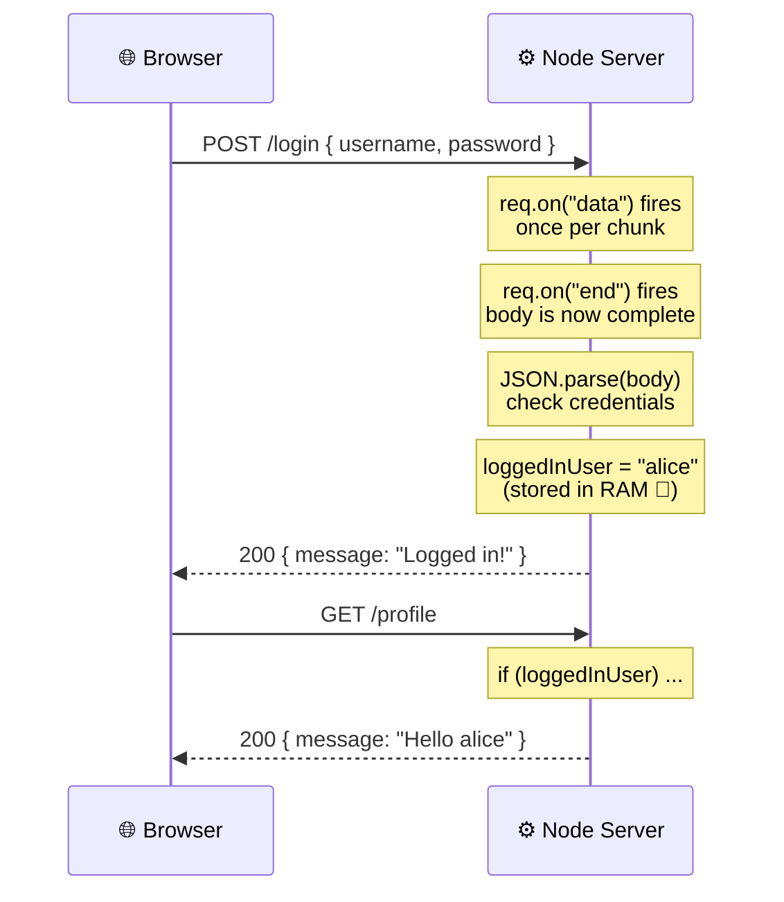

<div align="center">

# Day 01 — What Is Authentication, Really?

### And why HTTP being "stateless" is the reason every auth system on Earth exists


</div>

---

> [!TIP]
> **Read this even if you've "already done JWT auth."**
> Today isn't about code that works. It's about the *problem* that made all of this necessary in the first place. Skip this and everything later feels like memorizing magic spells.

---

## 🎯 What you'll walk away with

By the end of this page you will be able to answer, out loud, without googling:

- [ ] What authentication actually is (in one sentence)
- [ ] What "HTTP is stateless" means — and why it's a *feature*, not a bug
- [ ] The exact problem sessions, cookies and JWTs were all invented to solve
- [ ] The three fundamental approaches humans came up with
- [ ] Every single line of a raw Node.js HTTP server — including `req.on("data")` and why chunks exist
- [ ] Why storing a logged-in user in a variable falls apart in **three different ways**

Let's go. 🔥

---

## 🏥 Start in the real world, not in code

Picture a hospital. Patient records, surgery schedules, prescriptions. Thousands of people walk through it every day — doctors, nurses, receptionists, cleaners, delivery guys.

Someone walks up to the front desk and says:

> *"I need the file for room 402."*

Before the hospital does **anything**, it has exactly one question:

> ### Who are you? And can I trust that you are who you say you are?

That's it. That's authentication. Nothing more, nothing less.

```txt
Authentication  =  proving WHO you are
Authorization   =  what you're ALLOWED to do once we know who you are
```

> [!NOTE]
> These two get mixed up constantly, even by experienced developers.
> **Authentication is the bouncer checking your ID at the door.**
> **Authorization is whether your wristband gets you into the VIP room.**
> We'll go deep on authorization later — today is purely about identity.

---

## 🌐 Now move the hospital to the internet

You open `hospital.com`. You type your username and password. You click **Login**.

The server asks the same question the front desk asked: *who are you, and can I trust that?*

You prove it. Password matches. Great — you're authenticated. ✅

And now we hit the single most important idea in this entire repo:

---

<div align="center">

## ⚡ HTTP is stateless

</div>

Here's what that actually means.

When your browser talks to a server, it speaks a protocol called HTTP. And every HTTP request is **completely independent of every other request**. The server has *zero* memory of what happened before.

So:

```txt
10:00:00 AM   →  You POST /login with your password
              →  Server checks it. Correct! You are authenticated. ✅

10:00:47 AM   →  You click "My Profile"  →  GET /profile
              →  Server:  "...who are you?" 🤨
```

The server has **completely forgotten you.** Not because it crashed. Not because of a bug. Because HTTP was *designed* that way.

### Why on earth would anyone design it like that?

Because statelessness is what made the web scale. If every server had to remember every visitor:

- Server memory would grow with every user who ever visited
- You couldn't put 50 servers behind a load balancer — request #2 might hit a different server that never saw request #1
- Every server restart would log out the entire internet

Statelessness makes servers simple, fast, and horizontally scalable. It is genuinely a **great** design decision.

It just happens to create one enormous problem:

> [!IMPORTANT]
> ### 🧩 The core problem
> **How does the server know, on every single request, that you're still the same authenticated person?**
>
> Sessions. Cookies. JWTs. OAuth. Refresh tokens. All of it.
> Every single one of them is just a different answer to *this one question.*

Internalize this sentence and the next three months make sense. Miss it, and you'll be memorizing library APIs forever.

---

## 🧠 The three approaches humans invented

Before touching code, here's the map of the entire territory. Three strategies exist. That's all. Everything else is a variation.



### 1️⃣ Sessions — *the classic way*

The server does the remembering. After login it creates a **session** (stored in memory, a database, or Redis) and hands you a **session ID** — basically a coat-check ticket. You send that ticket with every request. The server looks it up.

**Stateful.** The truth lives on the server.

### 2️⃣ Tokens / JWT — *the modern, scalable way*

The server remembers **nothing**. After login it gives you a **signed token** that literally contains your identity inside it. You send the token with every request. The server reads it and trusts it — because only the server has the key that could have signed it.

**Stateless.** The truth travels with you.

### 3️⃣ OAuth / SSO — *the delegated way*

You don't prove your identity to the app at all. You say *"Google already knows me — go ask them."* Google vouches for you. The app trusts Google.

**Federated.** The truth is outsourced.

> [!TIP]
> Nobody "won." Real systems at scale use **all three at once** — OAuth to log in, a JWT access token for API calls, and a server-side session record so you can force-logout a compromised account. You'll build every one of these.

---

## 💻 Now — let's see the problem naked

Here's the thing that separates people who *understand* auth from people who *use* auth: before you learn a solution, **feel the problem in your hands.**

So we're going to write a login system with **no sessions, no cookies, no tokens** — the most naive thing possible — and watch it fall apart.

> [!WARNING]
> **This code is intentionally broken.** Never, ever ship anything like it. We're building it so that when you meet the real solution tomorrow, you already know exactly what it's rescuing you from.

**Zero dependencies.** No Express. Just the Node.js standard library, so nothing is hidden from you.

```js
const http = require("http");

// 📌 Passwords in plaintext. We fix this tomorrow.
const USERS = { alice: "1234", bob: "5678" };

// 🚨 Our "who is logged in" store. A single variable in RAM. Yes, really.
let loggedInUser = null;

const server = http.createServer((req, res) => {
  const { method, url } = req;

  // ───────────────────────────────────────────────
  // 1. LOGIN ROUTE  →  POST /login
  // ───────────────────────────────────────────────
  if (method === "POST" && url === "/login") {
    let body = "";

    // Request data arrives in pieces. We collect them manually.
    // (Express does exactly this for you behind the scenes.)
    req.on("data", (chunk) => {
      body += chunk.toString();
    });

    req.on("end", () => {
      const { username, password } = JSON.parse(body);

      if (USERS[username] && USERS[username] === password) {
        loggedInUser = username;              // "remember" them in RAM
        res.writeHead(200, { "Content-Type": "application/json" });
        res.end(JSON.stringify({ message: "Logged in!" }));
      } else {
        res.writeHead(401, { "Content-Type": "application/json" });
        res.end(JSON.stringify({ message: "Wrong credentials" }));
      }
    });
  }

  // ───────────────────────────────────────────────
  // 2. PROTECTED ROUTE  →  GET /profile
  // ───────────────────────────────────────────────
  else if (method === "GET" && url === "/profile") {
    if (loggedInUser) {
      res.writeHead(200, { "Content-Type": "application/json" });
      res.end(JSON.stringify({ message: `Hello ${loggedInUser}` }));
    } else {
      res.writeHead(401, { "Content-Type": "application/json" });
      res.end(JSON.stringify({ message: "Not authenticated" }));
    }
  }

  // ───────────────────────────────────────────────
  // 3. EVERYTHING ELSE  →  404
  // ───────────────────────────────────────────────
  else {
    res.writeHead(404);
    res.end();
  }
});

server.listen(3000, () => console.log("🚀 Pure Node server running on :3000"));
```

➡️ **Runnable version:** [`code/day-01-stateless-problem/`](../../code/day-01-stateless-problem/)

---

## 🔬 Line by line — nothing skipped

This is the part most tutorials refuse to do. If you've only ever written Express, half of these lines are invisible to you. Let's kill that.

---

### `const http = require("http");`

First, a fair question: **HTTP is a communication protocol. How can it have a `createServer()` function?**

Great catch — and the answer is that these are two different things sharing a name.

| | What it is |
|---|---|
| **HTTP** | The *rules* browsers and servers use to talk to each other |
| **Node's `http` module** | A *toolkit* Node ships with for speaking those rules |

Think of it like this:

```txt
English            = the language
An English grammar = the tool you use to work with the language
```

So `require("http")` doesn't import "the protocol." It imports a plain JavaScript object Node built for you, which roughly looks like:

```js
{
  createServer: function () { ... },
  request:      function () { ... },
  get:          function () { ... },
  // ...
}
```

Which is why `http.createServer()` works — **`http` is just an object with methods on it.**

---

### `let loggedInUser = null;`

Two questions hiding in one line.

**Why `null` and not just `let loggedInUser;`?**

```js
let a;            // undefined → "nobody has assigned this yet"
let b = null;     // null      → "I deliberately set this to nothing"
```

`undefined` is the *language* telling you nothing happened. `null` is *you* telling the reader: **"there is intentionally no user logged in right now."** Same behavior in an `if`, completely different intent. Writing intent into your code is a habit worth building early.

**Where does this value actually live?** In **RAM**. Which sets up the first disaster:

```txt
server starts   →  loggedInUser = null
user logs in    →  loggedInUser = "alice"
server restarts →  loggedInUser = null      ← 💥 everyone logged out
```

That's exactly why real apps push this into a database, a session store, Redis, or a signed token. Hold that thought.

---

### `http.createServer((req, res) => { ... })`

`createServer()` builds an HTTP server and takes a **callback** — a function Node will run **every single time a request arrives.**

You never call that function yourself. Node calls it *for* you, and hands you two objects:

```txt
   Browser  ──────── req ────────▶  Server
   Browser  ◀─────── res ─────────  Server
```

| Object | Direction | Contains |
|:------:|-----------|----------|
| `req` | **incoming** — from browser | method, URL, headers, body |
| `res` | **outgoing** — to browser | the tools to send a reply |

If the "Node calls my function with arguments" part feels weird, it's the same pattern as:

```js
function test(a, b) { console.log(a, b); }
test(10, 20);          // a = 10, b = 20
```

You wrote the function. Somebody else decided what goes in. Here, that somebody is Node. 🙂

---

### `const { method, url } = req;`

Destructuring. Pure shorthand for:

```js
const method = req.method;
const url    = req.url;
```

**Where do those values come from?** The browser puts them there. Every HTTP request starts with a line like:

```http
GET /profile HTTP/1.1
Host: localhost:3000
```

So Node fills in `method = "GET"` and `url = "/profile"`.

> [!NOTE]
> **Yes — every HTTP request always carries a method.** There's no such thing as a method-less request.
> `GET` · `POST` · `PUT` · `PATCH` · `DELETE` · `HEAD` · `OPTIONS`

---

### `if (method === "POST" && url === "/login")`

Read it in plain English: *"is the browser asking to POST to /login?"*

**Why `POST` and not `GET` for login?**

| Method | Meaning | Where data goes |
|--------|---------|-----------------|
| `GET` | *fetch* something | in the **URL** — visible, logged, cached, bookmarked |
| `POST` | *send* something | in the **body** — not in the URL |

A login sends a **password**. If you used `GET`, that password would land in the URL:

```txt
GET /login?username=alice&password=1234     ← 😱
```

…which gets written into browser history, server access logs, proxy logs, and the `Referer` header of the next page you visit. `POST` puts it in the body instead. Not encryption — HTTPS does that — but it keeps secrets out of places that quietly keep records.

---

### `let body = "";` — and why data arrives in pieces

This is the line that confuses everyone, so let's be thorough.

**Why start with an empty string?** Because **the request body does not arrive all at once.** Node hands it to you as a **stream** — think of a pipe with water flowing through, not a bucket dropped on your desk.

The browser sends:

```json
{ "username": "alice", "password": "1234" }
```

…but Node may hand it to you as:

```txt
chunk 1:  {"user
chunk 2:  name":"alice"
chunk 3:  ,"password":"1234"}
```

So you need a container to glue the pieces back together. `body = ""` is that container.

---

### `req.on("data", (chunk) => { body += chunk.toString(); });`

**`.on()` means "listen for an event."** So `req.on("data", ...)` reads as:

> *"Hey request — every time a new piece of data shows up, run this function with it."*

And yes — that listener stays active, firing again and again until the body is finished.

**What is a `chunk`?** One small piece of the incoming data. And critically, it's **not a string** — it's a `Buffer`, Node's raw-bytes object:

```txt
<Buffer 7b 22 75 73 65 72 ...>
```

That's why `.toString()` is there: **raw bytes → readable text.**

And `+=` instead of `=` because we're *accumulating*:

```js
body = ""                                    // start
body = '{"user'                              // after chunk 1
body = '{"username":"alice"'                 // after chunk 2
body = '{"username":"alice","password":"1234"}'  // after chunk 3
```

> [!TIP]
> **Why streams at all?** Imagine uploading a 2 GB video. If Node waited for the whole thing before giving you anything, it'd need 2 GB of RAM per upload. Streams let you process data as it flows. Express's `express.json()` middleware does exactly what these five lines do — it just hides them from you.

---

### `req.on("end", () => { ... })`

The `end` event fires when **the last chunk has arrived.** Only now is `body` complete and safe to read.

This is why the login logic lives *inside* this callback. Put it outside and you'd be parsing a half-arrived request. 🙃

---

### `const { username, password } = JSON.parse(body);`

Right now `body` is still just **text**:

```js
'{"username":"alice","password":"1234"}'   // a string. You can't do body.username on this.
```

`JSON.parse()` turns that text into a real JavaScript object:

```js
{ username: "alice", password: "1234" }    // now you can.
```

Then destructuring pulls the two fields out.

> [!CAUTION]
> `JSON.parse()` **throws** if the body isn't valid JSON — and an uncaught throw here crashes your whole server. Anyone can crash this server by sending `hello` to `/login`. Real code wraps it in `try/catch`. Noted for later. 📌

---

### `res.writeHead(200, { "Content-Type": "application/json" });`

Sends the **status code** and **headers** — the reply's envelope, before the letter.

| Code | Meaning | Used here for |
|:----:|---------|---------------|
| `200` | OK | login worked |
| `401` | Unauthorized | wrong credentials / not logged in |
| `404` | Not Found | unknown route |

`Content-Type: application/json` tells the browser *"what follows is JSON, parse it as JSON."* Leave it out and the browser treats your careful JSON as plain text.

---

### `res.end(JSON.stringify({ message: "Logged in!" }));`

`JSON.stringify()` is the exact mirror of `JSON.parse()`:

```txt
JSON.parse()      text  →  object     (coming in)
JSON.stringify()  object →  text      (going out)
```

You can't send a JavaScript object over a network. Networks move **bytes**. So you serialize the object into a string first:

```js
{ message: "Logged in!" }   →   '{"message":"Logged in!"}'
```

And `res.end()` does two things: **sends the body** and **closes the response.** Nothing can be sent after it.

---

### `server.listen(3000, ...)`

Binds the server to port `3000` and starts accepting connections. Until this line runs, your server exists but isn't listening to anything.

---

## 🗺 The complete mental model



---

## 💥 Now break it — three ways

Run the server and try these. **Actually try them.** Reading about a bug and watching it happen are different experiences, and only one of them sticks.

### Break #1 — Two users, one variable

```bash
# Alice logs in
curl -X POST http://localhost:3000/login \
  -H "Content-Type: application/json" \
  -d '{"username":"alice","password":"1234"}'

# Bob logs in
curl -X POST http://localhost:3000/login \
  -H "Content-Type: application/json" \
  -d '{"username":"bob","password":"5678"}'

# Now ask who you are
curl http://localhost:3000/profile
```

Alice is **gone**. One variable, one slot. The second login overwrote the first. In a real app, Alice would now be looking at Bob's data. 😬

### Break #2 — Nobody logged in, everybody's in

```bash
# Restart the server, then WITHOUT logging in:
curl http://localhost:3000/profile     # correctly rejected ✅

# Now have ONE person log in. Then open a fresh incognito window,
# a different browser, a different terminal — anything with no shared
# state at all — and ask again:
curl http://localhost:3000/profile     # "Hello alice" 💀
```

That second caller proved *nothing*. No password, no cookie, no token, no shared session — a completely unrelated client. It got Alice's identity anyway. Deploy this and that caller is any stranger on the internet.

The server never checks *who is asking*. It only checks *whether anyone, anywhere, has ever logged in.* There is no link between the request and the identity.

**This is the real lesson of Day 1.** Authentication isn't just "check the password once." It's **binding an identity to every subsequent request.**

### Break #3 — Restart the server

```bash
# Log in, confirm /profile works, then Ctrl+C and restart.
node server.js
curl http://localhost:3000/profile     # "Not authenticated"
```

Every user on the planet logged out, because state lived in RAM. Now imagine 50 servers behind a load balancer — they don't share that variable either. Log in on server #3, get a request routed to server #7, and you're a stranger again.

---

## ✅ Day 1 recap

| Concept | What it actually means |
|---------|------------------------|
| **Authentication** | Proving who you are |
| **Authorization** | What you're allowed to do once known |
| **HTTP is stateless** | Every request is independent; the server remembers nothing |
| **The core problem** | How to prove identity on *every* request, not just at login |
| **Sessions** | Server remembers → you carry an ID (stateful) |
| **Tokens / JWT** | Server remembers nothing → you carry the proof (stateless) |
| **OAuth / SSO** | A third party vouches for you (federated) |
| `require("http")` | Imports Node's HTTP toolkit — an object, not the protocol |
| `req` / `res` | Incoming request / outgoing response |
| `req.on("data")` | Listen for body chunks (bodies stream in, they don't teleport) |
| `chunk.toString()` | Raw `Buffer` bytes → readable text |
| `JSON.parse` / `stringify` | text → object / object → text |
| `res.end()` | Send the body and close the response |

---

## 🧠 Self-check (no peeking)

1. Why is HTTP being stateless considered *good* design?
2. What's the difference between `null` and `undefined` here, and why does it matter?
3. Why does the request body arrive in chunks instead of all at once?
4. Why is `chunk.toString()` necessary?
5. A single user logs in. A stranger in another country hits `/profile` and gets `"Hello alice"`. **Why?**

If #5 is crystal clear to you, you've genuinely got Day 1. That question *is* the whole reason sessions exist.

---

## 🔮 Coming up — Day 02

We store the password as `"1234"` and compare it with `===`. Both of those are catastrophic, for reasons that are more interesting than "just use bcrypt."

Tomorrow: **why plaintext passwords are unforgivable, what hashing actually is, why hashing alone still isn't enough (rainbow tables), what salt does, and why bcrypt is deliberately, gloriously slow.** Plus a real registration + login system with proper password hashing.

---

<div align="center">

**Most developers with three years of experience have never asked why HTTP statelessness matters.**
**You just did, on day one. Keep going. 🔥**

[⬅️ Back to README](../../README.md) · [Day 02 ➡️ _(coming soon)_](#)

</div>
