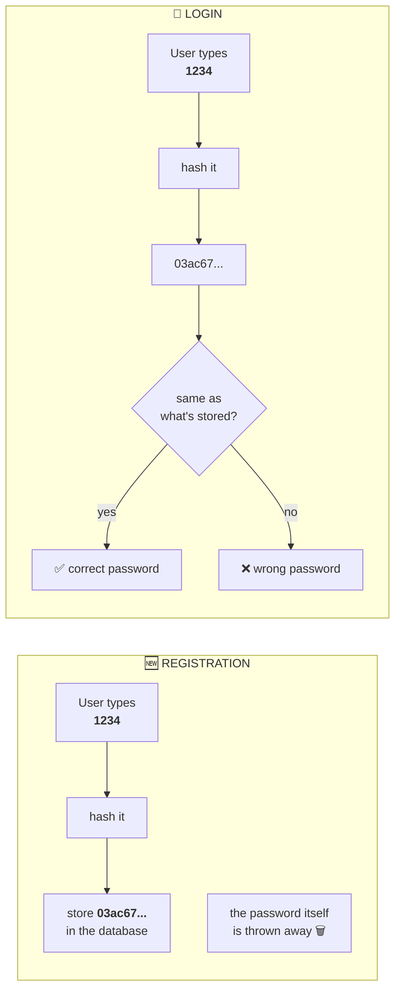
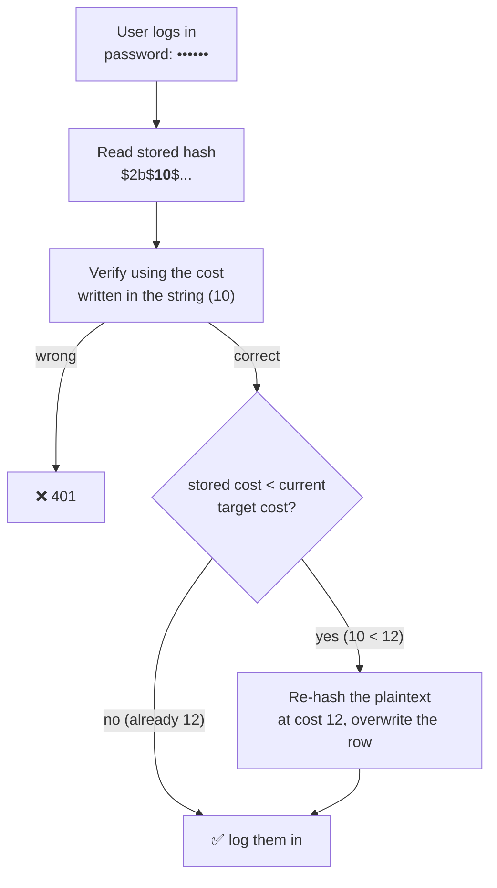

<div align="center">

# Day 02 — The Password Problem

### How do you verify a password without ever storing it?


</div>

---

### 📖 How to read this page

| Marker | What it means |
|---|---|
| **📜 CASE FILE** | Real-world history. Context and stories — step outside the code for a minute. |
| **🧪 PROVEN ON MY MACHINE** | Actual measured output. Not a claim from a blog post — numbers I ran myself. |
| **🙋 WAIT —** | A question you're probably already asking. Answered immediately, not later. |
| `> [!NOTE]` boxes | Short asides that matter but don't break the flow. |

---

> [!TIP]
> **Day 1 left a bomb in the code.** We wrote `password === "1234"` and moved on. Today we find out why those seven characters are the most dangerous thing in the whole file — and why the fix is one of the most beautiful ideas in computer science.

---

## 🎯 What you'll walk away with

- [ ] Why storing a password *at all* is the original sin
- [ ] What hashing is, and **why it genuinely cannot be reversed** (with a proof you can do in your head)
- [ ] Why hashing alone is still broken — rainbow tables
- [ ] What salt is, and why two users with the same password look completely different
- [ ] Why bcrypt is **deliberately slow**, and how to read all 60 characters of a bcrypt string
- [ ] Why a GPU — the attacker's favourite weapon — chokes on bcrypt
- [ ] How to raise your work factor years later **without breaking a single login**
- [ ] Two silent killers most tutorials never mention: **timing-based username enumeration** and **bcrypt's 72-byte truncation**

---

## 💣 First — look at what we wrote yesterday

```js
if (USERS[username] && USERS[username] === password) {
```

`USERS` was a plain object holding `"1234"`. In a real app, that object is your **database**. Which means your database contains the literal string `1234`, sitting there in a column, readable by anyone who gets in.

So ask the only question that matters:

> ### What happens when — not if — someone reads your database?

Every developer thinks "my database is secure, it's behind a firewall." Backups get copied to laptops. Staging servers get exposed. A junior runs a query in the wrong terminal. An SQL injection slips through. A cloud bucket gets set to public.

**Assume the attacker will read your database.** Design so that it doesn't matter.

---

> ### 📜 CASE FILE — Adobe, October 2013
>
> *Real-world history. The breach the industry still teaches from.*
>
> Adobe announced a breach affecting **2.9 million** customers. Security researchers then found a compromised backup server, and the file that eventually circulated online held **153 million account records**.
>
> **What was in it:**
> - Internal IDs, usernames, email addresses
> - Passwords protected with **reversible encryption**, not hashing
> - **Password hints stored in plaintext** — literally the user's own words describing their password
> - Proprietary source code for Acrobat, ColdFusion and Photoshop
>
> **Here's the part that makes it legendary.** Adobe didn't hash. They encrypted with **3DES in ECB mode**. Encryption is a locked box — with the key, everything opens. Worse, ECB mode encrypts each 8-byte block *independently* with no salt, which means:
>
> > **identical passwords produced identical ciphertext.**
>
> Researchers never needed the key. They just lined the records up and looked:
>
> - Everyone whose encrypted blob matched *this* pattern shared a password
> - One of them had left a plaintext hint like `"name of my dog"`
> - Another in the same group: `"rhymes with assword"`
>
> Match the duplicates, read the hints, and the password falls out. People cracked millions of passwords with **a text editor and patience**. xkcd #1286 turned the whole thing into a crossword puzzle — that's how mechanical it was.
>
> **How did the world learn Adobe's method?** Pure reverse-engineering. Every encrypted value was an exact multiple of 8 bytes — the block size of DES. That one structural fingerprint gave the algorithm away. Nobody at Adobe had to confess.

> [!IMPORTANT]
> **Clearing up a common mix-up:** Adobe used **neither hashing nor JWTs**. JWTs are session tokens handed out *after* login — they have nothing to do with how a password is stored. And what Adobe did was encryption (reversible), which is the exact opposite of hashing (irreversible). The whole disaster is a story about choosing the wrong primitive.

---

## 🤯 The paradox

So we can't store the password. But we have to check it on every login.

> **How do you verify something is correct without knowing what it is?**

That sounds impossible. It isn't — and the answer is hashing.

---

## 🥩 What hashing actually is

Picture a meat grinder. Put a whole chicken in. Ground meat comes out.

Two things are true about that grinder:

1. **Same chicken in → same mince out.** Every single time. It's deterministic.
2. **You cannot run it backwards.** No amount of staring at the mince reconstructs the chicken.

A hash function is exactly that, for data. Feed it any string, get back a fixed-length fingerprint.

> 🧪 **PROVEN ON MY MACHINE** — real SHA-256 output
>
> ```txt
> "1234"  →  03ac674216f3e15c761ee1a5e255f067953623c8b388b4459e13f978d7c846f4
> "1235"  →  310ced37200b1a0dae25edb263fe52c491f6e467268acab0ffec06666e2ed959
> "1234"  →  03ac674216f3e15c761ee1a5e255f067953623c8b388b4459e13f978d7c846f4   ← identical again
> ```
>
> One character changed and **the entire output is unrecognisable.** That's called the avalanche effect. And `"1234"` gives the same answer every time, forever, on every machine on Earth.

So here's the trick that solves the paradox:



The database never contains the password. The server itself **does not know your password** and has no way to find out. If an attacker steals the whole table, they get `03ac67...`, which unlocks nothing.

---

> ### 🙋 WAIT — if the server can recreate the hash, why can't a hacker recreate the password?
>
> This is *the* question. Everyone arrives at it, and it's the right instinct.
>
> You're correct about one half: **password + salt + algorithm → always the same hash.** That's precisely how login works.
>
> But that arrow only points one way. You can go `password → hash`. You can never go `hash → password`.
>
> **Here's a hash function simple enough to prove it by hand:** *add up the digits, keep the last digit.*
>
> ```txt
> 567  →  5+6+7 = 18  →  hash is 8
> 990  →  9+9+0 = 18  →  hash is 8
> 125  →  1+2+5 =  8  →  hash is 8
> 44   →  4+4   =  8  →  hash is 8
> ```
>
> Now I hand you the hash `8` and ask for the original number. **You can't.** Not because you aren't clever enough — because the information is *physically gone*. Four different inputs produced it. So did millions of others.
>
> That's the whole thing. Hashing **destroys information on purpose**. Encryption preserves it (that was Adobe's mistake). A real hash squeezes inputs of any length into a fixed 256 bits — infinitely many inputs, finitely many outputs. The original cannot be recovered because it is no longer there.
>
> So what *can* an attacker do? Only one thing: **guess.** Take a guess, hash it, see if it matches. Guess again. Forever. The entire remainder of this page is about making that guessing as miserable as possible.

---

## 💥 But plain hashing is already broken: rainbow tables

Attackers aren't stupid. They thought:

> *"I can't reverse a hash. But hashes are deterministic and public. What if I just pre-compute the hash of every common password, once, and keep the lookup table?"*

```txt
"password"   →  5f4dcc3b5aa765d61d8327deb882cf99
"123456"     →  e10adc3949ba59abbe56e057f20f883e
"1234"       →  03ac674216f3e15c761ee1a5e255f067...
"qwerty"     →  d8578edf8458ce06fbc5bb76a58c5ca4
...billions more
```

That's a **rainbow table**. Build it once, use it against every breached database forever. They're downloadable right now, for free, covering essentially every password a human would plausibly invent.

> [!CAUTION]
> Against a rainbow table, plain `SHA-256(password)` offers **almost no protection at all**. Steal the database, run the lookup, done. Milliseconds per account.

---

## 🧂 The fix: salt

A **salt** is a random string mixed into the password *before* hashing.

```txt
password         "1234"
random salt      "xK9#mP2"
combined         "1234xK9#mP2"
hash of that  →  a7f3b2...        ← nothing like the hash of "1234"
```

You store the salt right alongside the hash. It is **not a secret** — and it doesn't need to be.

**Why it kills rainbow tables:** the attacker's table contains the hash of `"1234"`. Your database contains the hash of `"1234xK9#mP2"`. Not in their table. To beat you they'd have to rebuild the *entire* billion-entry table from scratch — **for every single user**, because every user gets a different salt.

That's the real magic. One table attacks a billion accounts; salting forces one table **per account**.

---

> ### 🙋 WAIT — do two users with the same password look the same in the database?
>
> **No.** And this is a bigger deal than it sounds.
>
> Alice and Bob both pick `12345`. Alice gets salt `X97f!`, Bob gets salt `Q2m4p`. Their stored hashes share nothing.
>
> Why that matters: in the Adobe breach, identical passwords produced **identical** stored values. That single property is what let researchers group users together and crack them in bulk. Salting means an attacker can't even tell that two accounts share a password — let alone which one.

---

## ⚡ Still broken: hash functions are too *fast*

Salting stops the pre-computed table. It does **not** stop live guessing.

And here's the trap: SHA-256 and MD5 were designed to be **blazingly fast**, because their real job is checking file integrity, where you might hash a 4 GB file.

For passwords, speed is the enemy — it's the attacker's speed too.

> 🧪 **PROVEN ON MY MACHINE**
>
> ```txt
> SHA-256, single CPU core, in Node:   ~300,000 - 650,000 hashes/sec
> ```
>
> (I ran it twice and got both ends of that range — it moves with whatever else the machine is doing. The order of magnitude is the point.)
>
> That's **one core** of an ordinary laptop. A real attacker runs a rack of GPUs and reaches **billions per second**. A 6-character password dies in seconds.

---

## 🐢 Enter bcrypt: slow on purpose

bcrypt's entire design philosophy is one sentence:

> **Make computing a single hash expensive, and let the defender choose how expensive.**

That dial is the **work factor** (also called cost, or rounds). It's exponential:

| Work factor | Internal rounds | |
|:---:|:---:|---|
| 10 | 2¹⁰ = **1,024** | |
| 12 | 2¹² = **4,096** | ← common default today |
| 14 | 2¹⁴ = **16,384** | |

**+1 to the cost doubles the work. +2 quadruples it.**

> 🧪 **PROVEN ON MY MACHINE** — `node test-work-factors.js`
>
> ```txt
> cost  8  (2^8  =   256 rounds)     13ms  →  ~76.9 guesses/sec for an attacker
> cost 10  (2^10 =  1024 rounds)     66ms  →  ~15.2 guesses/sec
> cost 12  (2^12 =  4096 rounds)    244ms  →   ~4.1 guesses/sec
> cost 14  (2^14 = 16384 rounds)    936ms  →   ~1.1 guesses/sec
> ```
>
> Run it on your own machine. **Your numbers will differ, and that's the entire point** — you tune the cost to your hardware, not to a number you read somewhere. (A second run on a busier machine gave me 483ms at cost 12. Same shape, different absolute values.)

Now put the two measurements side by side:

```txt
SHA-256    ~644,000 guesses/sec   😱   (and that's just one CPU core)
bcrypt 12       ~4.1 guesses/sec   🐢
```

**That's a slowdown of roughly 150,000× — on the attacker.** For your user, it's a quarter of a second, once, at login. They will never notice.

> [!NOTE]
> **The tuning rule of thumb:** pick the highest cost where hashing still takes **~250–350ms on your production hardware**. Fast enough that logins feel instant, slow enough that offline cracking is hopeless. Re-check it every couple of years as CPUs get faster.

---

## 🔬 Anatomy of a real bcrypt string

This is a genuine bcrypt hash of the password `12345`, generated on my machine:

```txt
$2b$12$Wg7L08UrPcgkTdwuCtfsUOOVgviVDGo8Yx6EAf9f/GKainb2iDRBS
└┬─┘└┬┘└──────────┬─────────┘└──────────────┬──────────────┘
 1   2            3                         4
```

| # | Part | Length | What it is |
|:-:|------|:------:|------------|
| 1 | `$2b$` | 4 | **Version tag.** Says "this is bcrypt, variant 2b". |
| 2 | `12$` | 3 | **Cost factor.** 2¹² = 4,096 rounds. |
| 3 | `Wg7L08UrPcgkTdwuCtfsUO` | **22** | **The salt.** 16 random bytes in bcrypt's own base64. |
| 4 | `OVgviVDGo8Yx6EAf9f/GKainb2iDRBS` | **31** | **The actual hash output.** |

**Total: always exactly 60 characters.** Size your database column accordingly — `VARCHAR(60)`, or `VARCHAR(72)` if you want headroom for a future variant.

> [!IMPORTANT]
> Look at what that single string contains: the algorithm, the cost, the salt, *and* the hash. The database row **carries its own instructions for how to verify it.** That's why you never need a separate `salt` column, and why upgrading your cost factor later doesn't break old rows. It's a genuinely elegant piece of design.

---

## 🙋 The questions you're definitely asking

### "Does the `12` mean the salt is 12 characters long?"

**No** — and this is the single most common misreading of a bcrypt string.

`12` is the **work factor**: 2¹² = 4,096 rounds of math. The salt is a *separate* field, and its length is **fixed at 22 characters, always**, no matter what the cost is. Change the cost to 14 and the salt is still 22 characters.

---

### "How does a hacker know you used 12 rounds and not 14?"

**They just read it.** It's printed in plaintext as the third field of the string they stole: `$2b$`**`12`**`$...`

And that is completely fine. bcrypt's security has **nothing** to do with hiding the cost. It comes from the cost being genuinely expensive to pay. Knowing a vault takes 4,096 turns to open doesn't help you — you still have to make all 4,096 turns, for every guess.

> [!NOTE]
> This is **Kerckhoffs's principle**: a system must stay secure even when everything about it except the key is public knowledge. Any scheme whose safety depends on attackers not knowing how it works is already broken.

---

### "Same password + same salt + same cost — do I get the same hash?"

**Yes. Byte for byte, every time.** This is exactly how login verification works.

> 🧪 **PROVEN ON MY MACHINE** — one fixed salt, hashed twice
>
> ```txt
> fixed salt :  $2b$12$H3fT8FK4u5ZVktvR0yevhO
> hash run 1 :  $2b$12$H3fT8FK4u5ZVktvR0yevhODeFwUxl6vfB98/t5U0hTiSq4Pd9h1SK
> hash run 2 :  $2b$12$H3fT8FK4u5ZVktvR0yevhODeFwUxl6vfB98/t5U0hTiSq4Pd9h1SK
> identical? :  true ✅
> ```

---

### "Then why does `bcrypt.hash('12345', 12)` give me something different every time?"

Because when you *don't* hand it a salt, **bcrypt generates a fresh random one for you**. Different salt → different output. You cannot run bcrypt without a salt; it won't let you.

> 🧪 **PROVEN ON MY MACHINE** — same password, no fixed salt
>
> ```txt
> run 1 :  $2b$12$cxl40uxloxGMqB7rT.XvRueO2FMsBVvYARbDjz8o4g/SXq2XqbxAq
> run 2 :  $2b$12$Dtoz5tfQXYcDHpUpEX8wM.JI7/IaCoFALhO9qesam/BuKE5D31CyG
> identical? :  false ✅  ← this is correct behaviour, not a bug
> ```
>
> Both strings verify `12345` successfully. Each carries its own salt, so each knows how to check itself.

---

### "Same password, same salt, but cost 10 vs cost 12 — same hash?"

**No. Completely different.**

> 🧪 **PROVEN ON MY MACHINE** — identical salt bytes, only the cost changed
>
> ```txt
> cost 10 :  $2b$10$H3fT8FK4u5ZVktvR0yevhOjJXMUAdu/UKqC/DKVlOHU62dcd7yfIW
> cost 12 :  $2b$12$H3fT8FK4u5ZVktvR0yevhODeFwUxl6vfB98/t5U0hTiSq4Pd9h1SK
>            └─ same salt ─────────────┘└─ totally different output ────┘
> ```

Why? bcrypt feeds each round's output into the next round. It's a chain. Running the chain 4,096 times lands somewhere completely unrelated to running it 1,024 times — the same way baking a cake for 12 minutes and 14 minutes doesn't give you "roughly the same cake".

---

### "Could an attacker crack a bcrypt hash using fast SHA-256 instead?"

**No. You're exactly right about this, and it's an important thing to be right about.**

To test a guess, the attacker must produce **the identical 31-character output** that sits in your database. That output came out of bcrypt's math. Feeding a guess into SHA-256 produces a SHA-256-shaped answer that looks nothing like a bcrypt string.

There is no shortcut, no cheaper equivalent algorithm. **The attacker is trapped inside bcrypt's slow math for every single guess.** They have to pay your work factor, every time, forever. That's the whole design.

---

## 🎮 Why GPUs — the attacker's superweapon — choke on bcrypt

To crack MD5 or SHA-256, attackers don't use CPUs. They use **graphics cards**.

> **CPU** = one brilliant professor solving one hard problem at a time.
> **GPU** = five thousand schoolchildren all doing simple arithmetic simultaneously.

Password hashing is embarrassingly parallel — every guess is independent — so a GPU with thousands of cores is perfect for it. Hence billions of SHA-256 guesses per second.

**bcrypt was built to ruin this.**

Under the hood bcrypt uses the **Blowfish** cipher, whose key schedule needs a ~**4 KB table of S-boxes** that is constantly rewritten throughout all 4,096 rounds.

```txt
SHA-256 attack   →  tiny state, fits in a GPU core's registers   →  🚀 millions in parallel
bcrypt attack    →  4 KB of fast memory  PER CORE                →  🐌 cores stall, starving
```

4 KB is nothing to a CPU. But a GPU trying to run 5,000 guesses at once needs 4 KB of *fast local* memory for **each** of those 5,000 cores — roughly 20 MB of on-chip cache that simply does not exist. The cores end up queueing for slow memory and sit idle.

> [!TIP]
> This property is called being **memory-hard**. bcrypt is mildly memory-hard, almost by accident. **Argon2** — which won the 2015 Password Hashing Competition — was designed to be *aggressively* memory-hard, letting you demand hundreds of megabytes per guess. We'll compare them properly later; for now, know that bcrypt remains a perfectly respectable choice in 2026.

---

## 🔧 Raising your work factor years later, without breaking logins

Your app launched in 2020 with cost 10. It's now 2026 and cost 10 is too fast. You want 12.

You **cannot** just rehash the database — you don't have anyone's password. That's the whole point of hashing. So how does a real company migrate?

**Upgrade-on-login.** The one moment you briefly hold the plaintext password is during a successful login. Use it:



```js
const ok = await bcrypt.compare(password, user.hash);
if (!ok) return sendJSON(res, 401, { error: "Invalid credentials" });

// The password is correct AND we still have the plaintext in memory.
// This is the only moment an upgrade is possible.
if (bcrypt.getRounds(user.hash) < SALT_ROUNDS) {
  user.hash = await bcrypt.hash(password, SALT_ROUNDS);
}
```

Old rows verify with old settings (the cost is in the string, remember). Active users silently migrate as they log in. Nobody is logged out, nobody resets anything, and after a few months almost everyone has moved.

> [!NOTE]
> Accounts that never log in keep their old hash forever. That's normally fine — but for a serious cost bump after a breach, you force a password reset on the stragglers instead.

---

## 💻 The code

Full runnable version: [`code/day-02-password-hashing/`](../../code/day-02-password-hashing/)

```js
const http = require("http");
const bcrypt = require("bcrypt");

const SALT_ROUNDS = 12;
const MAX_PASSWORD_BYTES = 72;

const usersDB = {};

// Decoy hash so unknown usernames cost the same time as real ones.
const DUMMY_HASH = bcrypt.hashSync("a-password-nobody-will-ever-use", SALT_ROUNDS);

// Seeded legacy account at the OLD cost of 10, to watch the upgrade happen.
usersDB["legacy_user"] = { hash: bcrypt.hashSync("oldpassword123", 10) };

function parseBody(req) {
  return new Promise((resolve, reject) => {
    let body = "";
    req.on("data", (chunk) => (body += chunk.toString()));
    req.on("end", () => {
      try { resolve(JSON.parse(body)); }
      catch { reject(new Error("Invalid JSON")); }
    });
    req.on("error", reject);
  });
}

function sendJSON(res, statusCode, data) {
  res.writeHead(statusCode, { "Content-Type": "application/json" });
  res.end(JSON.stringify(data));
}

const server = http.createServer(async (req, res) => {
  const { method, url } = req;

  if (method === "POST" && url === "/register") {
    try {
      const { username, password } = await parseBody(req);

      if (!username || !password)
        return sendJSON(res, 400, { error: "Username and password required" });
      if (password.length < 8)
        return sendJSON(res, 400, { error: "Password must be at least 8 characters" });
      if (Buffer.byteLength(password, "utf8") > MAX_PASSWORD_BYTES)
        return sendJSON(res, 400, { error: `Password must be at most ${MAX_PASSWORD_BYTES} bytes` });
      if (usersDB[username])
        return sendJSON(res, 409, { error: "User already exists" });

      const hash = await bcrypt.hash(password, SALT_ROUNDS);
      usersDB[username] = { hash };

      return sendJSON(res, 201, { message: "User registered successfully" });
    } catch (err) {
      const bad = err.message === "Invalid JSON";
      return sendJSON(res, bad ? 400 : 500, { error: bad ? "Invalid JSON" : "Internal server error" });
    }
  }

  else if (method === "POST" && url === "/login") {
    try {
      const { username, password } = await parseBody(req);

      if (!username || !password)
        return sendJSON(res, 400, { error: "Username and password required" });

      const user = usersDB[username];

      // Unknown user: burn the same time, then fail identically.
      if (!user) {
        await bcrypt.compare(password, DUMMY_HASH);
        return sendJSON(res, 401, { error: "Invalid credentials" });
      }

      const ok = await bcrypt.compare(password, user.hash);
      if (!ok) return sendJSON(res, 401, { error: "Invalid credentials" });

      // Upgrade-on-login
      if (bcrypt.getRounds(user.hash) < SALT_ROUNDS) {
        user.hash = await bcrypt.hash(password, SALT_ROUNDS);
      }

      return sendJSON(res, 200, { message: `Welcome ${username}! Password verified.` });
    } catch (err) {
      const bad = err.message === "Invalid JSON";
      return sendJSON(res, bad ? 400 : 500, { error: bad ? "Invalid JSON" : "Internal server error" });
    }
  }

  else if (method === "GET" && url === "/debug-db") {
    return sendJSON(res, 200, { database: usersDB });
  }

  else {
    return sendJSON(res, 404, { error: "Route not found" });
  }
});

server.listen(3000, () => console.log("🔐 Day 2 server on http://localhost:3000"));
```

---

## 🔬 Line by line — the parts that are new since Day 1

Day 1 covered `require`, `createServer`, `req`/`res`, streams, chunks, `JSON.parse`, `res.end`. Those work identically here. **These are the genuinely new pieces.**

---

### `const bcrypt = require("bcrypt");`

Unlike `http`, this is **not** built into Node — you install it with `npm install bcrypt`.

One thing worth knowing: `bcrypt` is a **native module**. It ships C++ that gets compiled for your machine during install. That makes it fast, but on some Windows setups without build tools the install fails outright.

> [!TIP]
> If `npm install bcrypt` errors with something about `node-gyp` or Visual Studio, use **`bcryptjs`** instead — a pure-JavaScript implementation with an identical API. Just swap the require line. It's slower, which for a deliberately-slow algorithm matters less than you'd think.

---

### `function parseBody(req) { return new Promise(...) }`

Day 1 handled the body inline:

```js
req.on("data", (chunk) => { body += chunk.toString(); });
req.on("end",  () => { /* all the logic, nested in here */ });
```

That works, but every route ends up with its logic buried inside a callback. Today we wrap the *same two events* in a **Promise** so we can write:

```js
const { username, password } = await parseBody(req);
```

Flat, readable, and errors land in a normal `try/catch`. **The mechanics underneath are byte-for-byte identical** — still a stream, still chunks, still `.toString()`. We only changed how we *wait* for it.

`resolve` = "success, here's the value." `reject` = "it failed, here's why." That's a Promise.

> [!NOTE]
> Notice the `catch { reject(...) }` around `JSON.parse`. **This is the Day 1 crash bug, fixed.** Yesterday, sending `hello` to `/login` killed the entire process. Now it returns a clean 400.

---

### `const server = http.createServer(async (req, res) => {`

Spot the `async`. Day 1's handler was a plain function.

It's `async` because hashing takes ~244ms and we must `await` it. Without `async` there's no `await`; without `await` you'd send the response before the hash finished.

---

### `await bcrypt.hash(password, SALT_ROUNDS)`

The one line Day 2 exists for. Internally it:

1. Generates **16 random bytes** of salt
2. Mixes salt + password
3. Runs **2¹² = 4,096 rounds** of the Blowfish key schedule
4. Returns the **60-character string** containing version + cost + salt + hash

You never create, store, or manage the salt yourself. It's inside the returned string.

---

### `await bcrypt.compare(password, user.hash)`

The mirror image, and it's smarter than it looks. It does **not** "decrypt" anything — there's nothing to decrypt. It:

1. **Reads the cost** (`12`) out of the stored string
2. **Reads the 22-character salt** out of the stored string
3. Runs the identical math on the password just typed
4. Compares the two 31-character results **in constant time**
5. Returns `true` or `false` — never a password

> [!IMPORTANT]
> Step 4 is the one most people skip past. It is **not** doing `===`. Read on.

---

## ⏱️ Timing attacks — why `===` is dangerous for secrets

```js
if (storedValue === inputValue) { ... }   // 🚨 leaks information
```

JavaScript's `===` **short-circuits**. It stops at the first mismatched character:

```txt
"abc" === "xbc"   → mismatch at position 0 → stops after 1 comparison   (fast)
"abc" === "abx"   → mismatch at position 2 → stops after 3 comparisons  (slower)
```

The difference is microscopic — microseconds. But an attacker can send **millions** of requests and average the response times. Statistics erase the noise. Character by character, they reconstruct the secret.

This is a **timing attack**, and it has been used against real production systems.

`bcrypt.compare()` uses a **constant-time comparison**: it always checks every byte, no matter where the first mismatch is. The duration reveals nothing.

> [!NOTE]
> You get this for free from bcrypt. But when you compare any *other* secret yourself — an API key, a password-reset token, a webhook signature — reach for `crypto.timingSafeEqual()` instead of `===`. Same reasoning, and it's the kind of detail that separates a careful engineer from a lucky one.

---

## 🕵️ Username enumeration — the leak hiding in plain sight

Look at this innocent-looking code:

```js
const user = usersDB[username];
if (!user) {
  return sendJSON(res, 401, { error: "Invalid credentials" });   // 🚨
}
const ok = await bcrypt.compare(password, user.hash);
```

The *message* is identical in both cases — "Invalid credentials" — so nothing leaks, right?

**Wrong. The clock leaks.**

- **Unknown username** → returns immediately. No bcrypt. ~0ms.
- **Real username, wrong password** → runs bcrypt. ~244ms.

An attacker doesn't read your message. They read their stopwatch.

> 🧪 **PROVEN ON MY MACHINE**
>
> ```txt
> === NAIVE (early return on unknown user) ===
> unknown username :   0.01ms
> known username   : 228.69ms
> LEAK GAP         : 228.68ms   ← blindingly obvious to an attacker
> ```

A **228 millisecond** gap. That isn't a subtle statistical signal needing a million samples — you can see it with one request. Feed in a list of 10,000 email addresses and you learn exactly which ones have accounts. Now you have a confirmed target list for credential stuffing, phishing, or extortion ("we know you have an account at this clinic").

**The fix:** when the user doesn't exist, compare against a throwaway hash anyway, so both paths cost the same.

```js
const DUMMY_HASH = bcrypt.hashSync("a-password-nobody-will-ever-use", SALT_ROUNDS);

if (!user) {
  await bcrypt.compare(password, DUMMY_HASH);   // burn the same ~244ms
  return sendJSON(res, 401, { error: "Invalid credentials" });
}
```

> 🧪 **PROVEN ON MY MACHINE** — after the fix
>
> ```txt
> === FIXED (compare against decoy hash) ===
> unknown username : 222.25ms
> known username   : 218.09ms
> LEAK GAP         :   4.16ms   ← ordinary system noise. Indistinguishable.
> ```

> [!WARNING]
> **Enumeration leaks through other doors too**, and you have to close all of them:
> - **Registration:** "User already exists" tells an attacker the account is real. Real fix: accept the signup silently and send a "someone tried to register with your email" message to the inbox.
> - **Password reset:** always say *"If an account exists, we've sent a link"* — never "no such email".
> - **Error codes:** keep 401 for both wrong-user and wrong-password. Never 404 for one and 401 for the other.
>
> The code in this folder still leaks at registration. That's deliberate — proper email-verified signup is its own topic, and this is how far a username/password system can honestly get.

---

## 🪓 bcrypt silently ignores everything past 72 bytes

Almost nobody knows this one, and it is genuinely dangerous.

**bcrypt only looks at the first 72 bytes of a password.** Everything after is discarded without warning, without error.

> 🧪 **PROVEN ON MY MACHINE**
>
> ```txt
> password 1 : "AAAA...(72 A's)...THIS_PART_IS_IGNORED"        (92 chars)
> password 2 : "AAAA...(72 A's)...COMPLETELY_DIFFERENT_TAIL"   (97 chars)
>
> hash created from password 1
> does password 2 unlock it?          →  true   😱
> does just the bare 72 A's unlock it? →  true   😱
> ```

Three **different** passwords. One hash. All three open it.

Why does this matter in the real world? Because people use password managers that generate 100-character passwords, and because **a passphrase of ~12 average English words crosses 72 bytes**. And remember it's **bytes, not characters** — an emoji is 4 bytes, so a password can hit the limit far sooner than its length suggests.

**The fix — reject, don't truncate:**

```js
if (Buffer.byteLength(password, "utf8") > 72) {
  return sendJSON(res, 400, { error: "Password must be at most 72 bytes" });
}
```

`Buffer.byteLength()`, not `password.length`. `"😀".length` is 2, but it occupies 4 bytes.

> [!TIP]
> Some systems pre-hash with SHA-256 and feed the digest to bcrypt to dodge the limit. It works, but it has sharp edges of its own. **Argon2 has no such limit at all** — one more reason it's the modern recommendation.

---

## 🧪 Run it and watch it happen

```bash
cd code/day-02-password-hashing
npm install
node server.js
```

**1. Register, then look in the "database":**

```bash
curl -X POST localhost:3000/register -H "Content-Type: application/json" \
  -d '{"username":"alice","password":"mypassword123"}'

curl localhost:3000/debug-db
```

You'll see the salt, cost and hash broken apart for you — and **no plaintext password anywhere.** That's the whole lesson in one response.

**2. Register a second user with the exact same password.** Compare the two stored strings. Completely different. That's salting.

**3. Log in correctly, then with a wrong password.** Note that wrong-password and wrong-username return the **identical message**.

**4. Watch a work-factor upgrade happen live:**

```bash
curl -X POST localhost:3000/login -H "Content-Type: application/json" \
  -d '{"username":"legacy_user","password":"oldpassword123"}'
```

The server log prints `[UPGRADE] legacy_user: cost 10 → 12`. Check `/debug-db` before and after — the stored string changes from `$2b$10$` to `$2b$12$`, and the user never knew.

**5. Feel the cost dial:**

```bash
node test-work-factors.js
```

**6. Send garbage and confirm the server survives** (Day 1's died here):

```bash
curl -X POST localhost:3000/login -H "Content-Type: application/json" -d 'hello'
```

---

## ✅ Day 2 recap

| Concept | What it actually means |
|---|---|
| **Never store passwords** | A breach is "when", not "if". Design for the attacker already being inside. |
| **Hashing** | One-way, deterministic. Destroys information **on purpose** — that's the security. |
| **Hashing ≠ encryption** | Encryption is reversible with a key. That was Adobe's fatal choice. |
| **Rainbow tables** | Pre-computed hash dictionaries. They defeat plain hashing instantly. |
| **Salt** | Random, per-user, **not secret**. Forces the attacker to rebuild their table per account. |
| **Why bcrypt, not SHA-256** | SHA-256 is fast — that's the attacker's advantage. bcrypt is slow by design. |
| **Work factor** | Exponential dial: +1 doubles, +2 quadruples. Target ~250–350ms on *your* hardware. |
| **The 60-char string** | version + cost + 22-char salt + 31-char hash. Carries its own verification instructions. |
| **Why GPUs fail** | Blowfish needs 4 KB of fast memory per guess. Thousands of GPU cores can't each have that. |
| **Upgrade-on-login** | Re-hash at the stronger cost during a successful login. Zero disruption. |
| **Timing attacks** | `===` short-circuits and leaks. `bcrypt.compare` is constant-time. |
| **Username enumeration** | Same message isn't enough — **the response time has to match too.** |
| **72-byte truncation** | bcrypt ignores the rest, silently. Reject long passwords instead. |

---

## 🧠 Self-check (no peeking)

1. Your database leaks. Why is `03ac674216f3...` useless to the attacker, when the same string reliably logs you in every day?
2. The salt is stored in plaintext right next to the hash. Why doesn't that ruin everything?
3. Two users have the password `qwerty`. Why don't their rows look identical — and why did that exact property doom Adobe's users?
4. An attacker reads `$2b$14$...` and now knows your work factor. Explain why you don't care.
5. Both wrong-username and wrong-password return `401 Invalid credentials`. **Describe how an attacker still works out which emails have accounts.**
6. Why can't you just loop over your database and re-hash everyone at cost 14 tonight?

If #5 came to you instantly, you're already thinking one level above most working developers.

---

## 🔮 Coming up — Day 03

The password problem is solved. **Day 1's problem is not.**

Log in successfully today and the server knows exactly who you are — for about 3 milliseconds. Then the response ends, and the next request arrives as a total stranger. We proved on Day 1 that HTTP remembers nothing.

Tomorrow: **Sessions** — the original answer. We build a complete session system from scratch in pure Node, no libraries: generating session IDs with real entropy (and why `Math.random()` is a genuine vulnerability), setting and reading cookies by hand, expiry, logout that actually logs out — and then we find exactly where sessions fall apart at scale.

---

<div align="center">

**Yesterday you learned the server can't remember you.**
**Today you learned it shouldn't even know your password.**
**Two days in, and you're already designing for the breach. 🔥**

[⬅️ Day 01](day-01-what-is-authentication.md) · [⬆️ README](../../README.md) · [Day 03 ➡️ _(coming soon)_](#)

</div>
