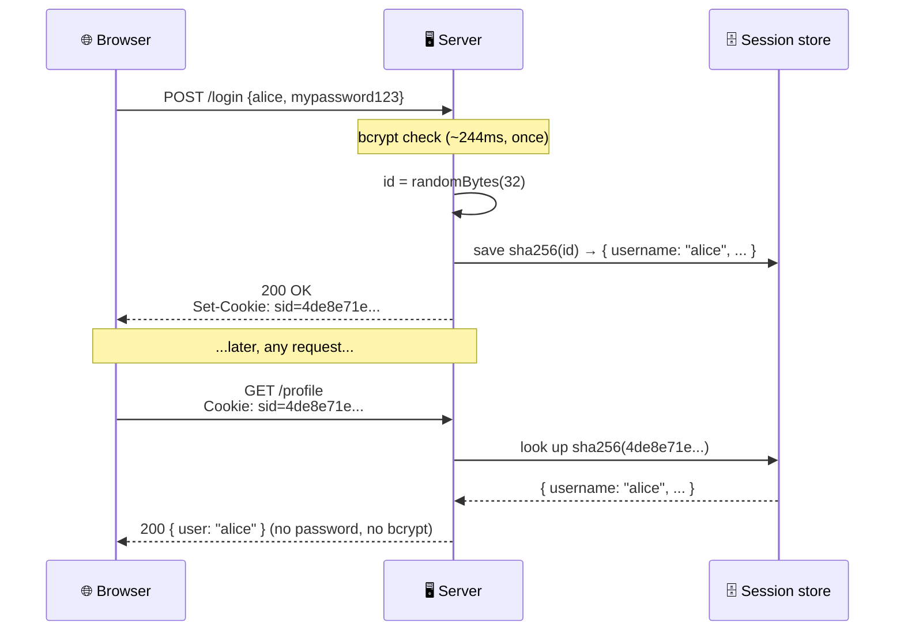
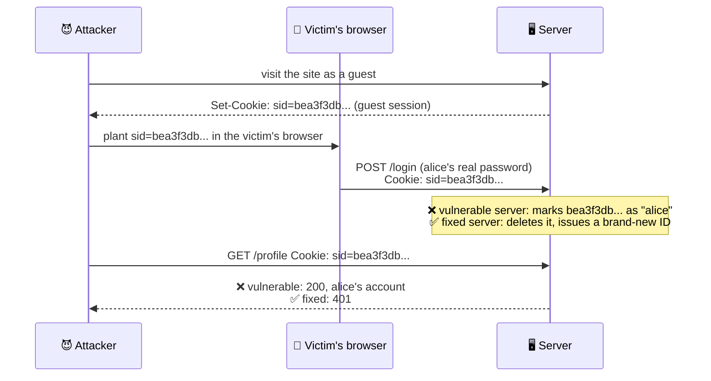

<div align="center">

# Day 03 — Sessions

### How does a server remember you, when HTTP forgets everything?


</div>

---

### 📖 How to read this page

| Marker | What it means |
|---|---|
| **📜 CASE FILE** | Real-world history. Context and stories — step outside the code for a minute. |
| **🧪 PROVEN ON MY MACHINE** | Actual measured output. Not a claim from a blog post — I ran it myself. |
| **🙋 WAIT —** | A question you're probably already asking. Answered immediately, not later. |
| `> [!NOTE]` boxes | Short asides that matter but don't break the flow. |

---

> [!TIP]
> **Day 2 ended with a server that checks your password perfectly — and then forgets you 3 milliseconds later.** The response ends, the next request arrives, and you're a stranger again. That's Day 1's problem, still sitting there untouched. Today we finally fix it, using nothing but a random number, a cookie, and a `Map`.

---

## 🎯 What you'll walk away with

- [ ] What a session really is — explained with a hotel key card you'll never forget
- [ ] That a cookie is **just two HTTP headers**, and the browser does the rest
- [ ] Why `Math.random()` is a **security bug** here, and how big a session ID has to be
- [ ] Why we store a **hash** of the session ID — and why fast SHA-256 is *right* here when Day 2 said it's wrong for passwords
- [ ] What each cookie flag (`HttpOnly`, `Secure`, `SameSite`, `Max-Age`) really stops — **and what it doesn't**
- [ ] Idle timeout vs absolute timeout, and why the **server**, not the cookie, decides when you're logged out
- [ ] Logout that actually logs out, plus **"log out of all devices"**
- [ ] **Session fixation** — run live against our own server, broken and then fixed
- [ ] The one-cookie crash: why a plain `{}` is a dangerous place to keep sessions
- [ ] Where sessions break at scale, and whether *"sessions are old, JWT is the modern way"* is actually true

---

## 🔁 Rewind — why can't the server just ask for the password every time?

Day 1 proved it: **HTTP remembers nothing.** Every request arrives alone, with no memory of the one before it.

The obvious fix is: *fine, then send the username and password with every request.* Every click, every page, every image. Let's see why nobody does that.

**① It would melt your server.** On Day 2 we made checking a password cost **~244ms of CPU on purpose**. A single page load easily fires 20–30 requests. That's 30 × 244ms ≈ **7 seconds of bcrypt per page, per user.** The slowness that protects you from attackers would destroy you under normal traffic.

**② The password would travel everywhere, all the time.** To resend it, the browser has to keep the raw password somewhere it can read it back. Every request is another chance for it to leak: a log line, a proxy, a browser extension. And people reuse passwords, so a leak here unlocks their email and their bank too.

**③ You could never log out.** The password is still valid tomorrow. You can't say *"kill my login on that one laptop I left at the library"* without changing the password everywhere.

So we do what every real system does: **prove who you are once, expensively, and get back something cheap to check for every request after.** That cheap thing is a **session**.

---

## 🏨 The hotel — the analogy that makes sessions obvious

You walk into a hotel. At reception you show your **passport**. The receptionist checks it carefully. That's slow, and it's supposed to be.

Then they hand you a **key card**.

From now on:

- You don't show your passport at the restaurant
- You don't show your passport at the gym
- You don't prove who you are to housekeeping

You just tap the card. Every department trusts it, because **the hotel issued it after checking you once.**

Now notice the details. They are exactly the details that make sessions secure:

- **The card has no room number printed on it.** It's just a meaningless code. Find it on the floor and it tells you nothing. Only the hotel's computer knows which room it opens.
- **You can't make your own card at home.** The codes are random, so you can't guess one that works.
- **When you check out, the hotel deactivates the card in its computer.** The plastic still exists. It still looks the same. It just opens nothing now. And notice who did the deactivating: **the hotel, not the card.**
- **Lose your card? Reception kills it** and gives you a new one. The person who found yours is locked out instantly.

| Hotel | Session world |
|---|---|
| Showing your passport at reception | Logging in with username + password (Day 2, slow bcrypt) |
| The key card | The **session ID**, stored in a **cookie** |
| The code on the card means nothing by itself | The session ID is random. It carries no data. |
| The hotel's computer that maps cards → rooms | The server's **session store** |
| Checking out / reporting a lost card | **Logout**: the session is deleted on the server |

Hold on to this hotel. Every attack later on this page is a hotel story too.

---

## ⚙️ The mechanics, precisely

After a successful login, the server does **three things**:

1. **Generates a random, unguessable session ID** — 64 characters like `4de8e71e827b4d66...`
2. **Stores data tied to that ID on the server:** who you are, when you logged in, when you were last seen
3. **Sends the ID to the browser as a cookie**

From then on, the browser **automatically** attaches that cookie to every request. The server reads the ID, looks it up, and knows who you are.



> [!IMPORTANT]
> **The server holds the truth. The browser holds only a key.**
> The browser never sees "alice is logged in, role: user". It only has a random string. All the meaning lives on the server, and that is exactly why the server can take it away at any moment.

---

## 🍪 What a cookie actually is

Most people think of cookies as "a storage thing in the browser". That's shallow. Here's the real picture:

> **A cookie is two HTTP headers. Nothing more.**

**Header 1, server → browser:** "please remember this"

> 🧪 **PROVEN ON MY MACHINE** — the real response from today's server after `POST /login`
>
> ```txt
> HTTP/1.1 200 OK
> X-Request-Id: 10a35a8b
> Set-Cookie: sid=4de8e71e827b4d6664243fb0cb2bb01c81c8ef3b984ab91d02c0196933d10b5d; HttpOnly; Secure; SameSite=Lax; Path=/; Max-Age=28800
> Content-Type: application/json
> ```

**Header 2, browser → server, on every request after that:** "here it is again"

```txt
GET /profile HTTP/1.1
Cookie: sid=4de8e71e827b4d6664243fb0cb2bb01c81c8ef3b984ab91d02c0196933d10b5d
```

That's the entire mechanism. The browser stores the value, and from then on it **automatically** adds the `Cookie` header to every request **to that same site**. You don't write any code for that. It just happens.

That word *automatically* is both the best and the most dangerous thing about cookies. It's why sessions feel effortless. It's also the root of an attack called CSRF, which we'll meet in the `SameSite` section below.

> ### 🙋 WAIT — if a cookie is just a header, can't I just type one myself?
>
> **Yes. Exactly.** Watch:
>
> ```bash
> curl localhost:3000/profile -H "Cookie: sid=4de8e71e827b4d66..."
> ```
>
> The server cannot tell whether that header came from Chrome, from curl, or from an attacker's script. **It only sees the value.** This is the single most important fact on this page:
>
> > **A session ID is a bearer key. Whoever holds it *is* you, as far as the server is concerned.**
>
> No password needed, no 2FA, nothing. That's why almost everything else today is about one question: **how do we stop this string from being guessed, stolen, planted, or living forever?**

---

## 🎲 The session ID — why `Math.random()` is a vulnerability

The session ID is the number on the key card. It has exactly one job: **nobody can guess it.**

The first thing most of us would reach for is `Math.random()`. Let's look at what it produces next to the right tool:

> 🧪 **PROVEN ON MY MACHINE**
>
> ```txt
> Math.random()                  : 0.6242115127357833
> Math.random().toString(36)     : 0i3fyytnkp5
> crypto.randomBytes(32) as hex  : b9ac107b4914441331336fb5678d335448ed2ba1d3437aec3400b4987853da98
> ```

They both *look* random. Only one of them is.

**`Math.random()` is built for games and animations, not secrets.** In Node and Chrome it's made by an algorithm called **xorshift128+**. It keeps a small internal state, and every number it gives you is computed directly from that state. That makes it fast, and it also makes it **predictable**: given a handful of consecutive outputs, the internal state can be worked out with a constraint solver. Public tools exist that do exactly this. Once an attacker has the state, they can compute **every future value**, which means **every future session ID your server will hand out**.

So the attack goes like this. Log in a few times yourself, collect your own session IDs, recover the generator's state, and predict the ID the next user is about to receive.

**`crypto.randomBytes()` comes from the operating system's cryptographically secure generator.** It's built specifically so that seeing past outputs tells you nothing about future ones. That's the only thing a session ID should ever be made from.

```js
const sessionId = crypto.randomBytes(32).toString("hex");
```

### How big is big enough?

OWASP's guidance is **at least 64 bits** of real randomness. We use **256 bits** (32 bytes). Here's what that means in practice:

> 🧪 **PROVEN ON MY MACHINE** — computed, not guessed
>
> ```txt
> possible 32-byte IDs                         : 10^77.1
> attacker with 1,000,000 live sessions to hit,
>   making 1,000,000,000 guesses every second  : 10^54.6 years to hit ANY one of them
> ```
>
> The universe is about 1.4 × 10^10 years old. You'd need to run the attack for **10^44 lifetimes of the universe** to expect a single hit.

Now compare a lazy 4-byte ID:

```txt
4 bytes  →  2^32 = 4,294,967,296 possible values
at 1 billion guesses/sec  →  4.3 seconds to try every single one
```

> ### 🙋 WAIT — but today's code ALSO makes a 4-byte random ID, for "request IDs". Isn't that the same mistake?
>
> Good eye. No, and the difference teaches the whole idea:
>
> | | Session ID | Request ID |
> |---|---|---|
> | **What it does** | Proves *who you are* | Labels *one request* in the logs, so support can find it |
> | **If an attacker guesses one** | They're logged in as you 💀 | They know a log label. That gets them nothing. |
> | **Is it a secret?** | **Yes** | No — we literally send it to the user |
> | **Size** | 32 bytes (256 bits) | 4 bytes is plenty |
>
> **The size of a random value depends on what happens if someone guesses it.** A session ID guards the front door. A request ID is a sticky note.

> [!NOTE]
> **Why hex?** 32 random bytes are raw binary, and some byte values are characters that would break a cookie header (`;`, `=`, spaces). `.toString("hex")` turns each byte into two safe characters `0-9a-f`, giving exactly 64 characters. Base64url (43 characters) would work too. Hex is just easier to read.

---

## 🗄️ Don't store the session ID. Store its hash.

Day 2's first rule: **assume the attacker will read your database.**

Apply it to sessions. Suppose your session store holds the raw IDs:

```txt
"4de8e71e827b4d66..."  →  { username: "alice" }
"9034b0c6a1f2e3d4..."  →  { username: "bob" }
```

The attacker steals a backup of that table. They don't need to crack anything. **Every row is a working login**: paste the ID into a cookie and you are alice. Same as storing passwords in plaintext, just with a shorter shelf life.

So we do the same thing we did with passwords: **the browser keeps the real ID, the store keeps only its hash.**

```js
function hashId(sessionId) {
  return crypto.createHash("sha256").update(sessionId).digest("hex");
}

sessions.set(hashId(sessionId), record);   // store the hash
setSessionCookie(res, sessionId);          // the browser gets the real thing
```

On every request we hash whatever arrives in the cookie and look *that* up.

> 🧪 **PROVEN ON MY MACHINE** — steal the store, try to use it
>
> ```txt
> cookie in the browser : 4de8e71e827b4d6664243fb0cb2bb01c81c8ef3b984ab91d02c0196933d10b5d
> key in the store      : 56530878bec46c6c90c7072fc1317b84984b8c0606f89d91ba20e18bbfbb2230
>
> $ curl localhost:3000/profile -H "Cookie: sid=56530878bec46c6c...(the stolen store key)"
> { "error": "Not logged in" }   [HTTP 401]
> ```
>
> The server hashes whatever you send. The hash of a hash is a different value, so it's not in the store. **The stolen table opens nothing.**

> ### 🙋 WAIT — Day 2 spent a whole section saying SHA-256 is too fast and therefore wrong. Why is it fine here?
>
> This is the best question on the page, and the answer separates people who memorise rules from people who understand them.
>
> SHA-256 was wrong for passwords **because passwords are guessable.** Humans pick from a small, predictable list: `password123`, their dog's name, `qwerty`. A fast hash lets an attacker try that list billions of times a second. bcrypt's slowness is there to make *guessing* expensive.
>
> A session ID **isn't guessable.** It's 256 bits straight from the OS. There's no list to try. We just calculated it above: even at a billion guesses a second, 10^54 years. Making each guess slower adds nothing when the number of guesses needed is already impossible.
>
> And slowness here would be a disaster, because this hash runs on **every single request**:
>
> > 🧪 **PROVEN ON MY MACHINE**
> >
> > ```txt
> > SHA-256 of a session ID :  ~2.5 µs each   (~390,000 per second, one core)
> > bcrypt at cost 12       :  ~244 ms each   (Day 2)
> > ```
> >
> > bcrypt here would be roughly **100,000× slower on every click**, for zero extra security.
>
> **The rule, properly understood:**
>
> | The secret | Where it comes from | Right hash |
> |---|---|---|
> | **Password** | A human chose it, so it's guessable | **Slow** (bcrypt / Argon2) |
> | **Session ID, API key, reset token** | 256 random bits from the machine | **Fast** (SHA-256) is perfect |
>
> The question was never "is SHA-256 good or bad". It's **"can the attacker guess the input?"**

> ### 🙋 WAIT — Day 2 said `===` leaks timing. But when it's comparing *hashes*, what does the attacker even learn? Nothing useful, right?
>
> **You're right — for bcrypt hashes, completely right.** Even if a timing leak told an attacker *"the first 3 characters of your hash matched the stored one"*, they still have no idea which password produces a hash starting that way. Change one letter of the input and every character of the output changes (the avalanche effect from Day 2). They can't steer the hash, so a prefix match is useless to them.
>
> **Where `===` really bites is when the attacker's input is compared directly to a raw secret**, with no hash in between:
>
> | Where | The dangerous line | What leaks |
> |---|---|---|
> | API keys | `if (req.headers["x-api-key"] === ADMIN_KEY)` | the key, one character at a time |
> | Password-reset tokens stored raw | `if (req.body.token === user.resetToken)` | a working reset link |
> | Webhook signatures | `if (req.headers["x-signature"] === expected)` | a forged "payment succeeded" |
>
> In each case the attacker sends `a000…`, `b000…`, `c000…` and watches for the one that takes a hair longer, because `===` got one character further before stopping. Then they move on to the second character. The difference is nanoseconds, so it takes a lot of samples, and it's much easier from inside the same network or cloud region. But it has worked against real systems, and "the network is noisy" is not a security control.
>
> **And notice that your own insight is exactly today's defence.** A session store with *raw* IDs would be the dangerous kind of lookup. Because we hash the cookie before looking it up, anything a timing leak could reveal is about the **hash**, which the attacker can't steer. Your reasoning about bcrypt hashes now protects session IDs too.
>
> When you *do* have to compare raw secrets yourself, Node has a constant-time comparison built in:
>
> ```js
> const crypto = require("crypto");
>
> function safeEqual(a, b) {
>   // Hash both sides first: equal lengths always, and nothing about the
>   // secret's length leaks either.
>   const ha = crypto.createHash("sha256").update(a).digest();
>   const hb = crypto.createHash("sha256").update(b).digest();
>   return crypto.timingSafeEqual(ha, hb);   // checks every byte, every time
> }
> ```
>
> You'll often see a version that checks `if (a.length !== b.length) return false` before `timingSafeEqual`. That's needed because `timingSafeEqual` throws on different lengths, but the early return quietly leaks the secret's length. Hashing first avoids both problems.

---

## 🛡️ The cookie flags — what each one really stops

Look at that `Set-Cookie` line again:

```txt
Set-Cookie: sid=4de8...; HttpOnly; Secure; SameSite=Lax; Path=/; Max-Age=28800
```

Everything after the value is an instruction to the browser. None of it is decoration. But a lot of tutorials oversell what each flag does, so let's be precise about **what it stops and what it doesn't.**

### `HttpOnly` — page JavaScript can't read it

Without it, any JavaScript running on your page can do this:

```js
document.cookie   // "sid=4de8e71e827b4d66..."
```

If an attacker manages to inject a script into your page (that's XSS, cross-site scripting: a comment box that doesn't escape `<script>`, a malicious npm package), that script reads the session ID and sends it to the attacker's server. Now they're you, from their own laptop, for as long as the session lives.

With `HttpOnly`, `document.cookie` simply doesn't include it. The browser still *sends* the cookie with requests, but no script can *read* it.

> [!WARNING]
> **What `HttpOnly` does NOT stop:** XSS itself. An injected script can't steal the cookie, but it can still call `fetch("/logout-all", { method: "POST" })` from your page, and the browser will attach your cookie automatically. `HttpOnly` turns *"steal the key and use it from anywhere, for days"* into *"use the key only while you're standing in the room"*. That's a huge improvement, but the real fix for XSS is never letting the script in.

### `Secure` — only ever sent over HTTPS

Without it, the browser will happily send your cookie over plain `http://`, in clear text, to anyone on the same network who's listening.

> ### 📜 CASE FILE — Firesheep, October 2010
>
> *Real-world history. The browser extension that embarrassed the biggest websites on earth.*
>
> In 2010, most big sites used HTTPS only for the login page. Your password went encrypted. Then, to save server costs, they switched back to plain HTTP for everything after, and the **session cookie travelled in clear text on every request.**
>
> Security researcher Eric Butler presented **Firesheep** at the ToorCon conference: a Firefox extension that did one thing. Sit on any open Wi-Fi (a coffee shop, an airport, a university) and it listened for session cookies from Facebook, Twitter and other popular sites flying past in plaintext. It showed a sidebar full of other people's names and profile photos. **Double-click a face, and you were logged in as that person.** No password. No hacking skill. One click.
>
> The attack itself wasn't new. Security people had warned about it for years. What Firesheep did was make it so easy that nobody could ignore it anymore. Over the next few years the big sites moved to **HTTPS on every page**, which is now the default everywhere.
>
> The lesson is today's `Secure` flag in one sentence: **encrypting the login means nothing if the session ID that comes after it travels naked.**

> [!NOTE]
> **"But I'm testing on `http://localhost`. Won't `Secure` break everything?"** No. `localhost` is treated as a secure context, so the cookie still works locally. I confirmed it with curl: the cookie was stored and sent on both `http://localhost` and `http://127.0.0.1`. Modern browsers make the same exception for localhost. On a real domain over plain `http://`, the browser would refuse to send it, which is exactly what you want.

### `SameSite` — don't send it on requests started by other websites

Remember *"the browser attaches the cookie automatically"*? Here's the nasty side of that.

You're logged in to `yourbank.com`. In another tab you visit `evil.com`, which contains a hidden form:

```html
<form action="https://yourbank.com/transfer" method="POST">
  <input name="to" value="attacker"><input name="amount" value="50000">
</form>
<script>document.forms[0].submit()</script>
```

Your browser sends that POST to `yourbank.com`, and without `SameSite` **it attaches your bank's session cookie automatically**. The bank sees a valid session and moves the money. You never clicked anything. This is **CSRF** (cross-site request forgery). It's big enough to get a full day of its own later in this series.

`SameSite` tells the browser when it's allowed to attach the cookie to a request that **started on a different site**:

| Value | Cookie sent when another site starts the request? | The trade-off |
|---|---|---|
| `Strict` | **Never** | Safest. But click a link to your site *from an email or a chat app*, and you arrive **logged out**, because that navigation started somewhere else. |
| `Lax` | **Only** for top-level GET navigation (clicking a normal link) | Links from emails still keep you logged in. Cross-site POSTs, hidden forms and background `fetch` calls get **no cookie**. |
| `None` | Always (and it *requires* `Secure`) | Only for cookies that genuinely must work inside other sites, like embedded widgets. Never for a session. |

**Today's code uses `Lax`**, the same default modern browsers fall back to when no `SameSite` is set. It blocks the hidden-form attack above, because that's a cross-site POST.

> [!IMPORTANT]
> **`Lax` comes with one rule you must never break: a GET request must never change anything.** Lax still sends the cookie on top-level GET links, so if `GET /logout-all` or `GET /delete-account` existed, a link on `evil.com` would trigger it *with* your cookie. That's why every state-changing route in today's code is a `POST`.
>
> High-security apps sometimes go further: `Strict` for the sensitive cookie, and a second `Lax` cookie only for knowing "is this person logged in at all" when they arrive from a link. Security vs convenience, decided per cookie.

### `Path=/` — which URLs get the cookie

`/` means every route on the site. It's needed because without it the browser defaults the path to the directory of the URL that set the cookie. Ours was set by `/login`, which works out to `/` anyway, but it's always better to say it explicitly.

### `Max-Age=28800` — when the *browser* throws it away

28,800 seconds = 8 hours. After that, the browser deletes the cookie.

> [!CAUTION]
> **`Max-Age` is not a security control.** It's an instruction to an honest browser. An attacker who has stolen the cookie into curl or a script doesn't care what `Max-Age` says, and keeps sending it forever. **Real expiry has to be enforced on the server**, which is the whole next section.
>
> Leave `Max-Age` out entirely and you get a *session cookie*, which the browser deletes when it closes. "Closes" is fuzzier than it sounds, though: browsers with "continue where you left off" switched on restore those cookies too.

### And one flag we deliberately *didn't* set: `Domain`

Without a `Domain` attribute, the cookie is **host-only**: sent to `yourapp.com` and nowhere else. Write `Domain=yourapp.com` and it's also sent to *every subdomain*, including `blog.yourapp.com`, `old-staging.yourapp.com`, and whatever forgotten marketing page lives on a third-party host. Fewer places holding your session key is better.

### The corrected cheat sheet

| Flag | What it does | Attack it stops | What it does **not** stop |
|---|---|---|---|
| `HttpOnly` | Hides the cookie from page JavaScript | XSS **stealing** the session ID | XSS **using** your session while you're on the page |
| `Secure` | HTTPS only | Sniffing on open Wi-Fi (Firesheep) | Theft from the device itself |
| `SameSite=Lax` | No cookie on cross-site POSTs | Classic CSRF via hidden forms | State changes done over GET (so never write those) |
| `Max-Age` | Browser deletes it after N seconds | A forgotten cookie lingering on a shared computer | An attacker who already copied it — **only the server can stop that** |

> [!TIP]
> **Production hardening you'll see in real apps:**
> - **Name the cookie `__Host-sid` instead of `sid`.** Browsers enforce rules on that prefix: the cookie must be `Secure`, must be `Path=/`, and must **not** have a `Domain`. That stops a sibling subdomain from overwriting your session cookie, which is one of the ways session fixation happens (below). We kept the plain name so the exercises behave the same for every reader.
> - **Don't use framework default names** like `PHPSESSID`, `JSESSIONID` or `connect.sid`. They announce your tech stack to anyone who looks. `sid` says nothing.
> - Want to see real flags in the wild? Log into GitHub, open DevTools → **Application** → **Cookies** → `github.com`, and find the cookie named `user_session`. Look at its `HttpOnly` and `Secure` columns.

---

## ⏳ Expiry — two clocks, and the server owns both

A session needs to end. There are two different reasons it should, and one clock can't capture both:

| Clock | Question it answers | Today's value |
|---|---|---|
| **Idle timeout** | *"Has nobody touched this session for a while?"* The user walked away from a shared computer. | **15 minutes** |
| **Absolute timeout** | *"How long since they actually typed their password?"* Even if they've been busy the whole time. | **8 hours** |

Every request resets the idle clock (that's called a *sliding* expiry). Nothing resets the absolute clock except logging in again.

**Why do you need the absolute clock at all, if the idle one already works?** Because of the attacker who stole a cookie. They can write a script that pings `/profile` once a minute, so the session never goes idle. **The absolute timeout is the one an attacker can't keep pushing back.** After 8 hours, whatever they stole dies.

**How short should they be?** It depends on what's behind the door. OWASP's rough guidance:

| Kind of app | Idle timeout | Absolute timeout |
|---|---|---|
| Banking, hospital records, admin panels | **2–5 minutes** | a few hours |
| Ordinary low-risk apps | 15–30 minutes | 4–8 hours (a working day) |
| "Remember me" on a social app | days or weeks | weeks, usually paired with re-checking the password before sensitive actions |

Short timeouts annoy users. Long timeouts give attackers more time. **The value is a business decision about risk, not a technical constant.**

> 🧪 **PROVEN ON MY MACHINE** — started with `IDLE_TIMEOUT_MS=5000` (5-second idle timeout)
>
> ```txt
> t=0s   GET /profile  →  HTTP 200
> t=3s   GET /profile  →  HTTP 200      ← activity, idle clock resets
> t=6s   GET /profile  →  HTTP 200      ← only 3s since the last request
> t=12s  GET /profile  →  HTTP 401  { "error": "Not logged in" }   ← 6s of silence
>
> is the cookie still in curl's cookie jar?  yes (1)
> ```
>
> **The cookie still exists. curl still sends it. The server says no.** The key card is in your pocket, and the hotel has deactivated it.

> ### 🙋 WAIT — the cookie already has `Max-Age`. Why does the server track expiry *again*?
>
> Because the cookie is the **client's** copy, and the client can't be trusted to throw it away. A browser respects `Max-Age`. An attacker's curl command doesn't. The proof is right above: the cookie was still sitting in the jar, still being sent, and the only thing that ended the session was the server checking its own timestamps.
>
> **The rule: the browser's expiry is a courtesy. The server's expiry is the law.**

---

## 🚪 Logout that actually logs out

Here's the entire logout:

```js
sessions.delete(current.key);   // the session is gone from the server
clearSessionCookie(res);        // ask the browser to forget the cookie too
```

The first line is the logout. The second is only tidying up. If the browser ignored the clear-cookie instruction, or an attacker kept a copy, it wouldn't matter: **the ID now points at nothing.** The hotel deactivated the card.

**Because the server holds the list, it can do something even better: log you out *everywhere*.**

You've seen this button: *"Sign out of all devices"* on Netflix, *"Sign out of all other sessions"* on GitHub, Google's list of devices with a remove button next to each. Today we build it: `GET /sessions` lists every place you're logged in, and `POST /logout-all` kills them all.

> 🧪 **PROVEN ON MY MACHINE** — a laptop, a phone, and an attacker holding a stolen copy of the laptop's cookie
>
> ```txt
> GET /sessions  (from the laptop)
> { "sessions": [
>     { "device": "curl/8.23.0", "loggedInAt": "...18:34:00.599Z", "thisDevice": true  },
>     { "device": "Phone/1.0",   "loggedInAt": "...18:34:02.543Z", "thisDevice": false }
> ] }
>
> attacker replays the laptop's cookie (User-Agent "EvilBox/6.6")  →  { "user": "alice", ... }   😱
>
> POST /logout-all  (from the phone)
> { "message": "Logged out of 2 session(s)" }
>
> laptop   →  HTTP 401
> attacker →  HTTP 401   ✅
> ```

That's the moment a user thinks *"I think someone's in my account"* and fixes it with one click. Remember it. It's the thing that's surprisingly hard to do with JWTs, and we'll come back to why at the end.

---

## 🎭 Session fixation — the attack hiding inside "a session that already exists"

Most developers with years of experience have never heard of this one. You're about to understand it well enough to run it.

**Session hijacking** = the attacker *steals* your session ID.
**Session fixation** = the attacker *gives you* a session ID they already know, and waits for you to log in with it.

### The hotel version

A friendly stranger at the hotel entrance hands you a key card. *"Here, this is for you."* You take it to reception and log in with your passport. The receptionist doesn't issue a new card. They just **activate the one you're holding** for your room.

The stranger made a copy before handing it to you. **They now have a working key to your room.** They never saw your passport and never stole anything from you. They simply got there first.

### The real version



### "But how does the attacker get their ID into my browser?"

That step sounds like the hard part. Historically it was embarrassingly easy:

- **Session IDs in URLs.** Old Java servers (`;jsessionid=...`) and old PHP setups would put the session ID in the link itself when cookies were off. The attacker just sent you `yoursite.com/login;jsessionid=THEIR_ID`, and the server accepted it.
- **A sibling subdomain.** If an attacker controls *any* subdomain (`old-blog.yoursite.com`, a user-content host), that page can set a cookie for the parent domain, and your browser carries it to `yoursite.com`. The `__Host-` prefix above exists largely to block this.
- **A shared or public computer.** The attacker opens your site, gets a guest session, notes the ID, and walks away. You sit down and log in.
- **Any XSS** on a page that can set cookies.

### "Our app doesn't even create a session before login, so we're safe?"

Real apps almost always do. **A shopping cart before you sign in. Your language choice. A CSRF token for the login form itself.** All of that is a session that exists *before* you log in, and that's why today's server has a guest `/cart`: to make the attack real.

### The fix — never promote an old ID

```js
const current = getSession(req);
const cart = current ? current.record.cart : [];   // keep what's useful
if (current) sessions.delete(current.key);          // kill the old ID
const { sessionId } = startSession(req, res, { username, cart });   // brand-new ID
```

Whatever ID the browser walked in with dies at the moment of login. The attacker's copy now points at nothing. The cart comes along, so the user loses nothing.

> 🧪 **PROVEN ON MY MACHINE** — the same attack, run against two servers
>
> **❌ A copy of today's server with the fix replaced by "just mark the existing session as logged in":**
>
> ```txt
> attacker POST /cart as a guest             →  sid=bea3f3db...   { "loggedInAs": null }
> attacker GET /profile                      →  401  (not logged in yet, so far so good)
> victim logs in, carrying the planted id    →  { "message": "Welcome alice!" }
> did login send a new Set-Cookie?           →  0   (no, same ID kept)
> attacker GET /profile with the SAME id     →  200  { "user": "alice", ... }   💀
> ```
>
> **✅ Today's real server:**
>
> ```txt
> victim logs in, carrying the planted id    →  Set-Cookie: sid=71bf55f72d379ea7...   (brand-new)
> attacker GET /profile with the old id      →  401  { "error": "Not logged in" }
> ```

> [!IMPORTANT]
> **Regenerate the ID on *every* change in privilege, not just login:** logging in, switching to an admin role, a password change, re-entering your password for a sensitive "sudo mode" action. And the other half of the defence, which today's code also follows: **never adopt an ID the server didn't create.** We only ever look IDs up; we never take an unknown ID from a browser and start using it.

---

## 🕵️ Session hijacking — when the attacker steals a live ID

Fixation is the attacker planting a key. Hijacking is them stealing yours. Here's every common way it gets stolen, and what stands in the way:

| How the ID gets stolen | What defends against it |
|---|---|
| XSS script reads `document.cookie` | `HttpOnly` (and escaping output so the script never gets in) |
| Sniffed on open Wi-Fi | `Secure` + HTTPS everywhere |
| Leaked database or backup | Storing `sha256(id)`, not the ID |
| Written into log files | Never logging full IDs (today's `short()` helper) |
| Malware on the user's own computer copies the browser's cookie files | **No cookie flag can stop this.** Only short timeouts, "log out everywhere", and asking for the password again before dangerous actions limit the damage. |

> ### 📜 CASE FILE — Linus Tech Tips, March 2023
>
> *Real-world history. How a channel with millions of subscribers was taken over without a password.*
>
> An employee at Linus Media Group opened what looked like a sponsorship offer. The attachment was malware. It quietly copied the **session cookies** out of the browser on that machine and sent them to the attackers.
>
> With those cookies, the attackers didn't need a password, and they didn't need 2FA. As far as YouTube's servers were concerned, they **were** the logged-in staff. They took over the company's YouTube channels, renamed the main one, and streamed crypto-scam videos to millions of subscribers before YouTube shut it down.
>
> This kind of malware is called an **infostealer**, and stealing session cookies is now one of its main jobs, precisely because a session cookie walks straight past MFA. It's why the industry is now working on ways to tie a session to the specific device it was created on, so a copied cookie stops working on another machine.
>
> The lesson: **a session ID is the login.** Everything we do to keep it short-lived, revocable, and visible to the user ("here are your active devices") is there for the day it gets stolen anyway.

> ### 🙋 WAIT — we store the `userAgent` with each session. Why not block the request when the user agent suddenly changes? That would catch the thief.
>
> It sounds great, and it barely works:
>
> - **The user agent is just a header the client sends.** A thief copies it along with the cookie. curl changes it with `-A "anything"`.
> - **It changes legitimately all the time.** Browser auto-updates change the version number. Blocking on that logs real users out at random.
>
> Look at the proof in the logout section: the attacker sent `EvilBox/6.6` and still got in. That's deliberate. Today's server uses the user agent only as a **label** in the "your devices" list, so a human can spot *"wait, I don't own a device called that"* and hit log out everywhere. Big services use it as one weak signal among many (location, time of day, behaviour) for flagging suspicious activity, not as a lock.

