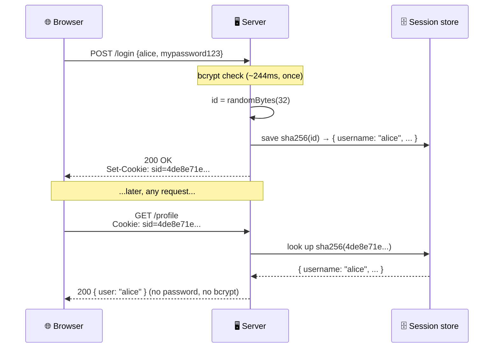
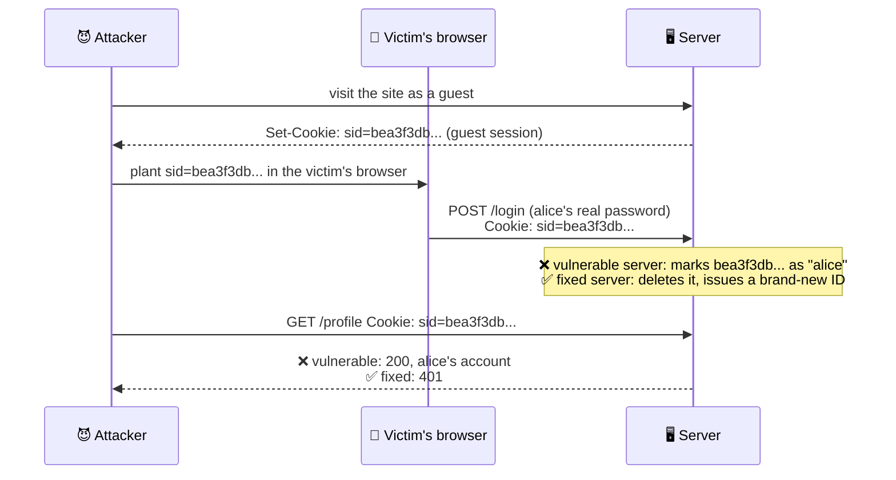
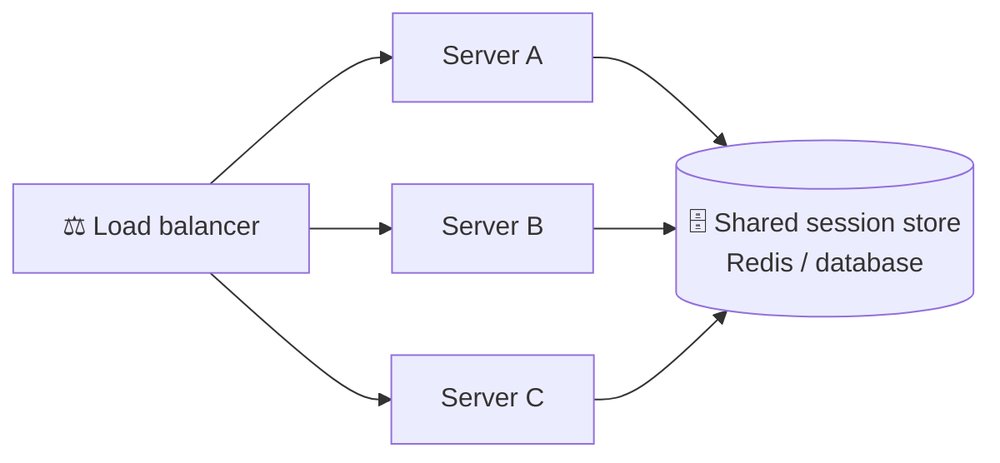

<div align="center">

# Day 03 — Sessions

### How does a server remember you, when HTTP forgets everything?


</div>

---

### 📖 How to read this page

| Marker | What it means |
|---|---|
| **📜 CASE FILE** | Real-world history. Context and stories — step outside the code for a minute. |
| **🧪 PROVEN ON MY MACHINE** | Actual measured output. Not a claim from a blog post — I ran it myself. |
| **🙋 WAIT —** | A question you're probably already asking. Answered immediately, not later. |
| `> [!NOTE]` boxes | Short asides that matter but don't break the flow. |

---

> [!TIP]
> **Day 2 ended with a server that checks your password perfectly — and then forgets you 3 milliseconds later.** The response ends, the next request arrives, and you're a stranger again. That's Day 1's problem, still sitting there untouched. Today we finally fix it, using nothing but a random number, a cookie, and a `Map`.

---

## 🎯 What you'll walk away with

- [ ] What a session really is — explained with a hotel key card you'll never forget
- [ ] That a cookie is **just two HTTP headers**, and the browser does the rest
- [ ] Why `Math.random()` is a **security bug** here, and how big a session ID has to be
- [ ] Why we store a **hash** of the session ID — and why fast SHA-256 is *right* here when Day 2 said it's wrong for passwords
- [ ] What each cookie flag (`HttpOnly`, `Secure`, `SameSite`, `Max-Age`) really stops — **and what it doesn't**
- [ ] Idle timeout vs absolute timeout, and why the **server**, not the cookie, decides when you're logged out
- [ ] Logout that actually logs out, plus **"log out of all devices"**
- [ ] **Session fixation** — run live against our own server, broken and then fixed
- [ ] The one-cookie crash: why a plain `{}` is a dangerous place to keep sessions
- [ ] Where sessions break at scale, and whether *"sessions are old, JWT is the modern way"* is actually true

---

## 🔁 Rewind — why can't the server just ask for the password every time?

### The problem: HTTP forgets you

On Day 1 we proved that **HTTP has no memory.** Every time your browser loads a page, an image or some data, it sends a brand-new request. The server answers that request and then forgets it completely.

So when your next request arrives, the server has no idea it's the same person from one second ago. **To the server, every request is a stranger knocking on the door.**

### The first idea: send the password with every request

A natural thought is: *"If the server keeps forgetting me, why doesn't my browser just attach my username and password to every request?"* Then every single request would prove who you are.

It sounds simple. But it fails, for three big reasons.

### Reason 1: it would make your server far too slow

- On Day 2 we made checking a password **slow on purpose**: about **244 ms** of CPU work for each check. That slowness is what stops attackers from guessing millions of passwords.
- But opening one web page is not one request. Your browser asks for the page itself, then its styles, its scripts, your profile picture, your notifications... easily **20 to 30 requests** for a single page.
- If every one of those requests carried your password, the server would have to run that slow check every time: **30 × 244 ms ≈ 7 seconds of CPU work, for one page, for one person.**
- Now picture hundreds of people using the site at the same time. The slowness that protects you from attackers would bring down your own server.

### Reason 2: your password would be exposed again and again

- To send your password on every request, the browser has to **keep your real password saved** somewhere it can read it back.
- Then that password travels across the network 30 times for one page, and thousands of times a day. Every trip is another chance for it to leak: into a server log, through a badly built proxy, or to a sketchy browser extension.
- And most people reuse the same password everywhere. So one leak here doesn't just expose this app. It can unlock their email, their social media and their bank account too.

### Reason 3: you could never log out of just one device

- Say you log in on a library computer and forget to log out.
- That computer is simply sending your password with every request, so it stays logged in for as long as your password is valid. **The server can't tell "your laptop" apart from "the library computer"**, because both are sending the exact same password.
- The only way to kick the library computer out is to change your password. And that logs you out **everywhere** at once: your phone, your laptop, every device you own.

### The solution: check once, then use a cheap pass

Real systems split this into steps:

1. **Prove who you are once (slow and careful).** You send your username and password to `POST /login` one time. The server runs the slow 244 ms check.
2. **Get a cheap pass back.** If the password is correct, the server hands your browser a long random string, for example `4de8e71e827b4d66...`. This is called a **session ID**.
3. **Show the pass on every request after that (fast).** From now on, your browser sends the session ID instead of the password. The server just looks it up in its list, which takes a few **microseconds** instead of 244 milliseconds. (We measure this later on this page.)

That one change fixes all three problems:

| Problem | How the session ID fixes it |
|---|---|
| **Too slow** | The slow password check runs **once**, at login. Every request after that is a quick lookup. |
| **Password exposed** | The password travels **once**. After that, only the random session ID travels, and it's useless anywhere else. |
| **Can't log out one device** | Each device gets **its own** session ID. To kick out the library computer, the server deletes that one session. Your password and your other devices are untouched. |

That cheap pass is called a **session**, and the rest of this page is about building one properly. Let's start with an everyday example that makes the whole idea easy to remember.

---

## 🏨 The hotel — the analogy that makes sessions obvious

You walk into a hotel. At reception you show your **passport**. The receptionist checks it carefully. That's slow, and it's supposed to be.

Then they hand you a **key card**.

From now on:

- You don't show your passport at the restaurant
- You don't show your passport at the gym
- You don't prove who you are to housekeeping

You just tap the card. Every department trusts it, because **the hotel issued it after checking you once.**

Now notice the details. They are exactly the details that make sessions secure:

- **The card has no room number printed on it.** It's just a meaningless code. Find it on the floor and it tells you nothing. Only the hotel's computer knows which room it opens.
- **You can't make your own card at home.** The codes are random, so you can't guess one that works.
- **When you check out, the hotel deactivates the card in its computer.** The plastic still exists. It still looks the same. It just opens nothing now. And notice who did the deactivating: **the hotel, not the card.**
- **Lose your card? Reception kills it** and gives you a new one. The person who found yours is locked out instantly.

| Hotel | Session world |
|---|---|
| Showing your passport at reception | Logging in with username + password (Day 2, slow bcrypt) |
| The key card | The **session ID**, stored in a **cookie** |
| The code on the card means nothing by itself | The session ID is random. It carries no data. |
| The hotel's computer that maps cards → rooms | The server's **session store** |
| Checking out / reporting a lost card | **Logout**: the session is deleted on the server |

Hold on to this hotel. Every attack later on this page is a hotel story too.

---

## ⚙️ The mechanics, precisely

After a successful login, the server does **three things**:

1. **Generates a random, unguessable session ID** — 64 characters like `4de8e71e827b4d66...`
2. **Stores data tied to that ID on the server:** who you are, when you logged in, when you were last seen
3. **Sends the ID to the browser as a cookie**

From then on, the browser **automatically** attaches that cookie to every request. The server reads the ID, looks it up, and knows who you are.



> [!IMPORTANT]
> **The server holds the truth. The browser holds only a key.**
> The browser never sees "alice is logged in, role: user". It only has a random string. All the meaning lives on the server, and that is exactly why the server can take it away at any moment.

---

## 🍪 What a cookie actually is

Most people think of cookies as "a storage thing in the browser". That's shallow. Here's the real picture:

> **A cookie is two HTTP headers. Nothing more.**

**Header 1, server → browser:** "please remember this"

> 🧪 **PROVEN ON MY MACHINE** — the real response from today's server after `POST /login`
>
> ```txt
> HTTP/1.1 200 OK
> X-Request-Id: 10a35a8b
> Set-Cookie: sid=4de8e71e827b4d6664243fb0cb2bb01c81c8ef3b984ab91d02c0196933d10b5d; HttpOnly; Secure; SameSite=Lax; Path=/; Max-Age=28800
> Content-Type: application/json
> ```

**Header 2, browser → server, on every request after that:** "here it is again"

```txt
GET /profile HTTP/1.1
Cookie: sid=4de8e71e827b4d6664243fb0cb2bb01c81c8ef3b984ab91d02c0196933d10b5d
```

That's the entire mechanism. The browser stores the value, and from then on it **automatically** adds the `Cookie` header to every request **to that same site**. You don't write any code for that. It just happens.

That word *automatically* is both the best and the most dangerous thing about cookies. It's why sessions feel effortless. It's also the root of an attack called CSRF, which we'll meet in the `SameSite` section below.

> ### 🙋 WAIT — if a cookie is just a header, can't I just type one myself?
>
> **Yes. Exactly.** Watch:
>
> ```bash
> curl localhost:3000/profile -H "Cookie: sid=4de8e71e827b4d66..."
> ```
>
> The server cannot tell whether that header came from Chrome, from curl, or from an attacker's script. **It only sees the value.** This is the single most important fact on this page:
>
> > **A session ID is a bearer key. Whoever holds it *is* you, as far as the server is concerned.**
>
> No password needed, no 2FA, nothing. That's why almost everything else today is about one question: **how do we stop this string from being guessed, stolen, planted, or living forever?**

---

## 🎲 The session ID — why `Math.random()` is a vulnerability

The session ID is the number on the key card. It has exactly one job: **nobody can guess it.**

The first thing most of us would reach for is `Math.random()`. Let's look at what it produces next to the right tool:

> 🧪 **PROVEN ON MY MACHINE**
>
> ```txt
> Math.random()                  : 0.6242115127357833
> Math.random().toString(36)     : 0i3fyytnkp5
> crypto.randomBytes(32) as hex  : b9ac107b4914441331336fb5678d335448ed2ba1d3437aec3400b4987853da98
> ```

They both *look* random. Only one of them is.

**`Math.random()` is built for games and animations, not secrets.** In Node and Chrome it's made by an algorithm called **xorshift128+**. It keeps a small internal state, and every number it gives you is computed directly from that state. That makes it fast, and it also makes it **predictable**: given a handful of consecutive outputs, the internal state can be worked out with a constraint solver. Public tools exist that do exactly this. Once an attacker has the state, they can compute **every future value**, which means **every future session ID your server will hand out**.

So the attack goes like this. Log in a few times yourself, collect your own session IDs, recover the generator's state, and predict the ID the next user is about to receive.

**`crypto.randomBytes()` comes from the operating system's cryptographically secure generator.** It's built specifically so that seeing past outputs tells you nothing about future ones. That's the only thing a session ID should ever be made from.

```js
const sessionId = crypto.randomBytes(32).toString("hex");
```

### How big is big enough?

OWASP's guidance is **at least 64 bits** of real randomness. We use **256 bits** (32 bytes). Here's what that means in practice:

> 🧪 **PROVEN ON MY MACHINE** — computed, not guessed
>
> ```txt
> possible 32-byte IDs                         : 10^77.1
> attacker with 1,000,000 live sessions to hit,
>   making 1,000,000,000 guesses every second  : 10^54.6 years to hit ANY one of them
> ```
>
> The universe is about 1.4 × 10^10 years old. You'd need to run the attack for **10^44 lifetimes of the universe** to expect a single hit.

Now compare a lazy 4-byte ID:

```txt
4 bytes  →  2^32 = 4,294,967,296 possible values
at 1 billion guesses/sec  →  4.3 seconds to try every single one
```

> ### 🙋 WAIT — but today's code ALSO makes a 4-byte random ID, for "request IDs". Isn't that the same mistake?
>
> Good eye. No, and the difference teaches the whole idea:
>
> | | Session ID | Request ID |
> |---|---|---|
> | **What it does** | Proves *who you are* | Labels *one request* in the logs, so support can find it |
> | **If an attacker guesses one** | They're logged in as you 💀 | They know a log label. That gets them nothing. |
> | **Is it a secret?** | **Yes** | No — we literally send it to the user |
> | **Size** | 32 bytes (256 bits) | 4 bytes is plenty |
>
> **The size of a random value depends on what happens if someone guesses it.** A session ID guards the front door. A request ID is a sticky note.

> [!NOTE]
> **Why hex?** 32 random bytes are raw binary, and some byte values are characters that would break a cookie header (`;`, `=`, spaces). `.toString("hex")` turns each byte into two safe characters `0-9a-f`, giving exactly 64 characters. Base64url (43 characters) would work too. Hex is just easier to read.

---

## 🗄️ Don't store the session ID. Store its hash.

Day 2's first rule: **assume the attacker will read your database.**

Apply it to sessions. Suppose your session store holds the raw IDs:

```txt
"4de8e71e827b4d66..."  →  { username: "alice" }
"9034b0c6a1f2e3d4..."  →  { username: "bob" }
```

The attacker steals a backup of that table. They don't need to crack anything. **Every row is a working login**: paste the ID into a cookie and you are alice. Same as storing passwords in plaintext, just with a shorter shelf life.

So we do the same thing we did with passwords: **the browser keeps the real ID, the store keeps only its hash.**

```js
function hashId(sessionId) {
  return crypto.createHash("sha256").update(sessionId).digest("hex");
}

sessions.set(hashId(sessionId), record);   // store the hash
setSessionCookie(res, sessionId);          // the browser gets the real thing
```

On every request we hash whatever arrives in the cookie and look *that* up.

> 🧪 **PROVEN ON MY MACHINE** — steal the store, try to use it
>
> ```txt
> cookie in the browser : 4de8e71e827b4d6664243fb0cb2bb01c81c8ef3b984ab91d02c0196933d10b5d
> key in the store      : 56530878bec46c6c90c7072fc1317b84984b8c0606f89d91ba20e18bbfbb2230
>
> $ curl localhost:3000/profile -H "Cookie: sid=56530878bec46c6c...(the stolen store key)"
> { "error": "Not logged in" }   [HTTP 401]
> ```
>
> The server hashes whatever you send. The hash of a hash is a different value, so it's not in the store. **The stolen table opens nothing.**

> ### 🙋 WAIT — Day 2 spent a whole section saying SHA-256 is too fast and therefore wrong. Why is it fine here?
>
> This is the best question on the page, and the answer separates people who memorise rules from people who understand them.
>
> SHA-256 was wrong for passwords **because passwords are guessable.** Humans pick from a small, predictable list: `password123`, their dog's name, `qwerty`. A fast hash lets an attacker try that list billions of times a second. bcrypt's slowness is there to make *guessing* expensive.
>
> A session ID **isn't guessable.** It's 256 bits straight from the OS. There's no list to try. We just calculated it above: even at a billion guesses a second, 10^54 years. Making each guess slower adds nothing when the number of guesses needed is already impossible.
>
> And slowness here would be a disaster, because this hash runs on **every single request**:
>
> > 🧪 **PROVEN ON MY MACHINE**
> >
> > ```txt
> > SHA-256 of a session ID :  ~2.5 µs each   (~390,000 per second, one core)
> > bcrypt at cost 12       :  ~244 ms each   (Day 2)
> > ```
> >
> > bcrypt here would be roughly **100,000× slower on every click**, for zero extra security.
>
> **The rule, properly understood:**
>
> | The secret | Where it comes from | Right hash |
> |---|---|---|
> | **Password** | A human chose it, so it's guessable | **Slow** (bcrypt / Argon2) |
> | **Session ID, API key, reset token** | 256 random bits from the machine | **Fast** (SHA-256) is perfect |
>
> The question was never "is SHA-256 good or bad". It's **"can the attacker guess the input?"**

> ### 🙋 WAIT — Day 2 said `===` leaks timing. But when it's comparing *hashes*, what does the attacker even learn? Nothing useful, right?
>
> **You're right — for bcrypt hashes, completely right.** Even if a timing leak told an attacker *"the first 3 characters of your hash matched the stored one"*, they still have no idea which password produces a hash starting that way. Change one letter of the input and every character of the output changes (the avalanche effect from Day 2). They can't steer the hash, so a prefix match is useless to them.
>
> **Where `===` really bites is when the attacker's input is compared directly to a raw secret**, with no hash in between:
>
> | Where | The dangerous line | What leaks |
> |---|---|---|
> | API keys | `if (req.headers["x-api-key"] === ADMIN_KEY)` | the key, one character at a time |
> | Password-reset tokens stored raw | `if (req.body.token === user.resetToken)` | a working reset link |
> | Webhook signatures | `if (req.headers["x-signature"] === expected)` | a forged "payment succeeded" |
>
> In each case the attacker sends `a000…`, `b000…`, `c000…` and watches for the one that takes a hair longer, because `===` got one character further before stopping. Then they move on to the second character. The difference is nanoseconds, so it takes a lot of samples, and it's much easier from inside the same network or cloud region. But it has worked against real systems, and "the network is noisy" is not a security control.
>
> **And notice that your own insight is exactly today's defence.** A session store with *raw* IDs would be the dangerous kind of lookup. Because we hash the cookie before looking it up, anything a timing leak could reveal is about the **hash**, which the attacker can't steer. Your reasoning about bcrypt hashes now protects session IDs too.
>
> When you *do* have to compare raw secrets yourself, Node has a constant-time comparison built in:
>
> ```js
> const crypto = require("crypto");
>
> function safeEqual(a, b) {
>   // Hash both sides first: equal lengths always, and nothing about the
>   // secret's length leaks either.
>   const ha = crypto.createHash("sha256").update(a).digest();
>   const hb = crypto.createHash("sha256").update(b).digest();
>   return crypto.timingSafeEqual(ha, hb);   // checks every byte, every time
> }
> ```
>
> You'll often see a version that checks `if (a.length !== b.length) return false` before `timingSafeEqual`. That's needed because `timingSafeEqual` throws on different lengths, but the early return quietly leaks the secret's length. Hashing first avoids both problems.

---

## 🛡️ The cookie flags — what each one really stops

Look at that `Set-Cookie` line again:

```txt
Set-Cookie: sid=4de8...; HttpOnly; Secure; SameSite=Lax; Path=/; Max-Age=28800
```

Everything after the value is an instruction to the browser. None of it is decoration. But a lot of tutorials oversell what each flag does, so let's be precise about **what it stops and what it doesn't.**

### `HttpOnly` — page JavaScript can't read it

Without it, any JavaScript running on your page can do this:

```js
document.cookie   // "sid=4de8e71e827b4d66..."
```

If an attacker manages to inject a script into your page (that's XSS, cross-site scripting: a comment box that doesn't escape `<script>`, a malicious npm package), that script reads the session ID and sends it to the attacker's server. Now they're you, from their own laptop, for as long as the session lives.

With `HttpOnly`, `document.cookie` simply doesn't include it. The browser still *sends* the cookie with requests, but no script can *read* it.

> [!WARNING]
> **What `HttpOnly` does NOT stop:** XSS itself. An injected script can't steal the cookie, but it can still call `fetch("/logout-all", { method: "POST" })` from your page, and the browser will attach your cookie automatically. `HttpOnly` turns *"steal the key and use it from anywhere, for days"* into *"use the key only while you're standing in the room"*. That's a huge improvement, but the real fix for XSS is never letting the script in.

### `Secure` — only ever sent over HTTPS

Without it, the browser will happily send your cookie over plain `http://`, in clear text, to anyone on the same network who's listening.

> ### 📜 CASE FILE — Firesheep, October 2010
>
> *Real-world history. The browser extension that embarrassed the biggest websites on earth.*
>
> In 2010, most big sites used HTTPS only for the login page. Your password went encrypted. Then, to save server costs, they switched back to plain HTTP for everything after, and the **session cookie travelled in clear text on every request.**
>
> Security researcher Eric Butler presented **Firesheep** at the ToorCon conference: a Firefox extension that did one thing. Sit on any open Wi-Fi (a coffee shop, an airport, a university) and it listened for session cookies from Facebook, Twitter and other popular sites flying past in plaintext. It showed a sidebar full of other people's names and profile photos. **Double-click a face, and you were logged in as that person.** No password. No hacking skill. One click.
>
> The attack itself wasn't new. Security people had warned about it for years. What Firesheep did was make it so easy that nobody could ignore it anymore. Over the next few years the big sites moved to **HTTPS on every page**, which is now the default everywhere.
>
> The lesson is today's `Secure` flag in one sentence: **encrypting the login means nothing if the session ID that comes after it travels naked.**

> [!NOTE]
> **"But I'm testing on `http://localhost`. Won't `Secure` break everything?"** No. `localhost` is treated as a secure context, so the cookie still works locally. I confirmed it with curl: the cookie was stored and sent on both `http://localhost` and `http://127.0.0.1`. Modern browsers make the same exception for localhost. On a real domain over plain `http://`, the browser would refuse to send it, which is exactly what you want.

### `SameSite` — don't send it on requests started by other websites

Remember *"the browser attaches the cookie automatically"*? Here's the nasty side of that.

You're logged in to `yourbank.com`. In another tab you visit `evil.com`, which contains a hidden form:

```html
<form action="https://yourbank.com/transfer" method="POST">
  <input name="to" value="attacker"><input name="amount" value="50000">
</form>
<script>document.forms[0].submit()</script>
```

Your browser sends that POST to `yourbank.com`, and without `SameSite` **it attaches your bank's session cookie automatically**. The bank sees a valid session and moves the money. You never clicked anything. This is **CSRF** (cross-site request forgery). It's big enough to get a full day of its own later in this series.

`SameSite` tells the browser when it's allowed to attach the cookie to a request that **started on a different site**:

| Value | Cookie sent when another site starts the request? | The trade-off |
|---|---|---|
| `Strict` | **Never** | Safest. But click a link to your site *from an email or a chat app*, and you arrive **logged out**, because that navigation started somewhere else. |
| `Lax` | **Only** for top-level GET navigation (clicking a normal link) | Links from emails still keep you logged in. Cross-site POSTs, hidden forms and background `fetch` calls get **no cookie**. |
| `None` | Always (and it *requires* `Secure`) | Only for cookies that genuinely must work inside other sites, like embedded widgets. Never for a session. |

**Today's code uses `Lax`**, the same default modern browsers fall back to when no `SameSite` is set. It blocks the hidden-form attack above, because that's a cross-site POST.

> [!IMPORTANT]
> **`Lax` comes with one rule you must never break: a GET request must never change anything.** Lax still sends the cookie on top-level GET links, so if `GET /logout-all` or `GET /delete-account` existed, a link on `evil.com` would trigger it *with* your cookie. That's why every state-changing route in today's code is a `POST`.
>
> High-security apps sometimes go further: `Strict` for the sensitive cookie, and a second `Lax` cookie only for knowing "is this person logged in at all" when they arrive from a link. Security vs convenience, decided per cookie.

### `Path=/` — which URLs get the cookie

`/` means every route on the site. It's needed because without it the browser defaults the path to the directory of the URL that set the cookie. Ours was set by `/login`, which works out to `/` anyway, but it's always better to say it explicitly.

### `Max-Age=28800` — when the *browser* throws it away

28,800 seconds = 8 hours. After that, the browser deletes the cookie.

> [!CAUTION]
> **`Max-Age` is not a security control.** It's an instruction to an honest browser. An attacker who has stolen the cookie into curl or a script doesn't care what `Max-Age` says, and keeps sending it forever. **Real expiry has to be enforced on the server**, which is the whole next section.
>
> Leave `Max-Age` out entirely and you get a *session cookie*, which the browser deletes when it closes. "Closes" is fuzzier than it sounds, though: browsers with "continue where you left off" switched on restore those cookies too.

### And one flag we deliberately *didn't* set: `Domain`

Without a `Domain` attribute, the cookie is **host-only**: sent to `yourapp.com` and nowhere else. Write `Domain=yourapp.com` and it's also sent to *every subdomain*, including `blog.yourapp.com`, `old-staging.yourapp.com`, and whatever forgotten marketing page lives on a third-party host. Fewer places holding your session key is better.

### The corrected cheat sheet

| Flag | What it does | Attack it stops | What it does **not** stop |
|---|---|---|---|
| `HttpOnly` | Hides the cookie from page JavaScript | XSS **stealing** the session ID | XSS **using** your session while you're on the page |
| `Secure` | HTTPS only | Sniffing on open Wi-Fi (Firesheep) | Theft from the device itself |
| `SameSite=Lax` | No cookie on cross-site POSTs | Classic CSRF via hidden forms | State changes done over GET (so never write those) |
| `Max-Age` | Browser deletes it after N seconds | A forgotten cookie lingering on a shared computer | An attacker who already copied it — **only the server can stop that** |

> [!TIP]
> **Production hardening you'll see in real apps:**
> - **Name the cookie `__Host-sid` instead of `sid`.** Browsers enforce rules on that prefix: the cookie must be `Secure`, must be `Path=/`, and must **not** have a `Domain`. That stops a sibling subdomain from overwriting your session cookie, which is one of the ways session fixation happens (below). We kept the plain name so the exercises behave the same for every reader.
> - **Don't use framework default names** like `PHPSESSID`, `JSESSIONID` or `connect.sid`. They announce your tech stack to anyone who looks. `sid` says nothing.
> - Want to see real flags in the wild? Log into GitHub, open DevTools → **Application** → **Cookies** → `github.com`, and find the cookie named `user_session`. Look at its `HttpOnly` and `Secure` columns.

---

## ⏳ Expiry — two clocks, and the server owns both

A session needs to end. There are two different reasons it should, and one clock can't capture both:

| Clock | Question it answers | Today's value |
|---|---|---|
| **Idle timeout** | *"Has nobody touched this session for a while?"* The user walked away from a shared computer. | **15 minutes** |
| **Absolute timeout** | *"How long since they actually typed their password?"* Even if they've been busy the whole time. | **8 hours** |

Every request resets the idle clock (that's called a *sliding* expiry). Nothing resets the absolute clock except logging in again.

**Why do you need the absolute clock at all, if the idle one already works?** Because of the attacker who stole a cookie. They can write a script that pings `/profile` once a minute, so the session never goes idle. **The absolute timeout is the one an attacker can't keep pushing back.** After 8 hours, whatever they stole dies.

**How short should they be?** It depends on what's behind the door. OWASP's rough guidance:

| Kind of app | Idle timeout | Absolute timeout |
|---|---|---|
| Banking, hospital records, admin panels | **2–5 minutes** | a few hours |
| Ordinary low-risk apps | 15–30 minutes | 4–8 hours (a working day) |
| "Remember me" on a social app | days or weeks | weeks, usually paired with re-checking the password before sensitive actions |

Short timeouts annoy users. Long timeouts give attackers more time. **The value is a business decision about risk, not a technical constant.**

> 🧪 **PROVEN ON MY MACHINE** — started with `IDLE_TIMEOUT_MS=5000` (5-second idle timeout)
>
> ```txt
> t=0s   GET /profile  →  HTTP 200
> t=3s   GET /profile  →  HTTP 200      ← activity, idle clock resets
> t=6s   GET /profile  →  HTTP 200      ← only 3s since the last request
> t=12s  GET /profile  →  HTTP 401  { "error": "Not logged in" }   ← 6s of silence
>
> is the cookie still in curl's cookie jar?  yes (1)
> ```
>
> **The cookie still exists. curl still sends it. The server says no.** The key card is in your pocket, and the hotel has deactivated it.

> ### 🙋 WAIT — the cookie already has `Max-Age`. Why does the server track expiry *again*?
>
> Because the cookie is the **client's** copy, and the client can't be trusted to throw it away. A browser respects `Max-Age`. An attacker's curl command doesn't. The proof is right above: the cookie was still sitting in the jar, still being sent, and the only thing that ended the session was the server checking its own timestamps.
>
> **The rule: the browser's expiry is a courtesy. The server's expiry is the law.**

---

## 🚪 Logout that actually logs out

Here's the entire logout:

```js
sessions.delete(current.key);   // the session is gone from the server
clearSessionCookie(res);        // ask the browser to forget the cookie too
```

The first line is the logout. The second is only tidying up. If the browser ignored the clear-cookie instruction, or an attacker kept a copy, it wouldn't matter: **the ID now points at nothing.** The hotel deactivated the card.

**Because the server holds the list, it can do something even better: log you out *everywhere*.**

You've seen this button: *"Sign out of all devices"* on Netflix, *"Sign out of all other sessions"* on GitHub, Google's list of devices with a remove button next to each. Today we build it: `GET /sessions` lists every place you're logged in, and `POST /logout-all` kills them all.

> 🧪 **PROVEN ON MY MACHINE** — a laptop, a phone, and an attacker holding a stolen copy of the laptop's cookie
>
> ```txt
> GET /sessions  (from the laptop)
> { "sessions": [
>     { "device": "curl/8.23.0", "loggedInAt": "...18:34:00.599Z", "thisDevice": true  },
>     { "device": "Phone/1.0",   "loggedInAt": "...18:34:02.543Z", "thisDevice": false }
> ] }
>
> attacker replays the laptop's cookie (User-Agent "EvilBox/6.6")  →  { "user": "alice", ... }   😱
>
> POST /logout-all  (from the phone)
> { "message": "Logged out of 2 session(s)" }
>
> laptop   →  HTTP 401
> attacker →  HTTP 401   ✅
> ```

That's the moment a user thinks *"I think someone's in my account"* and fixes it with one click. Remember it. It's the thing that's surprisingly hard to do with JWTs, and we'll come back to why at the end.

---

## 🎭 Session fixation — the attack hiding inside "a session that already exists"

Most developers with years of experience have never heard of this one. You're about to understand it well enough to run it.

**Session hijacking** = the attacker *steals* your session ID.
**Session fixation** = the attacker *gives you* a session ID they already know, and waits for you to log in with it.

### The hotel version

A friendly stranger at the hotel entrance hands you a key card. *"Here, this is for you."* You take it to reception and log in with your passport. The receptionist doesn't issue a new card. They just **activate the one you're holding** for your room.

The stranger made a copy before handing it to you. **They now have a working key to your room.** They never saw your passport and never stole anything from you. They simply got there first.

### The real version



### "But how does the attacker get their ID into my browser?"

That step sounds like the hard part. Historically it was embarrassingly easy:

- **Session IDs in URLs.** Old Java servers (`;jsessionid=...`) and old PHP setups would put the session ID in the link itself when cookies were off. The attacker just sent you `yoursite.com/login;jsessionid=THEIR_ID`, and the server accepted it.
- **A sibling subdomain.** If an attacker controls *any* subdomain (`old-blog.yoursite.com`, a user-content host), that page can set a cookie for the parent domain, and your browser carries it to `yoursite.com`. The `__Host-` prefix above exists largely to block this.
- **A shared or public computer.** The attacker opens your site, gets a guest session, notes the ID, and walks away. You sit down and log in.
- **Any XSS** on a page that can set cookies.

### "Our app doesn't even create a session before login, so we're safe?"

Real apps almost always do. **A shopping cart before you sign in. Your language choice. A CSRF token for the login form itself.** All of that is a session that exists *before* you log in, and that's why today's server has a guest `/cart`: to make the attack real.

### The fix — never promote an old ID

```js
const current = getSession(req);
const cart = current ? current.record.cart : [];   // keep what's useful
if (current) sessions.delete(current.key);          // kill the old ID
const { sessionId } = startSession(req, res, { username, cart });   // brand-new ID
```

Whatever ID the browser walked in with dies at the moment of login. The attacker's copy now points at nothing. The cart comes along, so the user loses nothing.

> 🧪 **PROVEN ON MY MACHINE** — the same attack, run against two servers
>
> **❌ A copy of today's server with the fix replaced by "just mark the existing session as logged in":**
>
> ```txt
> attacker POST /cart as a guest             →  sid=bea3f3db...   { "loggedInAs": null }
> attacker GET /profile                      →  401  (not logged in yet, so far so good)
> victim logs in, carrying the planted id    →  { "message": "Welcome alice!" }
> did login send a new Set-Cookie?           →  0   (no, same ID kept)
> attacker GET /profile with the SAME id     →  200  { "user": "alice", ... }   💀
> ```
>
> **✅ Today's real server:**
>
> ```txt
> victim logs in, carrying the planted id    →  Set-Cookie: sid=71bf55f72d379ea7...   (brand-new)
> attacker GET /profile with the old id      →  401  { "error": "Not logged in" }
> ```

> [!IMPORTANT]
> **Regenerate the ID on *every* change in privilege, not just login:** logging in, switching to an admin role, a password change, re-entering your password for a sensitive "sudo mode" action. And the other half of the defence, which today's code also follows: **never adopt an ID the server didn't create.** We only ever look IDs up; we never take an unknown ID from a browser and start using it.

---

## 🕵️ Session hijacking — when the attacker steals a live ID

Fixation is the attacker planting a key. Hijacking is them stealing yours. Here's every common way it gets stolen, and what stands in the way:

| How the ID gets stolen | What defends against it |
|---|---|
| XSS script reads `document.cookie` | `HttpOnly` (and escaping output so the script never gets in) |
| Sniffed on open Wi-Fi | `Secure` + HTTPS everywhere |
| Leaked database or backup | Storing `sha256(id)`, not the ID |
| Written into log files | Never logging full IDs (today's `short()` helper) |
| Malware on the user's own computer copies the browser's cookie files | **No cookie flag can stop this.** Only short timeouts, "log out everywhere", and asking for the password again before dangerous actions limit the damage. |

> ### 📜 CASE FILE — Linus Tech Tips, March 2023
>
> *Real-world history. How a channel with millions of subscribers was taken over without a password.*
>
> An employee at Linus Media Group opened what looked like a sponsorship offer. The attachment was malware. It quietly copied the **session cookies** out of the browser on that machine and sent them to the attackers.
>
> With those cookies, the attackers didn't need a password, and they didn't need 2FA. As far as YouTube's servers were concerned, they **were** the logged-in staff. They took over the company's YouTube channels, renamed the main one, and streamed crypto-scam videos to millions of subscribers before YouTube shut it down.
>
> This kind of malware is called an **infostealer**, and stealing session cookies is now one of its main jobs, precisely because a session cookie walks straight past MFA. It's why the industry is now working on ways to tie a session to the specific device it was created on, so a copied cookie stops working on another machine.
>
> The lesson: **a session ID is the login.** Everything we do to keep it short-lived, revocable, and visible to the user ("here are your active devices") is there for the day it gets stolen anyway.

> ### 🙋 WAIT — we store the `userAgent` with each session. Why not block the request when the user agent suddenly changes? That would catch the thief.
>
> It sounds great, and it barely works:
>
> - **The user agent is just a header the client sends.** A thief copies it along with the cookie. curl changes it with `-A "anything"`.
> - **It changes legitimately all the time.** Browser auto-updates change the version number. Blocking on that logs real users out at random.
>
> Look at the proof in the logout section: the attacker sent `EvilBox/6.6` and still got in. That's deliberate. Today's server uses the user agent only as a **label** in the "your devices" list, so a human can spot *"wait, I don't own a device called that"* and hit log out everywhere. Big services use it as one weak signal among many (location, time of day, behaviour) for flagging suspicious activity, not as a lock.

---

## 💻 The code

Full runnable version: [`code/day-03-sessions/`](../../code/day-03-sessions/)

> [!TIP]
> **Read this code first. Don't scroll past it.**
>
> Go top to bottom and try to work out what each line is doing on your own: no Google, no AI, no scrolling ahead. You will hit lines that make no sense. *Why a `Map` and not a normal object? Why hash an ID that's already random? Why is there a `catch` with no `(err)` in one place and `catch (err)` in another? What is `.unref()`?*
>
> **When you read this code you'll have doubts. I'm 100% sure that's not a gap in your knowledge — that's what learning something new feels like.** I'm a beginner here too, and I had exactly those questions while writing it. So underneath, I've answered every one of them, in the order they hit me.
>
> Read it yourself first. Then come down and check your guesses. If a question of yours isn't answered down there, that's a gap in *my* writing — [tell me](#-this-is-open-source--help-make-it-better) and I'll add it.

```js
const http = require("http");
const crypto = require("crypto"); // built into Node: secure randomness + SHA-256
const bcrypt = require("bcrypt");

// ─── Settings ──────────────────────────────────────────────────────────────
const PORT = 3000;
const SALT_ROUNDS = 12;
const MAX_PASSWORD_BYTES = 72;

const COOKIE_NAME = "sid";

// Two different clocks. A session dies when EITHER one runs out.
const IDLE_TIMEOUT_MS = Number(process.env.IDLE_TIMEOUT_MS) || 15 * 60 * 1000; // 15 min
const ABSOLUTE_TIMEOUT_MS = Number(process.env.ABSOLUTE_TIMEOUT_MS) || 8 * 60 * 60 * 1000; // 8 h

// What a real session ID looks like: exactly 64 hex characters (32 bytes).
const SESSION_ID_FORMAT = /^[0-9a-f]{64}$/;

// ─── In-memory stores ──────────────────────────────────────────────────────
// Map, NOT a plain {}.
const users = new Map(); //    username        → { passwordHash }
const sessions = new Map(); // sha256(sessionId) → { username, cart, createdAt, lastSeenAt, userAgent }

// Same decoy as Day 2. Generated at startup, so it always matches SALT_ROUNDS.
const DUMMY_HASH = bcrypt.hashSync("a-password-nobody-will-ever-use", SALT_ROUNDS);

// ─── Errors we throw on purpose ────────────────────────────────────────────
function clientError(statusCode, message) {
  const err = new Error(message);
  err.statusCode = statusCode;
  return err;
}

// ─── Session helpers ───────────────────────────────────────────────────────
function hashId(sessionId) {
  return crypto.createHash("sha256").update(sessionId).digest("hex");
}

function parseCookies(req) {
  const cookies = new Map();
  const header = req.headers.cookie;
  if (!header) return cookies;

  for (const pair of header.split(";")) {
    const eq = pair.indexOf("=");
    if (eq === -1) continue; // not a name=value pair, ignore it
    const name = pair.slice(0, eq).trim();
    const value = pair.slice(eq + 1).trim();
    if (!cookies.has(name)) cookies.set(name, value); // first one wins
  }
  return cookies;
}

function isExpired(record, now) {
  return (
    now - record.lastSeenAt > IDLE_TIMEOUT_MS ||
    now - record.createdAt > ABSOLUTE_TIMEOUT_MS
  );
}

function getSession(req) {
  const sessionId = parseCookies(req).get(COOKIE_NAME);
  if (!sessionId || !SESSION_ID_FORMAT.test(sessionId)) return null;

  const key = hashId(sessionId);
  const record = sessions.get(key);
  if (!record) return null;

  const now = Date.now();
  if (isExpired(record, now)) {
    sessions.delete(key); // the server decides it's over, not the cookie
    return null;
  }

  record.lastSeenAt = now; // activity resets the idle clock
  return { key, record };
}

function setSessionCookie(res, sessionId) {
  res.setHeader(
    "Set-Cookie",
    [
      `${COOKIE_NAME}=${sessionId}`,
      "HttpOnly",
      "Secure",
      "SameSite=Lax",
      "Path=/",
      `Max-Age=${Math.floor(ABSOLUTE_TIMEOUT_MS / 1000)}`,
    ].join("; ")
  );
}

function clearSessionCookie(res) {
  res.setHeader(
    "Set-Cookie",
    `${COOKIE_NAME}=; HttpOnly; Secure; SameSite=Lax; Path=/; Max-Age=0`
  );
}

function startSession(req, res, { username, cart }) {
  const sessionId = crypto.randomBytes(32).toString("hex"); // 256 bits from the OS
  const key = hashId(sessionId);
  const now = Date.now();
  const record = {
    username, // null = a guest (not logged in yet)
    cart,
    createdAt: now,
    lastSeenAt: now,
    userAgent: req.headers["user-agent"] || "unknown",
  };

  sessions.set(key, record);
  setSessionCookie(res, sessionId);
  return { sessionId, key, record };
}

function short(id) {
  return id.slice(0, 8) + "…";
}

// ─── Request helpers (same as Day 2, errors upgraded) ──────────────────────
function parseBody(req) {
  return new Promise((resolve, reject) => {
    let body = "";
    req.on("data", (chunk) => (body += chunk.toString()));
    req.on("end", () => {
      let data;
      try {
        data = JSON.parse(body);
      } catch {
        // No (err) on purpose: we replace JSON.parse's message with our own.
        return reject(clientError(400, "Invalid JSON"));
      }
      // `null`, `42` and `[1,2]` are all valid JSON, but none is the object we need.
      if (data === null || typeof data !== "object" || Array.isArray(data)) {
        return reject(clientError(400, "Expected a JSON object"));
      }
      resolve(data);
    });
    req.on("error", reject);
  });
}

function sendJSON(res, statusCode, data) {
  res.writeHead(statusCode, { "Content-Type": "application/json" });
  res.end(JSON.stringify(data, null, 2));
}

// ─── Routes ────────────────────────────────────────────────────────────────
async function route(req, res) {
  const { method, url } = req;

  if (method === "POST" && url === "/register") {
    const { username, password } = await parseBody(req);

    if (typeof username !== "string" || typeof password !== "string" || !username || !password) {
      throw clientError(400, "Username and password required");
    }
    if (password.length < 8) {
      throw clientError(400, "Password must be at least 8 characters");
    }
    if (Buffer.byteLength(password, "utf8") > MAX_PASSWORD_BYTES) {
      throw clientError(400, `Password must be at most ${MAX_PASSWORD_BYTES} bytes`);
    }
    if (users.has(username)) {
      throw clientError(409, "Username is already taken");
    }

    users.set(username, { passwordHash: await bcrypt.hash(password, SALT_ROUNDS) });
    console.log(`[REGISTER] ${username}`);
    return sendJSON(res, 201, { message: "Registered. Now log in." });
  }

  if (method === "POST" && url === "/login") {
    const { username, password } = await parseBody(req);

    if (typeof username !== "string" || typeof password !== "string" || !username || !password) {
      throw clientError(400, "Username and password required");
    }

    const user = users.get(username);
    const ok = await bcrypt.compare(password, user ? user.passwordHash : DUMMY_HASH);
    if (!user || !ok) {
      throw clientError(401, "Invalid credentials");
    }

    // ★ SESSION FIXATION DEFENCE
    const current = getSession(req);
    const cart = current ? current.record.cart : [];
    if (current) sessions.delete(current.key);

    const { sessionId } = startSession(req, res, { username, cart });
    console.log(`[LOGIN] ${username} → new session ${short(sessionId)}` +
      (current ? " (old session destroyed)" : ""));

    return sendJSON(res, 200, { message: `Welcome ${username}!`, cart });
  }

  if (method === "POST" && url === "/cart") {
    const { item } = await parseBody(req);
    if (typeof item !== "string" || !item) throw clientError(400, "item required");

    const current = getSession(req) || startSession(req, res, { username: null, cart: [] });
    current.record.cart.push(item);

    return sendJSON(res, 200, {
      cart: current.record.cart,
      loggedInAs: current.record.username, // null for a guest
    });
  }

  if (method === "GET" && url === "/profile") {
    const current = getSession(req);
    if (!current || !current.record.username) {
      throw clientError(401, "Not logged in");
    }
    const s = current.record;
    return sendJSON(res, 200, {
      user: s.username,
      cart: s.cart,
      loggedInAt: new Date(s.createdAt).toISOString(),
      idleLogoutAt: new Date(s.lastSeenAt + IDLE_TIMEOUT_MS).toISOString(),
      hardLogoutAt: new Date(s.createdAt + ABSOLUTE_TIMEOUT_MS).toISOString(),
    });
  }

  if (method === "GET" && url === "/sessions") {
    const current = getSession(req);
    if (!current || !current.record.username) throw clientError(401, "Not logged in");

    const mine = [];
    for (const [key, s] of sessions) {
      if (s.username !== current.record.username) continue;
      mine.push({
        device: s.userAgent,
        loggedInAt: new Date(s.createdAt).toISOString(),
        lastSeenAt: new Date(s.lastSeenAt).toISOString(),
        thisDevice: key === current.key,
      });
    }
    return sendJSON(res, 200, { sessions: mine });
  }

  if (method === "POST" && url === "/logout") {
    const current = getSession(req);
    if (current) {
      sessions.delete(current.key); // ★ the ID is now dead, everywhere, instantly
      console.log(`[LOGOUT] ${current.record.username ?? "guest"}`);
    }
    clearSessionCookie(res);
    return sendJSON(res, 200, { message: "Logged out" });
  }

  if (method === "POST" && url === "/logout-all") {
    const current = getSession(req);
    if (!current || !current.record.username) throw clientError(401, "Not logged in");

    const username = current.record.username;
    let killed = 0;
    for (const [key, s] of sessions) {
      if (s.username === username) {
        sessions.delete(key);
        killed++;
      }
    }
    clearSessionCookie(res);
    console.log(`[LOGOUT-ALL] ${username}: ${killed} session(s) destroyed`);
    return sendJSON(res, 200, { message: `Logged out of ${killed} session(s)` });
  }

  if (method === "GET" && url === "/debug") {
    return sendJSON(res, 200, {
      users: [...users].map(([name, u]) => ({ username: name, passwordHash: u.passwordHash })),
      sessions: [...sessions].map(([key, s]) => ({
        storedKey: key,
        username: s.username,
        cart: s.cart,
      })),
    });
  }

  throw clientError(404, "Route not found");
}

// ─── Server — one place that catches every error ───────────────────────────
const server = http.createServer(async (req, res) => {
  const requestId = crypto.randomBytes(4).toString("hex");
  res.setHeader("X-Request-Id", requestId);

  try {
    await route(req, res);
  } catch (err) {
    if (err.statusCode) {
      return sendJSON(res, err.statusCode, { error: err.message });
    }
    console.error(`[req-${requestId}] ${req.method} ${req.url} failed:`, err);
    return sendJSON(res, 500, { error: "Internal server error", requestId });
  }
});

// ─── Housekeeping: sweep out sessions nobody came back for ─────────────────
setInterval(() => {
  const now = Date.now();
  for (const [key, s] of sessions) {
    if (isExpired(s, now)) sessions.delete(key);
  }
}, 60 * 1000).unref();

server.listen(PORT, () => console.log(`🍪 Day 3 server running on http://localhost:${PORT}`));
```

---

## 🔬 Line by line — the parts that are new since Day 2

Day 2 covered `bcrypt`, `parseBody`, the `try/catch` around `JSON.parse`, `req.on("error")`, `DUMMY_HASH` and the 72-byte check. Those ideas carry straight over. **These are the genuinely new pieces.**

> [!TIP]
> **If any part of this feels heavy — don't worry. I had exactly the same questions.**
>
> Every `🙋 WAIT —` block below is a question that genuinely stopped me while writing this code. *Why a `Map`? Who creates the `Error` object? Does `console.error` show up in the user's browser?* None of it clicked on the first pass for me either, so I've written every answer out below, in the order they hit me.
>
> Read it once for the shape, run the code, then come back. The second pass is where it clicks.

---

### The second built-in import

```js
const crypto = require("crypto");
```

Like `http`, this is **built into Node**. No `npm install`. It's where all the serious security tools live: secure random bytes (`randomBytes`), hashing (`createHash`), and constant-time comparison (`timingSafeEqual`). Today we use the first two.

---

### Settings you can change from the terminal

```js
const IDLE_TIMEOUT_MS = Number(process.env.IDLE_TIMEOUT_MS) || 15 * 60 * 1000;
```

`process.env` holds **environment variables**: settings passed in from outside the program. Start the server with `IDLE_TIMEOUT_MS=5000 node server.js` and this line reads `"5000"`.

Three things happen on that one line:

1. Environment variables are **always strings**, so `Number(...)` converts `"5000"` to `5000`.
2. If the variable isn't set, `process.env.IDLE_TIMEOUT_MS` is `undefined`, and `Number(undefined)` is `NaN`.
3. `NaN` is *falsy*, so `||` falls back to the default: `15 * 60 * 1000` = 900,000 ms = 15 minutes.

**Why bother?** So you can watch a session expire in 5 seconds instead of waiting 15 minutes, without editing the code. Real apps configure every timeout, port and secret this way.

---

### Rejecting anything that doesn't look like our ID

```js
const SESSION_ID_FORMAT = /^[0-9a-f]{64}$/;

if (!sessionId || !SESSION_ID_FORMAT.test(sessionId)) return null;
```

A regular expression meaning: *from start (`^`) to end (`$`), exactly 64 characters, each one `0-9` or `a-f`.* That's precisely what `randomBytes(32).toString("hex")` produces, so **every real session ID passes and nothing else does.**

**What breaks without it?** Nothing dramatic, because the Map lookup would just miss. But anything the attacker sends in a cookie would go straight into SHA-256 and the store lookup. Checking the shape first is cheap, and it's a habit worth building: **validate untrusted input at the door, before it touches anything that matters.**

---

### Why `new Map()` and not `{}` — the one-cookie crash

```js
const users = new Map();
const sessions = new Map();
```

> ### 🙋 WAIT — every tutorial stores sessions in a plain object, `const sessions = {}`. Why a `Map`?
>
> Because the first version of this server used a plain object, and **one request crashed the whole thing.** Not a login attempt. Not a flood of traffic. One cookie:
>
> > 🧪 **PROVEN ON MY MACHINE** — first draft (plain `{}` store, raw IDs, no central `try/catch`)
> >
> > ```txt
> > $ curl localhost:3000/profile -H "Cookie: sessionId=constructor"
> > (no response)
> >
> > RangeError: Invalid time value
> >     at Date.toISOString (<anonymous>)
> >     at Server.<anonymous> (server.js:130:51)
> >
> > Node.js v24.14.1                       ← the process exited. Everyone is offline.
> >
> > sessionId=__proto__       →  same crash
> > sessionId=toString        →  same crash
> > sessionId=hasOwnProperty  →  same crash
> > ```
>
> Follow it step by step, because every step looks innocent:
>
> ```txt
> 1. const sessionStore = {}            ← looks empty. It isn't.
> 2. Every {} quietly inherits keys from Object.prototype:
>    constructor, toString, hasOwnProperty, __proto__, valueOf, ...
> 3. sessionStore["constructor"]        → the Object function    (truthy!)
> 4. if (!session) return null           → skipped, "a session exists"
> 5. Date.now() > session.expiresAt     → Date.now() > undefined → false
>                                          → "not expired" 🙃
> 6. new Date(session.createdAt)         → new Date(undefined) → Invalid Date
> 7. .toISOString()                      → throws RangeError
> 8. the /profile route had no try/catch → uncaught exception → process exits
> ```
>
> Five small assumptions, each reasonable on its own, chained into **a one-request kill switch for the entire server.** That's how real vulnerabilities usually look: not one obvious mistake, but several harmless-looking ones lined up.
>
> **A `Map` only contains what you put into it.** `sessions.get("constructor")` is `undefined`, full stop. No inherited surprises.
>
> > 🧪 **PROVEN ON MY MACHINE** — today's server
> >
> > ```txt
> > sid=constructor     →  401 { "error": "Not logged in" }
> > sid=__proto__       →  401
> > sid=toString        →  401
> > sid=hasOwnProperty  →  401
> > server alive        →  HTTP 200
> > ```
>
> Today's server is protected **three times over**, and each layer would have stopped it alone: the format check rejects `constructor` before any lookup, the `Map` has no inherited keys, and the central `try/catch` (below) means even an unexpected throw becomes a 500 instead of a dead process.

> [!NOTE]
> **The general rule:** whenever the *keys* come from user input (usernames, cookie values, anything from a request), use a `Map`, or an object created with `Object.create(null)`, which has no prototype at all. A plain `{}` is fine for keys *you* wrote in the code.

---

### The decoy hash — why we don't hard-code a fake one

```js
const DUMMY_HASH = bcrypt.hashSync("a-password-nobody-will-ever-use", SALT_ROUNDS);
```

Same line as Day 2, same reason: an unknown username must cost the same bcrypt time as a real one. [Day 2 explains `hashSync` at startup in full.](day-02-password-hashing.md#the-decoy-hash--the-line-that-looks-like-dead-code)

> ### 🙋 WAIT — I've seen code that just hard-codes a fake hash string like `"$2b$12$KIx5/jrHG3A3jXgRk5qXe.fake.hash.to.prevent.timing.leak"`. No startup cost. Isn't that simpler?
>
> I tested exactly that string. **It works today, by luck, and breaks silently in two different ways.**
>
> It works because bcrypt only reads the first 29 characters (`$2b$12$` plus the 22-character salt) to decide *how* to hash. The made-up tail is just compared against and fails. It's also 61 characters, one more than any real bcrypt hash, and bcrypt doesn't complain.
>
> > 🧪 **PROVEN ON MY MACHINE**
> >
> > ```txt
> > hard-coded fake (cost 12)                  355 – 398 ms  → false
> > real user hash after a bump to cost 13     814 – 891 ms  → false
> > the fake, trimmed / with a typo              0.3 ms      → false   (no error!)
> > ```
>
> **Break #1: you raise the cost.** Day 2 taught you to raise `SALT_ROUNDS` as hardware gets faster. Change it to 13 and real users now take ~850ms, but the hard-coded `$12$` still takes ~375ms. **The ~450ms timing gap is back**, and username enumeration with it. Nothing errors. Nothing warns you.
>
> **Break #2: someone tidies the string.** A teammate trims it, or a find-and-replace touches it. bcrypt can't parse it anymore and returns `false` in **0.3ms**, which is worse than having no decoy, and again with no error.
>
> Generating it at startup from `SALT_ROUNDS` means it **can't drift**. The cost is one 244ms pause before the server opens its door, which nobody waits for.

---

### Errors that carry their own status code

```js
function clientError(statusCode, message) {
  const err = new Error(message);
  err.statusCode = statusCode;
  return err;
}
```

Day 2's catch block did this:

```js
if (err.message === "Invalid JSON") return sendJSON(res, 400, ...);
```

That works, but it's fragile. Comparing message text means that the day someone fixes a typo in the message, or a second kind of 400 appears, the check silently stops matching and a client mistake turns into a 500.

So instead, **errors we throw on purpose carry a `statusCode` property.** The catch block asks one question: *"did we create this on purpose?"*

```txt
err.statusCode exists   →  we threw it deliberately → the message is safe to show
err.statusCode missing  →  something we didn't expect → it's OUR bug → log it, say nothing
```

Every route can now just `throw clientError(401, "Not logged in")` and stop. No `return sendJSON(...)` repeated in twenty places.

---

### Hashing the session ID

```js
function hashId(sessionId) {
  return crypto.createHash("sha256").update(sessionId).digest("hex");
}
```

Read it left to right like a little machine: *create a SHA-256 hasher → feed it the ID → give me the result as hex.* The whole reason it exists is in [the section above](#️-dont-store-the-session-id-store-its-hash): a stolen store must not contain working logins.

---

### Reading cookies by hand

```js
for (const pair of header.split(";")) {
  const eq = pair.indexOf("=");
  if (eq === -1) continue;
  const name = pair.slice(0, eq).trim();
  const value = pair.slice(eq + 1).trim();
  if (!cookies.has(name)) cookies.set(name, value);
}
```

The browser sends every cookie for the site in a single header:

```txt
Cookie: sid=4de8e71e...; theme=dark; lang=en
```

So we split on `;`, then split each piece at its **first** `=`. Three details matter:

- **`split(";")` then `.trim()`, not `split("; ")`.** Browsers send `"; "`, but other clients don't have to. A request with `a=1;b=2` would break a parser that insists on the space.
- **`indexOf("=")`, not `split("=")`.** A cookie *value* can contain `=` (base64 values end in `=` all the time). Cutting at the first `=` keeps the rest of the value intact.
- **First one wins.** It's possible to receive two cookies with the same name, for example one set by your site and one planted from a subdomain. We pick a rule and stick to it, rather than whichever happens to come last.

`express-session` and the `cookie` package do exactly this, with more edge cases handled. Now you know what's inside.

---

### Finding the session, and the sliding idle clock

```js
const record = sessions.get(key);
if (!record) return null;

const now = Date.now();
if (isExpired(record, now)) {
  sessions.delete(key);
  return null;
}

record.lastSeenAt = now;
```

`Date.now()` is the current time in milliseconds since 1 January 1970. Every timestamp in the store is in that same unit, so *"how long ago"* is just subtraction.

Two things to notice:

- **An expired session is deleted the moment someone tries to use it.** Not just ignored, deleted.
- **`record.lastSeenAt = now` is the sliding part.** Every request pushes the idle deadline forward. `createdAt` is never touched, which is what makes the absolute timeout absolute.

---

### Deleting a cookie means overwriting it

```js
`${COOKIE_NAME}=; HttpOnly; Secure; SameSite=Lax; Path=/; Max-Age=0`
```

There's no "delete cookie" header. You send the **same cookie name**, an empty value, and `Max-Age=0`, which means *"this expired zero seconds from now"*. The browser throws it away.

**The trap:** the name **and `Path`** (and `Domain`, if you used one) must match the original exactly. Send `Path=/account` when the original was `Path=/` and the browser treats it as a *different* cookie, creates it, and keeps the original. Your logout looks like it worked while the real cookie sits untouched.

---

### Creating a session

```js
const sessionId = crypto.randomBytes(32).toString("hex");
const key = hashId(sessionId);
...
sessions.set(key, record);
setSessionCookie(res, sessionId);
return { sessionId, key, record };
```

The raw `sessionId` exists in exactly two places: **this function's memory for a moment, and the `Set-Cookie` header going to the browser.** It is never stored. The store gets `key`, the hash.

---

### Logging only the first 8 characters

```js
function short(id) {
  return id.slice(0, 8) + "…";
}
```

Logs get copied into monitoring tools, pasted into tickets, and shared with whoever is debugging. **A full session ID in a log line is a working login for anyone who reads that log.** Eight characters is enough to tell sessions apart while debugging and useless to an attacker.

The first draft of this server logged the full ID *and* printed the whole session store on every login. Easy to do, and a genuine leak.

---

### Valid JSON that still isn't what we need

```js
if (data === null || typeof data !== "object" || Array.isArray(data)) {
  return reject(clientError(400, "Expected a JSON object"));
}
```

Day 2 [proved that valid JSON isn't automatically safe](day-02-password-hashing.md#wrapping-the-request-body-in-a-promise) (the duplicate-`username` trick). Here's another case of it. `null` is perfectly valid JSON, and so are `42` and `[1,2]`. None of them is the `{ username, password }` object we're about to pull apart:

> 🧪 **PROVEN ON MY MACHINE**
>
> ```txt
> without the check:  const { username } = JSON.parse("null")
>   → TypeError: Cannot destructure property 'username' of 'JSON.parse(...)' as it is null.
>   → the client made the mistake, but gets a 500 "our fault"
>
> with the check:
>   body null    →  400 { "error": "Expected a JSON object" }
>   body 42      →  400 { "error": "Expected a JSON object" }
>   body [1,2]   →  400 { "error": "Expected a JSON object" }
>   body hello   →  400 { "error": "Invalid JSON" }
> ```

`typeof null` is `"object"` in JavaScript (a famous 1995 bug that can never be fixed without breaking the web), which is why `null` needs its own check. Arrays are objects too, hence `Array.isArray`.

Same idea in the routes: `typeof username !== "string"`. Someone can send `{"username": {"a": 1}}`. A `Map` will happily use an object as a key, so we make sure it's actually text before it goes anywhere near the store.

---

### "Username is already taken"

```js
if (users.has(username)) {
  throw clientError(409, "Username is already taken");
}
```

> ### 🙋 WAIT — Day 2 said "user already exists" leaks which accounts are real. But Instagram, Gmail, GitHub all say "that username is taken". Are they all wrong?
>
> **No. You've spotted that security and usability pull in opposite directions, and the right answer depends on what you're building.**
>
> **When the login name is a public username, saying "taken" is correct and unavoidable.** On Instagram anyone can visit `instagram.com/rahul` and see that the account exists. Hiding it at signup protects nothing. And without the message, a new user could never pick a unique name: they'd keep submitting the form with no idea why it isn't working. Today's server uses usernames, so it has to say it.
>
> **It becomes a real leak when *the account existing* is itself the private information:**
>
> | Kind of app | What "this email already has an account" reveals |
> |---|---|
> | A hospital or clinic patient portal | **This person is a patient there**, which is medical information |
> | A mental-health or addiction-support app | Something deeply private, leaked through a signup form |
> | A bank or crypto exchange | **Who's worth targeting.** Attackers run millions of leaked emails through the signup form and phish only the ones that match. |
> | An internal company portal | Which employee emails are real login names |
>
> **How sensitive apps handle signup instead:** the login name is your **email**, and the signup form *always* says the same thing:
>
> ```txt
> "Check your inbox to finish signing up."
>
> new email      → inbox gets  "Click here to verify your email"
> existing email → inbox gets  "You already have an account — log in or reset your password"
> ```
>
> The answer goes to the inbox, which only the real owner can read. The screen looks identical either way, so an attacker learns nothing. This needs email sending and verification links, which is its own topic.
>
> **What never changes, whatever kind of app it is:** login and password reset must never leak. Login gets the same message and the same timing ([Day 2's decoy hash](day-02-password-hashing.md#️-username-enumeration--the-leak-hiding-in-plain-sight)). Reset always says *"If an account exists, we've sent a link."*

---

### The fixation defence — four lines

```js
const current = getSession(req);
const cart = current ? current.record.cart : [];
if (current) sessions.delete(current.key);
const { sessionId } = startSession(req, res, { username, cart });
```

Covered in full [in the fixation section](#-session-fixation--the-attack-hiding-inside-a-session-that-already-exists). The order matters: **read** the useful data out, **destroy** the old session, **create** a new one. What breaks if you delete the middle line? The old guest session lingers until it times out. That's not exploitable on its own, because it has no username, but it's dead weight. What breaks if you replace all four lines with *"just set `username` on the existing session"*? You saw it above: the attacker becomes alice.

---

### The guest session that's created on demand

```js
const current = getSession(req) || startSession(req, res, { username: null, cart: [] });
```

`||` means *"use the left side if it's truthy, otherwise run the right side"*. If the browser already has a session, use it. If not, create a guest session right here. `getSession` returns `{ key, record }` and so does `startSession`, so both sides have the same shape, and the line after works either way.

This route exists to make fixation **real**: it's how an attacker gets a valid pre-login session ID to plant.

---

### Listing devices and logging out everywhere

```js
for (const [key, s] of sessions) {
  if (s.username === username) {
    sessions.delete(key);
    killed++;
  }
}
```

`for...of` over a `Map` gives you `[key, value]` pairs. And yes, deleting from a `Map` while looping over it is safe in JavaScript.

> [!NOTE]
> This loop checks **every session of every user** to find alice's. Fine for a learning server, slow with a million sessions. Production stores keep a second index, *"alice → her session keys"*, so finding them is instant. In Redis that's typically a set per user.

---

### One `try/catch` for the whole server, and the request ID

```js
const server = http.createServer(async (req, res) => {
  const requestId = crypto.randomBytes(4).toString("hex");
  res.setHeader("X-Request-Id", requestId);

  try {
    await route(req, res);
  } catch (err) {
    if (err.statusCode) {
      return sendJSON(res, err.statusCode, { error: err.message });
    }
    console.error(`[req-${requestId}] ${req.method} ${req.url} failed:`, err);
    return sendJSON(res, 500, { error: "Internal server error", requestId });
  }
});
```

Day 2 had a separate `try/catch` in each route. The crash above happened in a route that **forgot** one. So today every route lives inside `route()`, and there's exactly **one** catch around all of it. A new route can't forget, because there's nothing to remember.

Day 2 explained [why a 400 and a 500 are different answers for different audiences](day-02-password-hashing.md#the-catch-block--two-kinds-of-failure-two-kinds-of-answer). Today adds the **request ID** that Day 2 only mentioned in a note:

> 🧪 **PROVEN ON MY MACHINE** — I added one buggy line to `/profile` (`theme: s.preferences.theme`, where `preferences` doesn't exist) and called it
>
> **What the user's browser receives:**
>
> ```txt
> HTTP/1.1 500 Internal Server Error
> X-Request-Id: e9d86d8f
>
> { "error": "Internal server error", "requestId": "e9d86d8f" }
> ```
>
> **What appears in the server's terminal** (paths trimmed):
>
> ```txt
> [req-e9d86d8f] GET /profile failed: TypeError: Cannot read properties of undefined (reading 'theme')
>     at route (…/server.js)
>     at Server.<anonymous> (…/server.js)
> ```
>
> **Server still alive afterwards?** HTTP 200.
>
> The user sees nothing useful to an attacker. They can still say *"I got error e9d86d8f"*, and you search your logs for `req-e9d86d8f` and land on the exact line with the full stack trace. Same number, two audiences.

> ### 🙋 WAIT — does `console.error` show up in the user's browser? Where does `console.log` actually go?
>
> It depends on **which computer is running the JavaScript file.** That's the whole answer, and it's worth getting completely clear:
>
> | The file runs on... | Example | `console.log` / `console.error` appears in... | Who can see it |
> |---|---|---|---|
> | **Your server** (Node) | `server.js`, every route here | **The server's terminal** (or a cloud log service in production) | Only you and your team |
> | **The user's browser** | A React app, a `<script>` in your HTML | **The browser's DevTools console** (F12 → Console) | **Anyone using your site** |
>
> `server.js` never leaves your machine. The user's browser only ever receives what you put in `sendJSON(...)`. So `console.error(err)` in a backend catch block is **private**, and that's exactly why it's safe to log everything there.
>
> The flip side: **in frontend code, assume everything you log is public.** Anyone can press F12. Never `console.log` a token, a user's data, or an API response full of personal details in browser code.
>
> **`console.log` vs `console.error`:** both print to the terminal, but to two different *streams*. `console.log` writes to **stdout** (standard output), `console.error` to **stderr** (standard error). In a terminal they look the same. In production, log tools treat them differently: stderr gets flagged as errors, coloured red, and can trigger alerts. Use `console.error` for errors so they're findable. Bigger apps eventually swap both for a structured logger (like Pino or Winston) that writes each line as JSON with the request ID, timestamp and level attached, but the idea is identical.
>
> **Try it yourself:** run the server, open `http://localhost:3000/profile` in a browser, press F12, and type `console.log("hello")` into the Console tab. It appears *there*, in the browser. Your server's terminal never sees it. Two computers, two consoles.

> ### 🙋 WAIT — who creates the `Error` object, JavaScript or Node? What's actually inside it?
>
> **`Error` is part of JavaScript itself**, so it exists in browsers and in Node. Node adds a few extra properties for system-level failures. Every error has three standard properties:
>
> | Property | What it holds | Show it to users? |
> |---|---|---|
> | `err.name` | The kind of error: `"Error"`, `"TypeError"`, `"SyntaxError"`... | No need |
> | `err.message` | Human-readable text: `"Invalid JSON"` | Only for errors **you** wrote on purpose |
> | `err.stack` | The file, function and line number of every step that led here | **Never.** It's a map of your code. |
>
> And errors arrive from two directions. **You** create them on purpose with `new Error("...")` when a rule is broken, and **JavaScript, Node, or a library** creates them automatically when something fails:
>
> > 🧪 **PROVEN ON MY MACHINE**
> >
> > ```txt
> > created automatically by JSON.parse("{bad"):
> >   name: SyntaxError
> >   message: Expected property name or '}' in JSON at position 1 (line 1 column 2)
> >
> > created on purpose by clientError(400, "Invalid JSON"):
> >   name: Error   message: Invalid JSON   statusCode: 400   ← our own extra property
> >
> > created automatically by Node when a database port is closed:
> >   name: Error   message: connect ECONNREFUSED 127.0.0.1:5999
> >   code: ECONNREFUSED   port: 5999                         ← Node's extras
> > ```
>
> That last one is what *"the database is down"* actually looks like. `err.code` is the useful part for code (`ECONNREFUSED`: nothing listening on that port, `ENOENT`: file not found). Notice how much it reveals: IP address and port. That's why it goes to the terminal and never to the user.
>
> An error object is a normal object, so you can attach anything to it, which is exactly what `clientError` does with `statusCode`.

> ### 🙋 WAIT — this file has `catch {` in one place and `catch (err) {` in another. Which one is right? Can I always skip the `(err)`?
>
> Both are valid JavaScript (skipping it has been allowed since 2019). **Both appear in today's file on purpose, and the reason is the whole lesson:**
>
> ```js
> // parseBody — no variable
> try {
>   data = JSON.parse(body);
> } catch {
>   return reject(clientError(400, "Invalid JSON"));
> }
> ```
>
> Here we know **exactly** what can fail (the client sent broken JSON), and we deliberately **replace** that error with our own clean 400. The original `SyntaxError` text adds nothing, and a client's typo isn't a server problem worth logging. Not needing the variable is the honest way to write that.
>
> ```js
> // the server — with a variable
> } catch (err) {
>   console.error(`[req-${requestId}] ...`, err);
> ```
>
> Here **anything** could have gone wrong, including bugs we haven't written yet. The error object is the only evidence we'll ever have, so we need it to log `err.stack`.
>
> | Write | When | Verdict |
> |---|---|---|
> | `catch (err)` | **Almost always**, whenever you might need to know *why* it failed | The default. `err` and `error` are both standard; pick one and stay consistent. |
> | `catch` (no variable) | Only when you know exactly what can fail **and** you're deliberately replacing or ignoring it | Rare. If you can't explain why the error doesn't matter, it does. |
>
> And `catch (err) { }` with an **empty body** is worse than both: you had the evidence and threw it away. [Day 2's warning about silent catch blocks](day-02-password-hashing.md#the-catch-block--two-kinds-of-failure-two-kinds-of-answer) applies everywhere, not just in auth code.

---

### The sweeper, and `.unref()`

```js
setInterval(() => {
  const now = Date.now();
  for (const [key, s] of sessions) {
    if (isExpired(s, now)) sessions.delete(key);
  }
}, 60 * 1000).unref();
```

`getSession` only deletes an expired session **when someone tries to use it.** But think about who never comes back: the user who closed the tab, the attacker who tried one stolen ID and left, every guest who added one item to a cart. Their sessions are expired but never *touched*, so they'd sit in memory forever. Slowly, the server runs out of RAM. So once a minute, this loop clears them out.

**`.unref()`** tells Node: *"don't keep the program alive just for this timer."* Normally a running `setInterval` keeps the process going forever. That's fine while the server is listening, but it would stop a test script from ever exiting, or delay a clean shutdown. With `unref`, the timer runs while the server is up and doesn't hold the door open after.

> [!NOTE]
> Redis does this job for you: give a key an expiry (`EXPIRE`) and Redis deletes it on its own. That's one of several reasons it became the default home for sessions.

---

## 🧪 Run it and watch it happen

```bash
cd code/day-03-sessions
npm install
node server.js
```

Open a **second** terminal for the commands. curl's `-c file` *saves* cookies the server sets, and `-b file` *sends* them back, so a file acts like one browser's cookie storage.

**1. Log in and see the cookie being born:**

```bash
curl -X POST localhost:3000/register -H "Content-Type: application/json" \
  -d '{"username":"alice","password":"mypassword123"}'

curl -i -X POST localhost:3000/login -H "Content-Type: application/json" \
  -d '{"username":"alice","password":"mypassword123"}' -c laptop.txt
```

`-i` prints the response headers. Find the `Set-Cookie` line and read each flag.

**2. Be remembered, then be a stranger:**

```bash
curl localhost:3000/profile -b laptop.txt     # 200: it knows you're alice
curl localhost:3000/profile                   # 401: no cookie, no idea who you are
```

That first line is **Day 1's problem, solved.** No password in that request. Just a key card.

**3. Steal the session store, try to use it:**

```bash
curl localhost:3000/debug
```

Copy the `storedKey` and send it as if it were a cookie:

```bash
curl localhost:3000/profile -H "Cookie: sid=PASTE_STORED_KEY_HERE"     # 401
```

Then compare it with the value in `laptop.txt`. Completely different. The store holds only hashes.

**4. Be the thief — then lock the thief out:**

```bash
# a second device logs in
curl -X POST localhost:3000/login -H "Content-Type: application/json" -A "Phone/1.0" \
  -d '{"username":"alice","password":"mypassword123"}' -c phone.txt

curl localhost:3000/sessions -b laptop.txt    # two devices listed

# the attacker uses a copy of the laptop's cookie (copy the value from laptop.txt)
curl localhost:3000/profile -A "EvilBox/6.6" -H "Cookie: sid=PASTE_LAPTOP_COOKIE"   # 200 😱

curl -X POST localhost:3000/logout-all -b phone.txt

curl localhost:3000/profile -H "Cookie: sid=PASTE_LAPTOP_COOKIE"   # 401 ✅
```

**5. The deactivated key card** (the most important one to watch):

```bash
curl -X POST localhost:3000/login -H "Content-Type: application/json" \
  -d '{"username":"alice","password":"mypassword123"}' -c laptop.txt
curl -X POST localhost:3000/logout -b laptop.txt
curl localhost:3000/profile -b laptop.txt       # 401
```

Open `laptop.txt`. **The cookie is still in there**, and curl just sent it. (We used `-b` without `-c`, so curl never updated the file. That's exactly the situation of a thief holding an old copy.) The key still exists. The hotel deactivated it.

**6. Watch the idle clock run out.** Stop the server and restart it with a 10-second idle timeout:

```bash
IDLE_TIMEOUT_MS=10000 node server.js            # bash / Git Bash
$env:IDLE_TIMEOUT_MS=10000; node server.js      # PowerShell
```

Log in, call `/profile` a few times within 10 seconds (all 200), then wait 11 seconds and call it again: **401**, with the cookie still sitting in your jar.

**7. Run the fixation attack yourself:**

```bash
# attacker gets a guest session
curl -X POST localhost:3000/cart -H "Content-Type: application/json" \
  -d '{"item":"bait"}' -c attacker.txt

# copy the sid value from attacker.txt, then the "victim" logs in carrying it
curl -i -X POST localhost:3000/login -H "Content-Type: application/json" \
  -H "Cookie: sid=PASTE_ATTACKER_SID" \
  -d '{"username":"alice","password":"mypassword123"}'

# attacker checks whether they got in
curl localhost:3000/profile -b attacker.txt       # 401: the fix worked
```

Now **break it on purpose.** In `server.js`, inside `/login`, find these three lines:

```js
const current = getSession(req);
const cart = current ? current.record.cart : [];
if (current) sessions.delete(current.key);
```

and replace them with:

```js
const current = getSession(req);
if (current) {
  current.record.username = username;    // ❌ promote the old ID
  return sendJSON(res, 200, { message: `Welcome ${username}!` });
}
const cart = [];
```

Restart, run the same three commands, and the attacker's last call returns **alice's profile**. Put the original lines back.

**8. Try to crash it the way the first draft crashed:**

```bash
curl localhost:3000/profile -H "Cookie: sid=constructor"
curl localhost:3000/profile -H "Cookie: sid=__proto__"
curl -X POST localhost:3000/login -H "Content-Type: application/json" -d 'null'
curl localhost:3000/debug        # still alive
```

**9. Restart the server, then try your cookie again:**

```bash
curl localhost:3000/profile -b laptop.txt     # 401, everyone is logged out
```

That's the cliffhanger for the next section.

**10. In a real browser — see `HttpOnly` with your own eyes.** Open `http://localhost:3000/profile` in Chrome or Firefox, press **F12**, go to the **Console** tab and paste:

```js
await fetch("/register", { method: "POST", body: JSON.stringify({ username: "web", password: "mypassword123" }) });
await fetch("/login",    { method: "POST", body: JSON.stringify({ username: "web", password: "mypassword123" }) });
document.cookie
```

Then refresh the page: it now shows your profile, because the browser stored the cookie and sends it automatically. But `document.cookie` doesn't show `sid`, because it's `HttpOnly`. Now open the **Application** (Chrome) or **Storage** (Firefox) tab → **Cookies**: the cookie is right there, with its `HttpOnly` and `Secure` boxes ticked. **The browser has it. Page JavaScript can't touch it.**

---

## 🏗️ Where sessions break — the scale problem

Exercise 9 showed it in one line:

> 🧪 **PROVEN ON MY MACHINE**
>
> ```txt
> before restart  →  GET /profile  →  HTTP 200
> (restart the server)
> after restart   →  GET /profile  →  HTTP 401  { "error": "Not logged in" }
> ```

Our sessions live in a `Map`, in this **one process's memory**. Restart it (a deploy, a crash, a cloud machine being replaced) and **every user is logged out at once.**

It gets worse when you grow. One server can't handle a million users, so you run several, with a **load balancer** in front sharing requests between them:

```txt
alice logs in        →  load balancer  →  Server A   (session saved in A's memory)
alice's next click   →  load balancer  →  Server B   (B has never heard of it)  →  401
```

Alice is randomly logged out, logs in again, gets logged out again two clicks later, and files a support ticket.

**The hotel version:** the hotel has grown into a chain with three buildings, and each building's reception keeps its *own* guest list. Your card was activated in building A. The gym is in building B. It doesn't recognise you.

There are three standard fixes, each with a cost:

| Fix | How it works | Cost |
|---|---|---|
| **Sticky sessions** | The load balancer always sends alice to the same server | That server dies or restarts → its users are all logged out. Load spreads unevenly. |
| **Shared session store** (Redis, Memcached) | Every server reads and writes sessions in one fast, central place | One more thing to run, secure, and keep alive. If it goes down, nobody can log in. |
| **Database table** | Sessions as rows in the database you already have | Simplest to run. One extra query per request, which is fine for many apps. |



With a shared store, a session created by Server A can be read by B and C, and a server can restart without logging anyone out. This is what `express-session` with a Redis store does in production. And the code barely changes: `sessions.get(key)` becomes `await redis.get(key)`. Everything else on this page — the random IDs, the hashing, the flags, the timeouts, fixation — stays exactly the same.

There's also a fourth idea: **what if the server didn't need to look anything up at all?** What if the cookie itself carried "this is alice", with a tamper-proof seal the server could check? That idea has a name, and it's tomorrow's topic.

---

## 🧭 "Sessions are old. JWT is the modern way." — is that true?

You'll hear this constantly. It's **not true**, and believing it causes real security problems. Let's sort it out properly.

**Sessions are not legacy. They're everywhere, right now:**

- **Django** stores sessions server-side in the database by default
- **PHP's** built-in `session_start()` stores sessions on the server
- **Laravel, Spring Session, `express-session`**: all server-side session systems, actively used in new projects
- **GitHub**: open DevTools on github.com while logged in and you'll find a session cookie named `user_session`
- Most online banking and healthcare web apps, where instant revocation isn't optional

And many systems that *say* they use tokens still keep server-side state, usually a list of **refresh tokens** that can be revoked. That list is a session store by another name.

### What a JWT actually changes

Back to the hotel. A session is a **key card**: meaningless by itself, and the hotel's computer has to look it up every time.

A JWT is an **all-inclusive resort wristband**: your name and room are printed on it, sealed with the resort's tamper-proof stamp. Staff anywhere can check the seal and serve you **without calling reception.** That's fast, and it works even if reception's computer is down.

But think about the wristband's weaknesses:

- **The resort can't take it back.** It's on your wrist until it expires. Report it stolen and the thief can still use it until the end date.
- **Whatever's printed on it stays printed.** Get downgraded from "VIP" to "regular" and the wristband still says VIP until it expires.
- **Anyone can read it.** The seal stops changes, not reading.

### The honest comparison

| | Sessions | JWT (stateless token) |
|---|---|---|
| **Where the truth lives** | Server (the store) | Inside the token itself |
| **Log out / revoke instantly** | ✅ Delete the row | ❌ Valid until it expires, unless you keep a server-side blocklist, **which is a session store again** |
| **"Log out of all devices"** | ✅ Today's `/logout-all` | ❌ Hard, for the same reason |
| **Role changes take effect** | ✅ Next request | ⚠️ When the token expires |
| **Many servers / services** | ⚠️ Needs a shared store | ✅ Any service holding the key can verify it |
| **If the central store goes down** | ❌ Nobody can log in | ✅ Unaffected, but the **signing key** becomes the single thing that must never leak |
| **Size of what's sent per request** | ~64 characters | Often hundreds of characters |

Neither one is "better". **They put the truth in different places, and that decides everything else.** There's a well-known 2016 article titled *"Stop using JWT for sessions"* that's still widely shared today, and it makes exactly this point: most web apps that adopt JWT end up rebuilding sessions badly.

### How to choose

| You're building... | Use |
|---|---|
| A website where users log in through a browser (most apps) | **Sessions.** Simple, revocable, battle-tested. |
| Hospital records, banking, admin panels: anywhere *"kill this login now"* must work instantly | **Sessions**, with short timeouts |
| Many separate services or APIs that each need to verify a user without calling home | **Short-lived tokens** (minutes), with a **server-side refresh token** that *can* be revoked |
| A mobile app talking to your API | Usually the same hybrid: short access token + revocable refresh token |

Notice the last two rows. Even the token-based designs keep **something** on the server that can be killed. The modern answer isn't "JWT instead of sessions". It's **"know exactly where your truth lives, and make sure you can always revoke it."**

---

## 🚧 What today's server still doesn't do (on purpose)

| Gap | Why it matters | Where it gets fixed |
|---|---|---|
| **Sessions live in one process's memory** | Restart = everyone logged out; can't run two servers | The shared-store pattern above, later in this series |
| **No rate limiting on `/login`** | Anyone can try thousands of passwords per minute. bcrypt makes each guess slow, but doesn't cap how many they make. | Rate limiting and lockout, later in this series |
| **CSRF is only partly covered** | `SameSite=Lax` blocks the classic attack, but real apps add more layers | CSRF gets its own day |
| **No HTTPS** | `Secure` cookies need HTTPS in production; localhost is the only exception | A production deployment concern |
| **Usernames are revealed at signup** | Fine for public usernames, not for sensitive apps | Email-verified signup |

---

## ✅ Day 3 recap

| Concept | What it actually means |
|---|---|
| **Session** | Prove identity once (slow), get a random key, show the key from then on (fast) |
| **The server holds the truth** | The browser has only a meaningless ID. Meaning and control live on the server. |
| **Cookie** | Two headers: `Set-Cookie` (server → browser), `Cookie` (browser → server, automatic) |
| **Bearer key** | Whoever holds the session ID *is* the user. Everything else protects that string. |
| **`crypto.randomBytes`, not `Math.random`** | `Math.random` is predictable from its outputs. 256 OS-random bits can't be guessed. |
| **Store `sha256(id)`** | A leaked store holds no working logins. Fast hash is right because the input isn't guessable. |
| **`HttpOnly`** | Stops XSS *stealing* the ID. Doesn't stop XSS *using* it. |
| **`Secure`** | Never over plain HTTP. Firesheep is why. |
| **`SameSite=Lax`** | No cookie on cross-site POSTs. Never change state with a GET. |
| **`Max-Age`** | A courtesy to the browser, not security. The server's expiry is the law. |
| **Idle + absolute timeout** | Idle catches the walk-away. Absolute caps a stolen session that's kept busy. |
| **Logout** | Delete the server record. Clearing the cookie is just tidying up. |
| **Session fixation** | Planted ID + login that keeps it = attacker is you. **Always issue a new ID at login.** |
| **`Map`, not `{}`** | User-controlled keys + inherited properties = a one-request crash |
| **Request ID** | A non-secret label linking a vague 500 to the exact detailed log line |
| **Scale** | In-memory sessions die on restart and don't share between servers. Shared store fixes it. |
| **Sessions vs JWT** | Not old vs new. Revocable truth on the server vs self-contained truth in the token. |

---

## 🧠 Self-check (no peeking)

1. Why not just send the username and password with every request? Give at least two reasons, one of them from Day 2.
2. An attacker steals a backup of your session table. Why can't they log in with any of it? And why is fast SHA-256 fine here when it's wrong for passwords?
3. `Math.random()` gives you a number with 16 digits. Why is that still not good enough for a session ID?
4. A cookie has `Max-Age=3600`. A thief copied it 2 hours ago. Is it still valid? **What decides that?**
5. Your session cookie is `HttpOnly`, and your site has an XSS bug. What can the attacker's script still do?
6. Walk through session fixation step by step. Which single behaviour in the login route makes it possible?
7. A session store is a plain `{}`. What happens when a request arrives with `Cookie: sid=constructor`, and why?
8. Your company says *"we're modern, we use JWTs."* A user reports their laptop was stolen and asks you to log it out **right now**. What do you need that a pure JWT setup doesn't have?

If #7 came to you instantly, you're already thinking like the person who finds the bug, not the person who ships it.

---

## 🔮 Coming up — Day 04

Today the server remembered you by **looking you up**. Every request, a trip to the store.

Tomorrow we flip it around: **JWT, JSON Web Tokens**, the "wristband" from the end of this page. We'll build one from scratch in pure Node: the three parts (header, payload, signature), why anyone can *read* a token but nobody can *change* it, and how the server verifies it without looking anything up. Then we'll find exactly where that design is brilliant, where it's dangerous, and the famous attacks that came from getting one small detail wrong.

---

## 🌱 This is open source — help make it better

I'm writing these notes while learning, in the open, because this is the explanation **I wish I'd found** when I started. Not "use `express-session` and move on", but *why every line exists and what breaks without it*.

We're all learning in an era where it's easy to get an answer and hard to get an understanding. These notes are my attempt at the second one — and they get better when other people push on them.

**So please — fork it, open an issue, send a PR:**

- 🐛 **Found a mistake?** Open an issue. I'd much rather be corrected in public than stay wrong in private.
- 🤔 **Something unclear?** That's a bug in the writing, not a gap in you. Tell me which paragraph lost you and I'll rewrite it.
- 💡 **Know a sharper analogy, a better diagram, or an attack I missed?** Send it. Especially if you've seen this stuff break in production.
- 🌍 **Want to translate a day into your language?** Go for it. More beginners reached is the entire point.
- ⭐ **Just learning along?** A star genuinely helps other beginners find it.

No contribution is too small. Fixing one confusing sentence helps the next person who reads it at 11pm wondering if they're the only one who doesn't get cookies.

> **You're not. I didn't either. That's why this repo exists.**

---

<div align="center">

**Day 1: the server couldn't remember you.**
**Day 2: it learned to check you without knowing your password.**
**Day 3: it remembers you — and can forget you the instant it needs to. 🔥**

[⬅️ Day 02](day-02-password-hashing.md) · [⬆️ README](../../README.md) · [Day 04 ➡️ _(coming soon)_](#)

</div>
