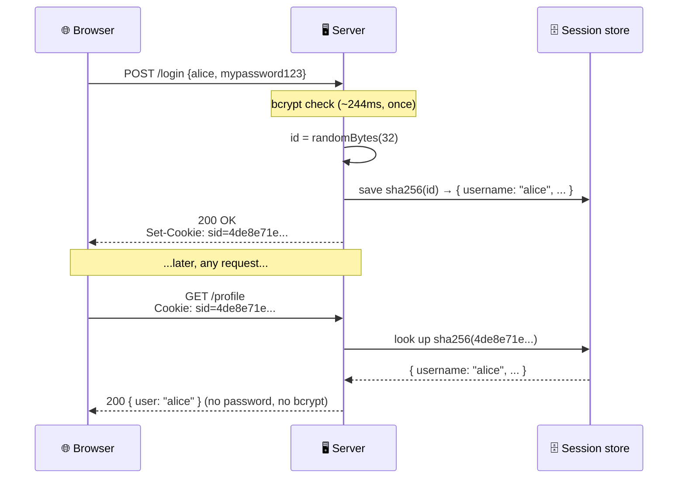

<div align="center">

# Day 03 — Sessions

### How does a server remember you, when HTTP forgets everything?


</div>

---

### 📖 How to read this page

| Marker | What it means |
|---|---|
| **📜 CASE FILE** | Real-world history. Context and stories — step outside the code for a minute. |
| **🧪 PROVEN ON MY MACHINE** | Actual measured output. Not a claim from a blog post — I ran it myself. |
| **🙋 WAIT —** | A question you're probably already asking. Answered immediately, not later. |
| `> [!NOTE]` boxes | Short asides that matter but don't break the flow. |

---

> [!TIP]
> **Day 2 ended with a server that checks your password perfectly — and then forgets you 3 milliseconds later.** The response ends, the next request arrives, and you're a stranger again. That's Day 1's problem, still sitting there untouched. Today we finally fix it, using nothing but a random number, a cookie, and a `Map`.

---

## 🎯 What you'll walk away with

- [ ] What a session really is — explained with a hotel key card you'll never forget
- [ ] That a cookie is **just two HTTP headers**, and the browser does the rest
- [ ] Why `Math.random()` is a **security bug** here, and how big a session ID has to be
- [ ] Why we store a **hash** of the session ID — and why fast SHA-256 is *right* here when Day 2 said it's wrong for passwords
- [ ] What each cookie flag (`HttpOnly`, `Secure`, `SameSite`, `Max-Age`) really stops — **and what it doesn't**
- [ ] Idle timeout vs absolute timeout, and why the **server**, not the cookie, decides when you're logged out
- [ ] Logout that actually logs out, plus **"log out of all devices"**
- [ ] **Session fixation** — run live against our own server, broken and then fixed
- [ ] The one-cookie crash: why a plain `{}` is a dangerous place to keep sessions
- [ ] Where sessions break at scale, and whether *"sessions are old, JWT is the modern way"* is actually true

---

## 🔁 Rewind — why can't the server just ask for the password every time?

Day 1 proved it: **HTTP remembers nothing.** Every request arrives alone, with no memory of the one before it.

The obvious fix is: *fine, then send the username and password with every request.* Every click, every page, every image. Let's see why nobody does that.

**① It would melt your server.** On Day 2 we made checking a password cost **~244ms of CPU on purpose**. A single page load easily fires 20–30 requests. That's 30 × 244ms ≈ **7 seconds of bcrypt per page, per user.** The slowness that protects you from attackers would destroy you under normal traffic.

**② The password would travel everywhere, all the time.** To resend it, the browser has to keep the raw password somewhere it can read it back. Every request is another chance for it to leak: a log line, a proxy, a browser extension. And people reuse passwords, so a leak here unlocks their email and their bank too.

**③ You could never log out.** The password is still valid tomorrow. You can't say *"kill my login on that one laptop I left at the library"* without changing the password everywhere.

So we do what every real system does: **prove who you are once, expensively, and get back something cheap to check for every request after.** That cheap thing is a **session**.

---

## 🏨 The hotel — the analogy that makes sessions obvious

You walk into a hotel. At reception you show your **passport**. The receptionist checks it carefully. That's slow, and it's supposed to be.

Then they hand you a **key card**.

From now on:

- You don't show your passport at the restaurant
- You don't show your passport at the gym
- You don't prove who you are to housekeeping

You just tap the card. Every department trusts it, because **the hotel issued it after checking you once.**

Now notice the details. They are exactly the details that make sessions secure:

- **The card has no room number printed on it.** It's just a meaningless code. Find it on the floor and it tells you nothing. Only the hotel's computer knows which room it opens.
- **You can't make your own card at home.** The codes are random, so you can't guess one that works.
- **When you check out, the hotel deactivates the card in its computer.** The plastic still exists. It still looks the same. It just opens nothing now. And notice who did the deactivating: **the hotel, not the card.**
- **Lose your card? Reception kills it** and gives you a new one. The person who found yours is locked out instantly.

| Hotel | Session world |
|---|---|
| Showing your passport at reception | Logging in with username + password (Day 2, slow bcrypt) |
| The key card | The **session ID**, stored in a **cookie** |
| The code on the card means nothing by itself | The session ID is random. It carries no data. |
| The hotel's computer that maps cards → rooms | The server's **session store** |
| Checking out / reporting a lost card | **Logout**: the session is deleted on the server |

Hold on to this hotel. Every attack later on this page is a hotel story too.

---

## ⚙️ The mechanics, precisely

After a successful login, the server does **three things**:

1. **Generates a random, unguessable session ID** — 64 characters like `4de8e71e827b4d66...`
2. **Stores data tied to that ID on the server:** who you are, when you logged in, when you were last seen
3. **Sends the ID to the browser as a cookie**

From then on, the browser **automatically** attaches that cookie to every request. The server reads the ID, looks it up, and knows who you are.



> [!IMPORTANT]
> **The server holds the truth. The browser holds only a key.**
> The browser never sees "alice is logged in, role: user". It only has a random string. All the meaning lives on the server, and that is exactly why the server can take it away at any moment.

---

## 🍪 What a cookie actually is

Most people think of cookies as "a storage thing in the browser". That's shallow. Here's the real picture:

> **A cookie is two HTTP headers. Nothing more.**

**Header 1, server → browser:** "please remember this"

> 🧪 **PROVEN ON MY MACHINE** — the real response from today's server after `POST /login`
>
> ```txt
> HTTP/1.1 200 OK
> X-Request-Id: 10a35a8b
> Set-Cookie: sid=4de8e71e827b4d6664243fb0cb2bb01c81c8ef3b984ab91d02c0196933d10b5d; HttpOnly; Secure; SameSite=Lax; Path=/; Max-Age=28800
> Content-Type: application/json
> ```

**Header 2, browser → server, on every request after that:** "here it is again"

```txt
GET /profile HTTP/1.1
Cookie: sid=4de8e71e827b4d6664243fb0cb2bb01c81c8ef3b984ab91d02c0196933d10b5d
```

That's the entire mechanism. The browser stores the value, and from then on it **automatically** adds the `Cookie` header to every request **to that same site**. You don't write any code for that. It just happens.

That word *automatically* is both the best and the most dangerous thing about cookies. It's why sessions feel effortless. It's also the root of an attack called CSRF, which we'll meet in the `SameSite` section below.

> ### 🙋 WAIT — if a cookie is just a header, can't I just type one myself?
>
> **Yes. Exactly.** Watch:
>
> ```bash
> curl localhost:3000/profile -H "Cookie: sid=4de8e71e827b4d66..."
> ```
>
> The server cannot tell whether that header came from Chrome, from curl, or from an attacker's script. **It only sees the value.** This is the single most important fact on this page:
>
> > **A session ID is a bearer key. Whoever holds it *is* you, as far as the server is concerned.**
>
> No password needed, no 2FA, nothing. That's why almost everything else today is about one question: **how do we stop this string from being guessed, stolen, planted, or living forever?**

---

## 🎲 The session ID — why `Math.random()` is a vulnerability

The session ID is the number on the key card. It has exactly one job: **nobody can guess it.**

The first thing most of us would reach for is `Math.random()`. Let's look at what it produces next to the right tool:

> 🧪 **PROVEN ON MY MACHINE**
>
> ```txt
> Math.random()                  : 0.6242115127357833
> Math.random().toString(36)     : 0i3fyytnkp5
> crypto.randomBytes(32) as hex  : b9ac107b4914441331336fb5678d335448ed2ba1d3437aec3400b4987853da98
> ```

They both *look* random. Only one of them is.

**`Math.random()` is built for games and animations, not secrets.** In Node and Chrome it's made by an algorithm called **xorshift128+**. It keeps a small internal state, and every number it gives you is computed directly from that state. That makes it fast, and it also makes it **predictable**: given a handful of consecutive outputs, the internal state can be worked out with a constraint solver. Public tools exist that do exactly this. Once an attacker has the state, they can compute **every future value**, which means **every future session ID your server will hand out**.

So the attack goes like this. Log in a few times yourself, collect your own session IDs, recover the generator's state, and predict the ID the next user is about to receive.

**`crypto.randomBytes()` comes from the operating system's cryptographically secure generator.** It's built specifically so that seeing past outputs tells you nothing about future ones. That's the only thing a session ID should ever be made from.

```js
const sessionId = crypto.randomBytes(32).toString("hex");
```

### How big is big enough?

OWASP's guidance is **at least 64 bits** of real randomness. We use **256 bits** (32 bytes). Here's what that means in practice:

> 🧪 **PROVEN ON MY MACHINE** — computed, not guessed
>
> ```txt
> possible 32-byte IDs                         : 10^77.1
> attacker with 1,000,000 live sessions to hit,
>   making 1,000,000,000 guesses every second  : 10^54.6 years to hit ANY one of them
> ```
>
> The universe is about 1.4 × 10^10 years old. You'd need to run the attack for **10^44 lifetimes of the universe** to expect a single hit.

Now compare a lazy 4-byte ID:

```txt
4 bytes  →  2^32 = 4,294,967,296 possible values
at 1 billion guesses/sec  →  4.3 seconds to try every single one
```

> ### 🙋 WAIT — but today's code ALSO makes a 4-byte random ID, for "request IDs". Isn't that the same mistake?
>
> Good eye. No, and the difference teaches the whole idea:
>
> | | Session ID | Request ID |
> |---|---|---|
> | **What it does** | Proves *who you are* | Labels *one request* in the logs, so support can find it |
> | **If an attacker guesses one** | They're logged in as you 💀 | They know a log label. That gets them nothing. |
> | **Is it a secret?** | **Yes** | No — we literally send it to the user |
> | **Size** | 32 bytes (256 bits) | 4 bytes is plenty |
>
> **The size of a random value depends on what happens if someone guesses it.** A session ID guards the front door. A request ID is a sticky note.

> [!NOTE]
> **Why hex?** 32 random bytes are raw binary, and some byte values are characters that would break a cookie header (`;`, `=`, spaces). `.toString("hex")` turns each byte into two safe characters `0-9a-f`, giving exactly 64 characters. Base64url (43 characters) would work too. Hex is just easier to read.

---

## 🗄️ Don't store the session ID. Store its hash.

Day 2's first rule: **assume the attacker will read your database.**

Apply it to sessions. Suppose your session store holds the raw IDs:

```txt
"4de8e71e827b4d66..."  →  { username: "alice" }
"9034b0c6a1f2e3d4..."  →  { username: "bob" }
```

The attacker steals a backup of that table. They don't need to crack anything. **Every row is a working login**: paste the ID into a cookie and you are alice. Same as storing passwords in plaintext, just with a shorter shelf life.

So we do the same thing we did with passwords: **the browser keeps the real ID, the store keeps only its hash.**

```js
function hashId(sessionId) {
  return crypto.createHash("sha256").update(sessionId).digest("hex");
}

sessions.set(hashId(sessionId), record);   // store the hash
setSessionCookie(res, sessionId);          // the browser gets the real thing
```

On every request we hash whatever arrives in the cookie and look *that* up.

> 🧪 **PROVEN ON MY MACHINE** — steal the store, try to use it
>
> ```txt
> cookie in the browser : 4de8e71e827b4d6664243fb0cb2bb01c81c8ef3b984ab91d02c0196933d10b5d
> key in the store      : 56530878bec46c6c90c7072fc1317b84984b8c0606f89d91ba20e18bbfbb2230
>
> $ curl localhost:3000/profile -H "Cookie: sid=56530878bec46c6c...(the stolen store key)"
> { "error": "Not logged in" }   [HTTP 401]
> ```
>
> The server hashes whatever you send. The hash of a hash is a different value, so it's not in the store. **The stolen table opens nothing.**

> ### 🙋 WAIT — Day 2 spent a whole section saying SHA-256 is too fast and therefore wrong. Why is it fine here?
>
> This is the best question on the page, and the answer separates people who memorise rules from people who understand them.
>
> SHA-256 was wrong for passwords **because passwords are guessable.** Humans pick from a small, predictable list: `password123`, their dog's name, `qwerty`. A fast hash lets an attacker try that list billions of times a second. bcrypt's slowness is there to make *guessing* expensive.
>
> A session ID **isn't guessable.** It's 256 bits straight from the OS. There's no list to try. We just calculated it above: even at a billion guesses a second, 10^54 years. Making each guess slower adds nothing when the number of guesses needed is already impossible.
>
> And slowness here would be a disaster, because this hash runs on **every single request**:
>
> > 🧪 **PROVEN ON MY MACHINE**
> >
> > ```txt
> > SHA-256 of a session ID :  ~2.5 µs each   (~390,000 per second, one core)
> > bcrypt at cost 12       :  ~244 ms each   (Day 2)
> > ```
> >
> > bcrypt here would be roughly **100,000× slower on every click**, for zero extra security.
>
> **The rule, properly understood:**
>
> | The secret | Where it comes from | Right hash |
> |---|---|---|
> | **Password** | A human chose it, so it's guessable | **Slow** (bcrypt / Argon2) |
> | **Session ID, API key, reset token** | 256 random bits from the machine | **Fast** (SHA-256) is perfect |
>
> The question was never "is SHA-256 good or bad". It's **"can the attacker guess the input?"**

> ### 🙋 WAIT — Day 2 said `===` leaks timing. But when it's comparing *hashes*, what does the attacker even learn? Nothing useful, right?
>
> **You're right — for bcrypt hashes, completely right.** Even if a timing leak told an attacker *"the first 3 characters of your hash matched the stored one"*, they still have no idea which password produces a hash starting that way. Change one letter of the input and every character of the output changes (the avalanche effect from Day 2). They can't steer the hash, so a prefix match is useless to them.
>
> **Where `===` really bites is when the attacker's input is compared directly to a raw secret**, with no hash in between:
>
> | Where | The dangerous line | What leaks |
> |---|---|---|
> | API keys | `if (req.headers["x-api-key"] === ADMIN_KEY)` | the key, one character at a time |
> | Password-reset tokens stored raw | `if (req.body.token === user.resetToken)` | a working reset link |
> | Webhook signatures | `if (req.headers["x-signature"] === expected)` | a forged "payment succeeded" |
>
> In each case the attacker sends `a000…`, `b000…`, `c000…` and watches for the one that takes a hair longer, because `===` got one character further before stopping. Then they move on to the second character. The difference is nanoseconds, so it takes a lot of samples, and it's much easier from inside the same network or cloud region. But it has worked against real systems, and "the network is noisy" is not a security control.
>
> **And notice that your own insight is exactly today's defence.** A session store with *raw* IDs would be the dangerous kind of lookup. Because we hash the cookie before looking it up, anything a timing leak could reveal is about the **hash**, which the attacker can't steer. Your reasoning about bcrypt hashes now protects session IDs too.
>
> When you *do* have to compare raw secrets yourself, Node has a constant-time comparison built in:
>
> ```js
> const crypto = require("crypto");
>
> function safeEqual(a, b) {
>   // Hash both sides first: equal lengths always, and nothing about the
>   // secret's length leaks either.
>   const ha = crypto.createHash("sha256").update(a).digest();
>   const hb = crypto.createHash("sha256").update(b).digest();
>   return crypto.timingSafeEqual(ha, hb);   // checks every byte, every time
> }
> ```
>
> You'll often see a version that checks `if (a.length !== b.length) return false` before `timingSafeEqual`. That's needed because `timingSafeEqual` throws on different lengths, but the early return quietly leaks the secret's length. Hashing first avoids both problems.

