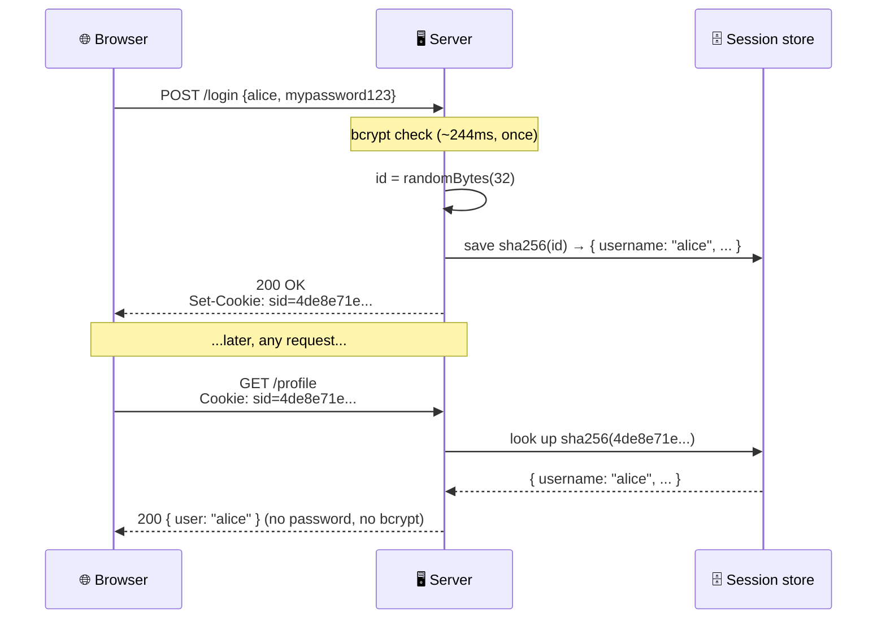

<div align="center">

# Day 03 — Sessions

### How does a server remember you, when HTTP forgets everything?


</div>

---

### 📖 How to read this page

| Marker | What it means |
|---|---|
| **📜 CASE FILE** | Real-world history. Context and stories — step outside the code for a minute. |
| **🧪 PROVEN ON MY MACHINE** | Actual measured output. Not a claim from a blog post — I ran it myself. |
| **🙋 WAIT —** | A question you're probably already asking. Answered immediately, not later. |
| `> [!NOTE]` boxes | Short asides that matter but don't break the flow. |

---

> [!TIP]
> **Day 2 ended with a server that checks your password perfectly — and then forgets you 3 milliseconds later.** The response ends, the next request arrives, and you're a stranger again. That's Day 1's problem, still sitting there untouched. Today we finally fix it, using nothing but a random number, a cookie, and a `Map`.

---

## 🎯 What you'll walk away with

- [ ] What a session really is — explained with a hotel key card you'll never forget
- [ ] That a cookie is **just two HTTP headers**, and the browser does the rest
- [ ] Why `Math.random()` is a **security bug** here, and how big a session ID has to be
- [ ] Why we store a **hash** of the session ID — and why fast SHA-256 is *right* here when Day 2 said it's wrong for passwords
- [ ] What each cookie flag (`HttpOnly`, `Secure`, `SameSite`, `Max-Age`) really stops — **and what it doesn't**
- [ ] Idle timeout vs absolute timeout, and why the **server**, not the cookie, decides when you're logged out
- [ ] Logout that actually logs out, plus **"log out of all devices"**
- [ ] **Session fixation** — run live against our own server, broken and then fixed
- [ ] The one-cookie crash: why a plain `{}` is a dangerous place to keep sessions
- [ ] Where sessions break at scale, and whether *"sessions are old, JWT is the modern way"* is actually true

---

## 🔁 Rewind — why can't the server just ask for the password every time?

Day 1 proved it: **HTTP remembers nothing.** Every request arrives alone, with no memory of the one before it.

The obvious fix is: *fine, then send the username and password with every request.* Every click, every page, every image. Let's see why nobody does that.

**① It would melt your server.** On Day 2 we made checking a password cost **~244ms of CPU on purpose**. A single page load easily fires 20–30 requests. That's 30 × 244ms ≈ **7 seconds of bcrypt per page, per user.** The slowness that protects you from attackers would destroy you under normal traffic.

**② The password would travel everywhere, all the time.** To resend it, the browser has to keep the raw password somewhere it can read it back. Every request is another chance for it to leak: a log line, a proxy, a browser extension. And people reuse passwords, so a leak here unlocks their email and their bank too.

**③ You could never log out.** The password is still valid tomorrow. You can't say *"kill my login on that one laptop I left at the library"* without changing the password everywhere.

So we do what every real system does: **prove who you are once, expensively, and get back something cheap to check for every request after.** That cheap thing is a **session**.

---

## 🏨 The hotel — the analogy that makes sessions obvious

You walk into a hotel. At reception you show your **passport**. The receptionist checks it carefully. That's slow, and it's supposed to be.

Then they hand you a **key card**.

From now on:

- You don't show your passport at the restaurant
- You don't show your passport at the gym
- You don't prove who you are to housekeeping

You just tap the card. Every department trusts it, because **the hotel issued it after checking you once.**

Now notice the details. They are exactly the details that make sessions secure:

- **The card has no room number printed on it.** It's just a meaningless code. Find it on the floor and it tells you nothing. Only the hotel's computer knows which room it opens.
- **You can't make your own card at home.** The codes are random, so you can't guess one that works.
- **When you check out, the hotel deactivates the card in its computer.** The plastic still exists. It still looks the same. It just opens nothing now. And notice who did the deactivating: **the hotel, not the card.**
- **Lose your card? Reception kills it** and gives you a new one. The person who found yours is locked out instantly.

| Hotel | Session world |
|---|---|
| Showing your passport at reception | Logging in with username + password (Day 2, slow bcrypt) |
| The key card | The **session ID**, stored in a **cookie** |
| The code on the card means nothing by itself | The session ID is random. It carries no data. |
| The hotel's computer that maps cards → rooms | The server's **session store** |
| Checking out / reporting a lost card | **Logout**: the session is deleted on the server |

Hold on to this hotel. Every attack later on this page is a hotel story too.

---

## ⚙️ The mechanics, precisely

After a successful login, the server does **three things**:

1. **Generates a random, unguessable session ID** — 64 characters like `4de8e71e827b4d66...`
2. **Stores data tied to that ID on the server:** who you are, when you logged in, when you were last seen
3. **Sends the ID to the browser as a cookie**

From then on, the browser **automatically** attaches that cookie to every request. The server reads the ID, looks it up, and knows who you are.



> [!IMPORTANT]
> **The server holds the truth. The browser holds only a key.**
> The browser never sees "alice is logged in, role: user". It only has a random string. All the meaning lives on the server, and that is exactly why the server can take it away at any moment.

---

## 🍪 What a cookie actually is

Most people think of cookies as "a storage thing in the browser". That's shallow. Here's the real picture:

> **A cookie is two HTTP headers. Nothing more.**

**Header 1, server → browser:** "please remember this"

> 🧪 **PROVEN ON MY MACHINE** — the real response from today's server after `POST /login`
>
> ```txt
> HTTP/1.1 200 OK
> X-Request-Id: 10a35a8b
> Set-Cookie: sid=4de8e71e827b4d6664243fb0cb2bb01c81c8ef3b984ab91d02c0196933d10b5d; HttpOnly; Secure; SameSite=Lax; Path=/; Max-Age=28800
> Content-Type: application/json
> ```

**Header 2, browser → server, on every request after that:** "here it is again"

```txt
GET /profile HTTP/1.1
Cookie: sid=4de8e71e827b4d6664243fb0cb2bb01c81c8ef3b984ab91d02c0196933d10b5d
```

That's the entire mechanism. The browser stores the value, and from then on it **automatically** adds the `Cookie` header to every request **to that same site**. You don't write any code for that. It just happens.

That word *automatically* is both the best and the most dangerous thing about cookies. It's why sessions feel effortless. It's also the root of an attack called CSRF, which we'll meet in the `SameSite` section below.

> ### 🙋 WAIT — if a cookie is just a header, can't I just type one myself?
>
> **Yes. Exactly.** Watch:
>
> ```bash
> curl localhost:3000/profile -H "Cookie: sid=4de8e71e827b4d66..."
> ```
>
> The server cannot tell whether that header came from Chrome, from curl, or from an attacker's script. **It only sees the value.** This is the single most important fact on this page:
>
> > **A session ID is a bearer key. Whoever holds it *is* you, as far as the server is concerned.**
>
> No password needed, no 2FA, nothing. That's why almost everything else today is about one question: **how do we stop this string from being guessed, stolen, planted, or living forever?**

